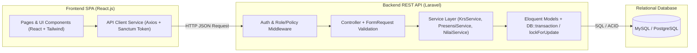
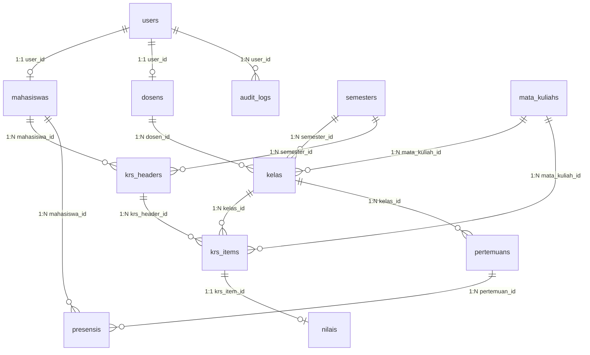
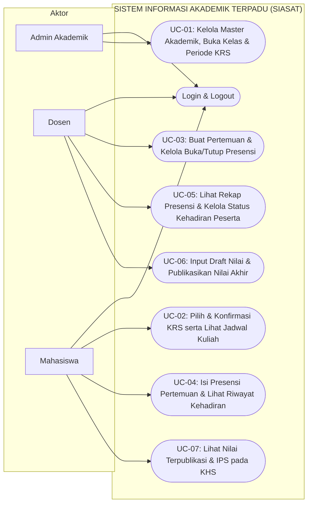
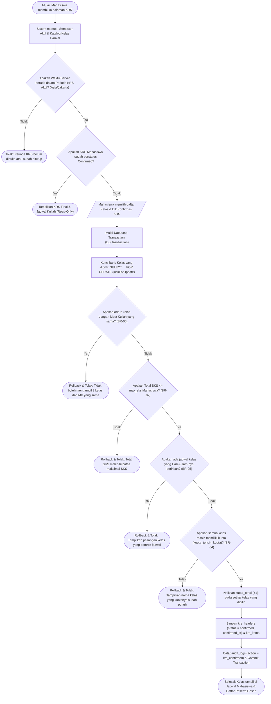
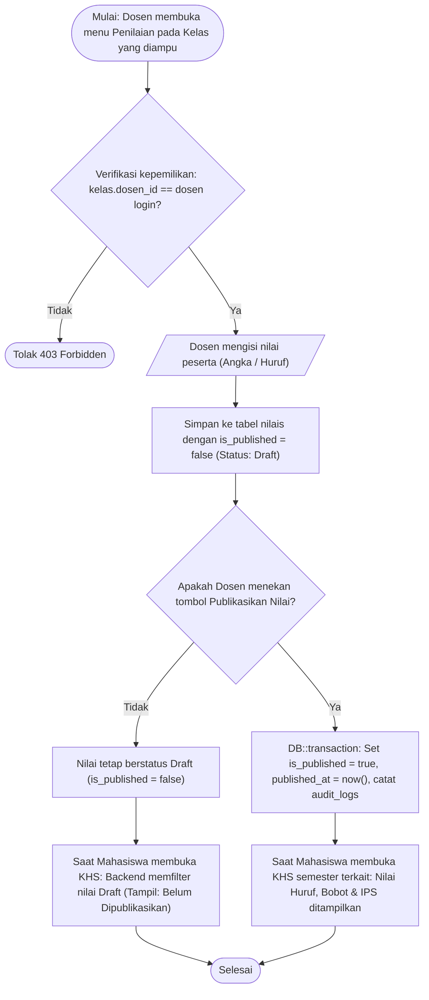

# APLIKASI WEB SISTEM INFORMASI AKADEMIK TERPADU (SIASAT)
## Software Requirements Specification (SRS)
**Manajemen Master Akademik, Pembukaan Kelas Paralel, Pengisian dan Konfirmasi Kartu Rencana Studi (KRS), Manajemen Pertemuan dan Presensi Perkuliahan Real-Time, serta Publikasi Nilai Kartu Hasil Studi (KHS)**

| Informasi Dokumen | Keterangan |
| :--- | :--- |
| **Versi** | `1.0` — Pengembangan dan penyelarasan lengkap dari Draf `v0.1`; mencakup arsitektur Frontend React.js & Backend Laravel, 12 tabel relasional aktif, aturan bisnis akademik, mekanisme concurrency database, ERD, data dictionary, use case, flowchart transaksional, spesifikasi seeder, dan pembagian kerja tim. |
| **Tanggal** | 19 November 2026 |
| **Status** | Spesifikasi Kebutuhan Final (Baseline Implementasi MVP). |
| **Platform** | Aplikasi Web (Single Page Application + RESTful API) |
| **Nama Aplikasi** | SIASAT (Sistem Informasi Akademik Terpadu) |
| **Teknologi Rencana** | **Frontend**: React.js (Vite, React Router, Tailwind CSS, Axios); **Backend**: PHP Laravel (REST API, Laravel Sanctum, Service Layer, Eloquent ORM); **Database**: MySQL / PostgreSQL (Relational Database dengan dukungan transaksi ACID). |
| **Tim Pengembang** | 2 Orang (Kolaborasi Fullstack Frontend React.js & Backend Laravel) |

> **Catatan**: Dokumen ini merupakan penyempurnaan komprehensif dari draf `SRS_SIASAT_v0.1.docx` dengan mengadopsi standar kedalaman spesifikasi, ketertelusuran kebutuhan, penanganan *concurrency*, dan struktur arsitektur setara dokumen referensi `Ritely_POS_SRS_v4.8.1`.

---

## Riwayat Revisi

| Versi | Tanggal | Perubahan |
| :--- | :--- | :--- |
| **0.1** | 19 November 2026 | Draf awal SRS SIASAT: tujuan dan ruang lingkup satu semester, tiga aktor utama (Admin akademik, Mahasiswa, Dosen), konsep kelas paralel dan pertemuan, 12 kebutuhan fungsional (`FR-01` s/d `FR-12`), 3 kebutuhan nonfungsional (`NFR-01` s/d `NFR-03`), 4 skenario uji penerimaan, serta catatan asumsi terbuka. |
| **1.0** | 19 November 2026 | Penyelarasan penuh SRS dengan stack **React.js + Laravel**: penambahan standar antarmuka dan konsistensi visual, arsitektur Decoupled MVC + Service Layer, matriks hak akses, perluasan kebutuhan fungsional (`FR-01` s/d `FR-28`) dengan pemetaan ke `v0.1`, penguncian aturan bisnis (`BR-01` s/d `BR-20`) termasuk batas SKS, deteksi bentrok jadwal, larangan duplikasi mata kuliah, penanganan izin/sakit/alpa, serta konversi nilai KHS; penambahan ERD 12 tabel relasional, data dictionary, unique index, mekanisme *concurrency* (`DB::transaction` & `lockForUpdate()`), spesifikasi Laravel Seeder (`InitialSeeder` & `DemoSeeder`), diagram & spesifikasi Use Case, Flowchart transaksional, serta rencana pembagian kerja 2 orang. |

---

## Daftar Isi

1. [Pendahuluan](#1-pendahuluan)
   - 1.1 Tujuan Dokumen
   - 1.2 Ruang Lingkup Produk
   - 1.3 Tujuan Sistem
   - 1.4 Definisi dan Istilah
2. [Gambaran Umum Sistem](#2-gambaran-umum-sistem)
   - 2.1 Perspektif Produk
   - 2.2 Fungsi Utama
   - 2.3 Lingkungan Operasi
   - 2.4 Mode Demo untuk Presentasi dan Evaluasi
   - 2.5 Standar Antarmuka dan Konsistensi Visual (React.js + Tailwind CSS)
   - 2.6 Arsitektur Aplikasi — Decoupled React.js & Laravel MVC + Service Layer
3. [Aktor dan Hak Akses](#3-aktor-dan-hak-akses)
4. [Kebutuhan Fungsional](#4-kebutuhan-fungsional)
5. [Aturan Bisnis](#5-aturan-bisnis)
6. [Kebutuhan Data dan Konsep Database](#6-kebutuhan-data-dan-konsep-database)
   - 6.1 Relasi Logis
   - 6.2 Entity Relationship Diagram (ERD)
   - 6.3 Data Dictionary
   - 6.4 Relasi Antartabel
   - 6.5 Index dan Unique Constraints Database
   - 6.6 Catatan Implementasi Database, Transaksi ACID, dan Concurrency
   - 6.7 Penyimpanan Waktu dan Zona Waktu
   - 6.8 Contoh Payload dan Query Agregasi Akademik
   - 6.9 Database Seeding (Laravel Seeder)
7. [Kebutuhan Nonfungsional](#7-kebutuhan-nonfungsional)
   - 7.1 Kebutuhan Antarmuka Pengguna (`NFR-UI`)
   - 7.2 Kebutuhan Nonfungsional Sistem (`NFR`)
8. [Use Case Utama dan Flowchart Sistem](#8-use-case-utama-dan-flowchart-sistem)
   - 8.1 Diagram Use Case dan Pemetaan Kebutuhan
   - 8.2 Spesifikasi Use Case
   - 8.3 Flowchart Sistem
9. [Kriteria Penerimaan](#9-kriteria-penerimaan)
10. [Batasan, Asumsi, dan Risiko](#10-batasan-asumsi-dan-risiko)
11. [Rencana Prioritas Implementasi dan Pembagian Tim (2 Orang)](#11-rencana-prioritas-implementasi-dan-pembagian-tim-2-orang)
- [Lampiran A — Definisi Metrik Akademik dan Skala Nilai](#lampiran-a--definisi-metrik-akademik-dan-skala-nilai)
- [Lampiran B — Kontrak Endpoint REST API Laravel](#lampiran-b--kontrak-endpoint-rest-api-laravel)

---

## 1. Pendahuluan

### 1.1 Tujuan Dokumen
Dokumen *Software Requirements Specification* (SRS) ini mendefinisikan kebutuhan perangkat lunak untuk aplikasi web **SIASAT (Sistem Informasi Akademik Terpadu)**. Dokumen ini menjadi acuan tunggal bagi tim pengembang (2 orang) dalam merancang, mengimplementasikan, mengintegrasikan, dan menguji aplikasi menggunakan **Frontend React.js** dan **Backend Laravel**.

Cakupan sistem mengikuti **satu siklus semester perkuliahan** secara utuh, dimulai dari pengelolaan data induk akademik, pembukaan kelas paralel dan periode pengisian Kartu Rencana Studi (KRS) oleh Admin Akademik, pemilihan dan konfirmasi KRS oleh Mahasiswa, pembentukan jadwal kuliah dan daftar peserta kelas, pengelolaan pertemuan dan pembukaan/penutupan presensi oleh Dosen, pengisian kehadiran oleh Mahasiswa, hingga pengisian dan publikasi nilai akhir pada Kartu Hasil Studi (KHS).

**Pemisahan Entitas Mata Kuliah dan Kelas**:
Sistem membedakan secara tegas antara **Mata Kuliah** dan **Kelas**. Sebagai contoh, *Basis Data* merupakan satu entitas Mata Kuliah pada kurikulum. Pada semester yang sama, Admin Akademik dapat membuka **Basis Data A** dan **Basis Data B** sebagai dua entitas **Kelas** yang terpisah, masing-masing dengan dosen pengampu, jadwal, ruangan, kuota, daftar peserta, serta daftar pertemuan sendiri. Jika dosen membuat pertemuan pertama di Kelas A, pertemuan beserta sesi presensinya hanya berlaku untuk peserta Kelas A.

### 1.2 Ruang Lingkup Produk
SIASAT ditujukan untuk mendukung operasional akademik perguruan tinggi dalam siklus semester aktif dengan tiga peran pengguna (*role*): **Admin Akademik**, **Dosen**, dan **Mahasiswa**.

**Fokus versi awal (MVP)**:
1. Autentikasi pengguna (*login* dan *logout*) menggunakan token/sesi terproteksi (**Laravel Sanctum**) dan otorisasi berbasis peran (*Role-Based Access Control*) serta kepemilikan sumber daya (*resource ownership* pada kelas dan data pribadi).
2. Pengelolaan data master akademik oleh Admin Akademik: data mahasiswa, dosen, mata kuliah, dan semester beserta penetapan waktu mulai dan berakhirnya pengisian KRS (`krs_mulai` dan `krs_selesai`).
3. Pembukaan kelas paralel pada semester tertentu oleh Admin Akademik dengan menetapkan mata kuliah, kode kelas (misal `A`, `B`), dosen pengampu, jadwal (hari, jam mulai, jam selesai), ruangan, serta kuota maksimum peserta.
4. Pengisian dan konfirmasi KRS oleh Mahasiswa selama periode KRS aktif dengan validasi berlapis di backend: pemeriksaan sisa kuota kelas (secara atomik), pendeteksian bentrok jadwal antar-kelas, pencegahan pengambilan dua kelas dari mata kuliah yang sama, dan pemeriksaan batas maksimum SKS.
5. Pembentukan jadwal kuliah pribadi mahasiswa dan daftar peserta kelas dosen secara otomatis dari KRS yang telah dikonfirmasi (*KRS Final*).
6. Pembuatan pertemuan perkuliahan oleh Dosen pengampu pada kelas yang diampu dengan pengisian tanggal dan topik, disertai penomoran urut otomatis (`1, 2, 3, ...`) yang independen untuk setiap kelas.
7. Pengelolaan siklus status presensi pertemuan oleh Dosen pengampu (`belum_dibuka` → `terbuka` → `ditutup`) serta pencatatan kehadiran mandiri satu kali per pertemuan oleh Mahasiswa yang terdaftar di kelas tersebut saat status presensi `terbuka`.
8. Penanganan rekapitulasi kehadiran pertemuan oleh Dosen (melihat siapa yang sudah dan belum mengisi presensi, serta pembaruan status kehadiran `hadir`, `izin`, `sakit`, atau `alpa`) dan riwayat kehadiran pribadi oleh Mahasiswa.
9. Pengisian nilai akhir peserta oleh Dosen pengampu (status *draft*) dan publikasi nilai akhir agar tampil secara resmi pada KHS pribadi Mahasiswa berdasarkan filter semester beserta perhitungan Indeks Prestasi Semester (IPS).
10. Penyediaan *Database Seeder* Laravel yang *idempotent* untuk menyiapkan akun awal dan data simulasi demonstrasi lengkap.

**Batasan di luar ruang lingkup MVP**:
- Pembayaran uang kuliah (UKT/SPP), tagihan keuangan, dan integrasi *payment gateway* tidak termasuk dalam MVP.
- Validasi prasyarat mata kuliah lintas semester (*prerequisite tree* seperti harus lulus *Algoritma* sebelum mengambil *Struktur Data*) tidak termasuk dalam MVP.
- Proses batal-tambah (*add/drop*) atau persetujuan berlapis Dosen Wali setelah mahasiswa menekan konfirmasi KRS Final tidak termasuk dalam MVP (KRS langsung berstatus final saat dikonfirmasi mahasiswa sesuai ketentuan Draf `v0.1`).

### 1.3 Tujuan Sistem
1. Menjamin ketertiban administrasi akademik mulai dari pembukaan kelas, pengisian KRS, perkuliahan, presensi, hingga penerbitan KHS dalam satu basis data yang konsisten.
2. Mencegah kesalahan operasional klasik pada masa KRS, seperti kuota kelas yang terlampaui akibat akses bersamaan (*race condition*), jadwal kuliah mahasiswa yang bentrok, atau pengambilan mata kuliah ganda.
3. Memastikan keabsahan presensi perkuliahan dengan membatasi pengisian kehadiran hanya bagi peserta sah kelas terkait ketika sesi presensi dibuka oleh dosen pengampu, serta mencegah pencatatan ganda (*double-submit*).
4. Menjaga kerahasiaan dan integritas nilai akademik dengan memastikan nilai yang masih bersifat *draft* tidak dapat dilihat mahasiswa sebelum dipublikasikan oleh dosen pengampu, serta mencegah mahasiswa mengakses data kelas atau KHS milik mahasiswa lain.

### 1.4 Definisi dan Istilah

| Istilah | Definisi |
| :--- | :--- |
| **SIASAT** | Sistem Informasi Akademik Terpadu; aplikasi web pengelolaan siklus perkuliahan satu semester. |
| **Mata Kuliah** | Unit kurikulum pembelajaran yang memiliki kode unik, nama, dan bobot SKS (contoh: `IF201 - Basis Data`, 3 SKS). |
| **Kelas (Kelas Paralel)** | Pembukaan suatu Mata Kuliah pada semester tertentu dengan kode kelas spesifik (contoh: `Basis Data A`, `Basis Data B`), dosen pengampu, jadwal hari/jam, ruangan, dan kuota peserta tersendiri. |
| **SKS** | Satuan Kredit Semester; bobot beban studi sebuah mata kuliah dan dasar perhitungan batas pengambilan KRS serta perhitungan IPS pada KHS. |
| **Periode KRS** | Rentang waktu resmi (`krs_mulai` hingga `krs_selesai`) pada semester aktif yang ditetapkan Admin Akademik di mana mahasiswa diizinkan memilih dan mengonfirmasi KRS. |
| **KRS Final** | Kartu Rencana Studi yang telah dikonfirmasi oleh mahasiswa (`status = confirmed`). Pada MVP, konfirmasi KRS bersifat final, langsung mengunci kuota kelas, menampilkan kelas di jadwal mahasiswa, dan mencantumkan mahasiswa di daftar peserta dosen. |
| **Pertemuan** | Sesi tatap muka perkuliahan yang dibuat dosen pada suatu Kelas, memiliki nomor urut otomatis per kelas (`1, 2, ...`), tanggal, topik, dan status presensi. |
| **Status Presensi** | Keadaan sesi kehadiran pada suatu pertemuan yang terdiri atas tiga tahap: `belum_dibuka` (awal dibuat), `terbuka` (mahasiswa dapat mengisi kehadiran), dan `ditutup` (sesi berakhir). |
| **Belum Mengisi** | Status tampilan bagi peserta kelas yang belum memiliki rekaman kehadiran pada suatu pertemuan ketika presensi belum diisi oleh mahasiswa maupun belum ditetapkan statusnya oleh dosen. |
| **Publikasi Nilai** | Tindakan dosen pengampu untuk mengesahkan nilai akhir peserta kelas (`is_published = true`) sehingga nilai tersebut dapat dilihat oleh mahasiswa yang bersangkutan pada halaman KHS. |
| **KHS** | Kartu Hasil Studi; laporan nilai akademik mahasiswa per semester yang hanya menampilkan nilai mata kuliah yang telah dipublikasikan beserta perhitungan IPS. |
| **IPS** | Indeks Prestasi Semester; nilai rata-rata tertimbang semester yang dihitung dari $\frac{\sum (\text{SKS} \times \text{Bobot Mutu})}{\sum \text{SKS}}$ untuk mata kuliah yang nilainya telah dipublikasikan. |
| **Zona Waktu Kampus** | `Asia/Jakarta` (WIB, UTC+7). Validasi periode KRS dan tampilan waktu presensi mengacu pada zona waktu ini, sedangkan database menyimpan timestamp dalam UTC. |

---

## 2. Gambaran Umum Sistem

### 2.1 Perspektif Produk
SIASAT dikembangkan sebagai aplikasi web modern dengan arsitektur *decoupled* (terpisah antara antarmuka klien dan layanan server):
- **Frontend**: **React.js** (menggunakan Vite sebagai *build tool*, React Router untuk navigasi halaman, Tailwind CSS untuk *styling*, dan Axios untuk komunikasi HTTP).
- **Backend**: **PHP Laravel** yang berfungsi sebagai penyedia RESTful API, pengelola autentikasi/otorisasi (**Laravel Sanctum**), pelaksana aturan bisnis melalui **Service Layer**, dan pengelola transaksi database.
- **Database**: Relational Database Management System (**MySQL / MariaDB** dengan *storage engine* InnoDB atau **PostgreSQL**) yang mendukung penuh transaksi ACID (*Atomicity, Consistency, Isolation, Durability*), *foreign key constraints*, *composite unique index*, dan *row-level locking* (`SELECT ... FOR UPDATE`).

### 2.2 Fungsi Utama
1. Autentikasi multi-peran dan proteksi rute/endpoint berbasis peran (*Admin Akademik*, *Dosen*, *Mahasiswa*) serta verifikasi kepemilikan data (*policy*).
2. Manajemen data master akademik: Mahasiswa, Dosen, Mata Kuliah, dan Semester.
3. Pembukaan Kelas Paralel beserta penetapan dosen pengampu, jadwal, ruang, kuota, dan pengaturan masa aktif Periode KRS.
4. Pengisian dan konfirmasi KRS oleh Mahasiswa disertai pemeriksaan kuota kelas, deteksi bentrok jadwal, pencegahan duplikasi mata kuliah, dan validasi batas SKS.
5. Penampilan jadwal kuliah mahasiswa dan daftar peserta kelas bagi dosen pengampu.
6. Manajemen pertemuan kelas oleh dosen (penomoran urut otomatis per kelas, penyiapan topik lebih awal) dan kendali siklus status presensi (`Belum dibuka` → `Terbuka` → `Ditutup`).
7. Pengisian presensi kehadiran mandiri satu kali per pertemuan oleh mahasiswa serta tampilan rekapitulasi kehadiran bagi dosen dan riwayat kehadiran bagi mahasiswa.
8. Pengisian nilai akhir (*draft*) dan publikasi nilai oleh dosen pengampu, serta penampilan Kartu Hasil Studi (KHS) per semester bagi mahasiswa.

### 2.3 Lingkungan Operasi
- Pengguna mengakses sistem melalui peramban web (*browser*) pada perangkat desktop, laptop, maupun ponsel pintar (*smartphone*) saat mahasiswa mengisi presensi di ruang kelas.
- Frontend berjalan sebagai aplikasi React.js SPA yang berkomunikasi dengan Backend Laravel melalui protokol HTTP/HTTPS dengan format data JSON.
- Backend berjalan di atas lingkungan PHP 8.2+ dan framework Laravel 11.x/12.x.
- Database menggunakan MySQL 8.0+ (InnoDB) atau PostgreSQL 15+ dengan dukungan transaksi database penuh.
- Zona waktu resmi operasional aplikasi adalah **`Asia/Jakarta` (WIB, UTC+7)**. Backend Laravel memvalidasi jadwal periode KRS dan mencatat waktu pengisian presensi menggunakan waktu server yang terkonversi secara konsisten.

### 2.4 Mode Demo untuk Presentasi dan Evaluasi
Untuk mendukung demonstrasi proyek di hadapan dosen penguji tanpa terhalang tanggal kalender riil:
- Sistem menyediakan `DemoSeeder` yang menyiapkan data lengkap satu semester simulasi (akun Admin, 2 Dosen, 5 Mahasiswa, Mata Kuliah termasuk *Basis Data*, Kelas Paralel *Basis Data A* dan *Basis Data B*, kelas dengan sisa kuota 1 kursi untuk uji rebutan/penolakan kuota penuh, pertemuan dengan presensi `Belum dibuka` dan `Terbuka`, serta nilai berstatus *draft* dan *published*).
- Admin Akademik dapat mengubah rentang waktu `krs_mulai` dan `krs_selesai` pada semester aktif kapan saja melalui halaman Admin untuk mendemonstrasikan kondisi **Periode KRS Aktif** maupun **Periode KRS Ditutup** secara langsung saat presentasi.

### 2.5 Standar Antarmuka dan Konsistensi Visual (React.js + Tailwind CSS)
Antarmuka SIASAT dibangun menggunakan komponen **React.js** yang modular dengan sistem desain berbasis **Tailwind CSS**. Kustomisasi tampilan memprioritaskan keterbacaan tabel akademik, kejelasan status (KRS, presensi, nilai), serta kecepatan interaksi.

#### Palet Warna Antarmuka
- **Sidebar & Header Utama**: Navy Akademik Gelap `#0F172A` (`slate-900`).
- **Aksi Utama & Penanda Menu Aktif**: Biru Royal `#1D4ED8` (`blue-700`) dengan *hover state* `#1E40AF` (`blue-800`).
- **Latar Area Kerja (Background)**: Abu-abu Terang `#F8FAFC` (`slate-50`); permukaan kartu, modal, form, dan tabel: Putih `#FFFFFF`.
- **Teks Utama**: `#0F172A` (`slate-900`); **Teks Sekunder / Label**: `#64748B` (`slate-500`).
- **Warna Status Semantik**:
  - **Berhasil / Hadir / KRS Final / Presensi Terbuka / Nilai Terpublikasi**: Hijau `#16A34A` (`green-600`, latar badge `#DCFCE7`).
  - **Peringatan / Draft / Belum Dibuka / Belum Mengisi / Izin / Sakit**: Amber `#D97706` (`amber-600`, latar badge `#FEF3C7`).
  - **Kesalahan / Bentrok Jadwal / Kuota Penuh / Presensi Ditutup / Alpa**: Merah `#DC2626` (`red-600`, latar badge `#FEE2E2`).

> **Aturan Aksesibilitas Visual**: Warna tidak boleh menjadi satu-satunya penanda status; setiap status wajib didampingi label teks eksplisit (misal badge bertuliskan `"Terbuka"`, `"Ditutup"`, `"Hadir"`, `"Belum Mengisi"`) dan/atau ikon pendukung.

#### Tipografi
- **Judul dan Heading**: `Plus Jakarta Sans` atau `Urbanist` (`font-semibold` / `font-bold`).
- **Teks Isi, Form, dan Tabel**: `Inter` atau `Outfit` (`font-normal` / `font-medium`).
- **Kode Akademik (NIM, NIDN, Kode MK, Ruangan, Jam Kuliah)**: Font *monospace* (`JetBrains Mono` / `font-mono`) agar penjajaran angka dan kode pada tabel terlihat rapi.

#### Prinsip Tata Letak dan Interaksi
1. **Halaman Admin Akademik**: Menyediakan navigasi sidebar terstruktur ke modul *Mahasiswa*, *Dosen*, *Mata Kuliah*, *Semester & Periode KRS*, serta *Pembukaan Kelas*. Tabel mendukung pencarian cepat dan modal form validasi.
2. **Halaman Mahasiswa**:
   - Pada halaman **KRS**: Menampilkan indikator ringkasan di bagian atas (*Status Periode KRS*, *Total SKS Terpilih vs Batas Maksimal SKS*, dan *Status KRS: Draft / Final*). Daftar kelas yang ditawarkan menampilkan sisa kuota (`Terisi / Kuota`), jadwal, dosen, serta alasan penolakan yang spesifik apabila terjadi bentrok jadwal, duplikasi mata kuliah, kuota penuh, atau SKS berlebih.
   - Pada halaman **Presensi**: Menampilkan nama kelas, nomor pertemuan, topik, dan status presensi sesuai `NFR-03`. Tombol **Hadir / Isi Presensi** langsung berubah menjadi *loading* dan *disabled* begitu ditekan untuk mencegah klik ganda dari sisi antarmuka, lalu menampilkan status **Hadir** beserta waktu pengisian (`HH:mm:ss WIB`) setelah server mengonfirmasi.
3. **Halaman Dosen**:
   - Memisahkan daftar kelas yang diampu secara jelas (misal *Basis Data A* vs *Basis Data B*).
   - Di dalam halaman detail kelas, terdapat tab terorganisasi: **Daftar Peserta**, **Pertemuan & Presensi** (lengkap dengan tombol *Buka Presensi* / *Tutup Presensi* dan rekap real-time siapa yang sudah/belum mengisi), serta **Penilaian Akhir** (dilengkapi pembeda jelas antara tombol *Simpan Draft Nilai* dan *Publikasikan Nilai*).

### 2.6 Arsitektur Aplikasi — Decoupled React.js & Laravel MVC + Service Layer
Aplikasi SIASAT menerapkan pemisahan tanggung jawab berlapis antara **Frontend React.js** dan **Backend Laravel** menggunakan pola **MVC dengan Service Layer**:



#### Komponen Arsitektur
1. **View Layer (Frontend React.js)**:
   - Bertanggung jawab merender antarmuka sesuai peran pengguna, mengelola *local UI state* (seperti filter tabel, *loading indicator*, input form), dan mengirim permintaan HTTP ke endpoint REST API Laravel.
   - Aturan bisnis kritis (seperti pengecekan kuota akhir, deteksi bentrok jadwal, hak akses kelas, dan validasi waktu presensi) **tidak boleh hanya mengandalkan Frontend**, melainkan wajib divalidasi dan ditegakkan di Backend Laravel.
2. **Controller & FormRequest Layer (Backend Laravel)**:
   - Menerima HTTP request, menjalankan validasi struktur input melalui `FormRequest` serta memeriksa otorisasi melalui *Middleware* dan *Laravel Policy* (misal `KelasPolicy` untuk memastikan dosen hanya memodifikasi kelas yang diampunya).
   - Memanggil `Service Layer` dan mengembalikan respons JSON standar (`status`, `message`, `data`, `errors`).
3. **Service Layer (Backend Laravel — `app/Services/`)**:
   - Memuat seluruh aturan bisnis inti dan pengelolaan transaksi database (`DB::transaction`), meliputi:
     - `KrsService`: validasi periode KRS, deteksi bentrok jadwal, pencegahan mata kuliah kembar, pemeriksaan batas SKS, dan penguncian baris kelas (`lockForUpdate()`) saat konfirmasi KRS.
     - `PertemuanPresensiService`: pembuatan pertemuan dengan nomor urut otomatis per kelas, transisi status presensi (`belum_dibuka` → `terbuka` → `ditutup`), serta pencatatan kehadiran mahasiswa yang *idempotent*.
     - `NilaiKhsService`: konversi nilai angka ke nilai huruf dan bobot mutu, penyimpanan nilai *draft*, publikasi nilai akhir, serta perhitungan IPS pada KHS.
4. **Model / Data Access Layer (Laravel Eloquent ORM)**:
   - Merepresentasikan struktur tabel relasional, relasi antartabel (`belongsTo`, `hasMany`, `hasOne`), *query scopes*, dan *type casting*.

---

## 3. Aktor dan Hak Akses

Sistem SIASAT memiliki tepat **tiga aktor (role)**: **Admin Akademik (`admin`)**, **Dosen (`dosen`)**, dan **Mahasiswa (`mahasiswa`)**.

| Fitur / Aksi Sistem | Admin Akademik | Dosen | Mahasiswa |
| :--- | :---: | :---: | :---: |
| Login dan Logout | Ya | Ya | Ya |
| Mengelola data master Mahasiswa (Tambah, Lihat, Ubah, Aktif/Nonaktif) | Ya | Tidak | Tidak |
| Mengelola data master Dosen (Tambah, Lihat, Ubah, Aktif/Nonaktif) | Ya | Tidak | Tidak |
| Mengelola data master Mata Kuliah (Kode, Nama, SKS) | Ya | Tidak | Tidak |
| Mengelola Semester & menetapkan waktu mulai/berakhir Periode KRS | Ya | Tidak | Tidak |
| Membuka Kelas Paralel (menetapkan Dosen, Jadwal, Ruang, Kuota) | Ya | Tidak | Tidak |
| Melihat daftar kelas yang ditawarkan selama periode KRS | Ya (Semua) | Tidak | Ya (Semester Aktif) |
| Memilih dan mengonfirmasi KRS pada periode KRS aktif | Tidak | Tidak | Ya (Milik Sendiri) |
| Melihat Jadwal Kuliah dari KRS Final | Tidak | Ya (Kelas Diampu) | Ya (Milik Sendiri) |
| Melihat Daftar Peserta Kelas dari KRS Final | Ya (Semua Kelas) | Ya (Hanya Kelas Diampu) | Tidak |
| Membuat Pertemuan (Tanggal & Topik; Nomor Urut Otomatis) | Tidak | Ya (Hanya Kelas Diampu) | Tidak |
| Mengubah Status Presensi (`Belum dibuka` → `Terbuka` → `Ditutup`) | Tidak | Ya (Hanya Kelas Diampu) | Tidak |
| Mengisi Presensi Kehadiran (1x saat status `Terbuka`) | Tidak | Tidak | Ya (Hanya Peserta Kelas) |
| Melihat Rekap Presensi Pertemuan (Sudah & Belum Mengisi) | Ya (Semua Kelas) | Ya (Hanya Kelas Diampu) | Tidak |
| Memperbarui status kehadiran peserta (`Hadir`/`Izin`/`Sakit`/`Alpa`) | Tidak | Ya (Hanya Kelas Diampu) | Tidak |
| Melihat Riwayat Kehadiran Pribadi per Kelas | Tidak | Tidak | Ya (Milik Sendiri) |
| Mengisi Nilai Akhir Peserta (*Simpan Draft*) | Tidak | Ya (Hanya Kelas Diampu) | Tidak |
| Memublikasikan Nilai Akhir Peserta ke KHS | Tidak | Ya (Hanya Kelas Diampu) | Tidak |
| Melihat Nilai Terpublikasi dan IPS pada KHS per Semester | Ya (Monitoring) | Tidak | Ya (Hanya Milik Sendiri) |

**Ketentuan Akun Pengguna**:
- Akun Admin Akademik pertama dibuat melalui mekanisme *bootstrap* yang aman menggunakan **Laravel Database Seeder** (`InitialSeeder`).
- Sistem **tidak menyediakan halaman registrasi publik mandiri (*self-registration*)**. Seluruh akun Dosen dan Mahasiswa dibuat serta dikelola oleh Admin Akademik.
- Setiap permintaan API diperiksa di sisi server (*backend*) untuk memastikan kesesuaian *role* dan kepemilikan sumber daya (`NFR-01`).

---

## 4. Kebutuhan Fungsional

Setiap kebutuhan fungsional diberi kode unik (`FR-xx`) beserta rujukan silang ke Draf `SRS_SIASAT_v0.1.docx` agar dapat ditelusuri pada saat implementasi dan pengujian penerimaan.

| ID | Ref v0.1 | Fitur | Spesifikasi Kebutuhan Fungsional |
| :--- | :---: | :--- | :--- |
| **FR-01** | `FR-01` | Autentikasi & Menu Peran | Sistem harus memverifikasi kredensial pengguna (`username` dan `password`) saat login, menerbitkan sesi/token autentikasi, dan menampilkan navigasi menu sesuai perannya (`admin`, `dosen`, atau `mahasiswa`). |
| **FR-02** | `FR-01`, `NFR-01` | Otorisasi Peran & Kepemilikan | Sistem harus membatasi akses halaman dan setiap endpoint API di backend berdasarkan peran pengguna serta kepemilikan kelas/data pribadi, termasuk menolak akses melalui tautan atau pemanggilan API langsung (*direct URL/ID access*). |
| **FR-03** | `FR-02` | Manajemen Data Mahasiswa | Admin Akademik dapat menambah, melihat, mencari, dan memperbarui data mahasiswa (termasuk akun login, NIM unik, nama, program studi, angkatan, batas maksimal SKS `max_sks`, dan status aktif). |
| **FR-04** | `FR-02` | Manajemen Data Dosen | Admin Akademik dapat menambah, melihat, mencari, dan memperbarui data dosen (termasuk akun login, NIDN unik, nama, fakultas/program studi, dan status aktif). |
| **FR-05** | `FR-02` | Manajemen Mata Kuliah | Admin Akademik dapat menambah, melihat, mencari, dan memperbarui data mata kuliah yang mencakup kode mata kuliah unik (`kode_mk`), nama mata kuliah (`nama_mk`), bobot SKS (bilangan bulat positif 1–6), dan status aktif. |
| **FR-06** | `FR-02` | Manajemen Semester | Admin Akademik dapat menambah, melihat, dan memperbarui data semester (kode semester unik seperti `20261`, nama semester seperti `Gasal 2026/2027`, dan status semester aktif di mana maksimal satu semester berstatus aktif pada satu waktu). |
| **FR-07** | `FR-04` | Pengaturan Periode KRS | Admin Akademik dapat menentukan dan memperbarui waktu mulai (`krs_mulai`) dan waktu berakhir (`krs_selesai`) pengisian KRS pada suatu semester menurut zona waktu `Asia/Jakarta`. |
| **FR-08** | `FR-03` | Pembukaan Kelas Paralel | Admin Akademik dapat membuka satu atau lebih kelas paralel untuk suatu mata kuliah pada semester tertentu (misal *Basis Data A* dan *Basis Data B*) dengan menetapkan kode kelas, dosen pengampu, hari, jam mulai, jam selesai, ruangan, dan kuota maksimum peserta. |
| **FR-09** | `FR-03` | Validasi Jadwal Dosen & Ruang | Saat Admin Akademik membuka atau memperbarui kelas pada semester yang sama, sistem harus menolak penyimpanan apabila terdapat bentrok jadwal (hari sama dan rentang jam beririsan) pada **dosen pengampu yang sama** atau **ruangan yang sama**. |
| **FR-10** | `FR-05` | Katalog Kelas pada Masa KRS | Mahasiswa dapat melihat daftar kelas yang dibuka pada semester aktif beserta informasi mata kuliah, SKS, kode kelas, dosen pengampu, jadwal (hari & jam), ruangan, kuota maksimum, dan jumlah kuota yang telah terisi. |
| **FR-11** | `FR-05` | Pemilihan & Konfirmasi KRS | Mahasiswa dapat memilih kelas dan mengonfirmasi KRS selama waktu server berada dalam rentang Periode KRS aktif (`krs_mulai <= now <= krs_selesai`). Di luar rentang tersebut, sistem menolak pengisian atau konfirmasi KRS. |
| **FR-12** | `FR-05` | Validasi Kuota Kelas pada KRS | Sebelum menyimpan konfirmasi KRS, backend harus memeriksa ketersediaan kuota setiap kelas yang dipilih secara atomik (`kuota_terisi < kuota`). Jika ada kelas yang penuh, sistem menolak konfirmasi KRS dan menampilkan alasan kelas mana yang telah penuh. |
| **FR-13** | `FR-05` | Validasi Bentrok Jadwal & MK Ganda | Sebelum menyimpan KRS, backend harus memeriksa bahwa tidak ada dua kelas pilihan mahasiswa yang memiliki jadwal beririsan pada hari yang sama, serta tidak ada dua kelas paralel yang berasal dari mata kuliah yang sama pada semester tersebut. Jika gagal, sistem menampilkan alasan rincinya. |
| **FR-14** | `FR-05` | Validasi Batas Maksimal SKS | Sebelum menyimpan KRS, backend harus memeriksa bahwa total SKS seluruh kelas yang dipilih tidak melebihi batas maksimal SKS mahasiswa (`total_sks <= mahasiswas.max_sks`, default 24 SKS). Jika melebihi batas, sistem menolak dan menampilkan pesan kesalahan. |
| **FR-15** | `FR-06` | Pembentukan Jadwal & Peserta Kelas | Setelah KRS berhasil dikonfirmasi menjadi final (`status = confirmed`), sistem secara otomatis menampilkan kelas-kelas tersebut pada halaman **Jadwal Kuliah Mahasiswa** dan mencantumkan nama serta NIM mahasiswa pada **Daftar Peserta Kelas** di halaman Dosen pengampu. |
| **FR-16** | `FR-07` | Pembuatan Pertemuan Kelas | Dosen pengampu dapat membuat pertemuan baru pada kelas yang diampunya dengan mengisi tanggal perkuliahan dan topik pembahasan (topik dapat disiapkan lebih awal sebelum hari kuliah). |
| **FR-17** | `FR-07` | Penomoran Urut Pertemuan per Kelas | Sistem secara otomatis memberikan nomor urut berurutan (`1, 2, 3, ...`) untuk setiap pertemuan baru di dalam lingkup kelas tersebut. Penomoran pertemuan Kelas A dan Kelas B pada mata kuliah yang sama bersifat independen. |
| **FR-18** | `FR-08` | Siklus Status Presensi Pertemuan | Setiap pertemuan baru otomatis memiliki status presensi `belum_dibuka`. Dosen pengampu kelas tersebut dapat mengubah status presensi menjadi `terbuka` saat sesi presensi dimulai, lalu mengubahnya menjadi `ditutup` setelah sesi berakhir. |
| **FR-19** | `FR-09`, `NFR-02`, `NFR-03` | Pengisian Presensi oleh Mahasiswa | Mahasiswa dapat mengisi presensi kehadiran tepat **satu kali per pertemuan** apabila mahasiswa tersebut terdaftar pada KRS Final kelas terkait dan status presensi pertemuan sedang `terbuka`. Sistem mencatat waktu pengisian (`waktu_isi`) dan menampilkan status `Hadir` beserta timestamp pengisiannya. |
| **FR-20** | `FR-10` | Rekap Presensi bagi Dosen | Dosen pengampu dapat melihat daftar seluruh peserta kelas pada setiap pertemuan yang mengelompokkan/menandai peserta yang **sudah mengisi presensi** (`Hadir` beserta waktu pengisian) dan peserta yang **belum mengisi presensi** (`Belum mengisi`). |
| **FR-21** | `FR-10`, Bab 7 `v0.1` | Pengelolaan Izin, Sakit, dan Alpa oleh Dosen | Dosen pengampu dapat menetapkan atau memperbarui status kehadiran peserta pada rekap pertemuan menjadi `hadir`, `izin`, `sakit`, atau `alpa` (misalnya bagi mahasiswa yang menyerahkan surat izin/sakit atau mahasiswa yang tetap `Belum mengisi` hingga presensi ditutup). |
| **FR-22** | `FR-10` | Riwayat Kehadiran Mahasiswa | Mahasiswa dapat melihat riwayat kehadirannya sendiri untuk setiap kelas yang diambil pada semester tersebut, mencakup daftar nomor pertemuan, tanggal, topik, status presensi pertemuan, status kehadirannya (`Hadir`, `Izin`, `Sakit`, `Alpa`, atau `Belum mengisi`), dan waktu pengisian. |
| **FR-23** | `FR-11` | Pengisian Nilai Akhir (Draft) | Dosen pengampu dapat mengisi dan menyimpan nilai akhir peserta pada kelas yang diampunya (input nilai angka `0–100` yang otomatis dikonversi ke nilai huruf `A, AB, B, BC, C, D, E` dan bobot mutu, atau pemilihan nilai huruf langsung) sebagai *draft* (`is_published = false`). |
| **FR-24** | `FR-11` | Publikasi Nilai Akhir | Dosen pengampu dapat memublikasikan nilai akhir peserta di kelas yang diampunya (`is_published = true` dan mencatat `published_at`). |
| **FR-25** | `FR-12` | Penampilan KHS per Semester | Mahasiswa dapat memilih semester untuk melihat Kartu Hasil Studi (KHS) pribadinya. KHS **hanya menampilkan nilai yang telah dipublikasikan** oleh dosen pengampu beserta total SKS lulus dan Indeks Prestasi Semester (IPS). Nilai yang belum dipublikasikan ditampilkan sebagai `"Belum Dipublikasikan"` tanpa membocorkan angka/huruf *draft*. |
| **FR-26** | Tambahan Standar | Audit Log Aktivitas Akademik | Sistem mencatat aktivitas penting pada tabel `audit_logs`, mencakup pembukaan/perubahan periode KRS, konfirmasi KRS mahasiswa, pembukaan/penutupan presensi, perubahan manual status kehadiran oleh dosen, serta penyimpanan dan publikasi nilai akhir. |
| **FR-27** | Tambahan Standar | Database Seeder | Sistem menyediakan mekanisme *database seeding* (`InitialSeeder` dan `DemoSeeder`) melalui CLI Artisan Laravel yang bersifat *idempotent*, menggunakan password *hash bcrypt*, dan menolak eksekusi data demo pada environment produksi. |

---

## 5. Aturan Bisnis

### BR-01 — Pemisahan Mata Kuliah dan Kelas Paralel
Mata Kuliah adalah entitas kurikulum (`mata_kuliahs`), sedangkan Kelas adalah entitas penyelenggaraan perkuliahan pada semester tertentu (`kelas`). Satu Mata Kuliah dapat memiliki banyak Kelas Paralel pada semester yang sama (contoh: *Basis Data A* dan *Basis Data B*) dengan kombinasi unik `(semester_id, mata_kuliah_id, kode_kelas)`. Seluruh pendaftaran KRS, jadwal, daftar peserta, pertemuan, presensi, dan penilaian terikat pada **Kelas**, bukan langsung pada Mata Kuliah.

### BR-02 — Semester Aktif dan Validasi Periode KRS
Hanya boleh ada maksimal satu semester yang berstatus aktif (`is_active = true`) pada satu waktu operasional. Pengisian dan konfirmasi KRS oleh mahasiswa hanya diizinkan apabila:
1. Kelas yang dipilih berada pada semester aktif, dan
2. Waktu server saat ini menurut zona waktu `Asia/Jakarta` berada dalam rentang `semesters.krs_mulai <= waktu_sekarang <= semesters.krs_selesai`.

### BR-03 — Pencegahan Bentrok Dosen dan Ruangan saat Pembukaan Kelas
Pada semester yang sama, Admin Akademik tidak boleh membuka dua kelas berbeda yang:
1. Diajar oleh **dosen pengampu yang sama** pada hari yang sama dengan jam perkuliahan yang beririsan, atau
2. Menggunakan **ruangan yang sama** pada hari yang sama dengan jam perkuliahan yang beririsan.
Rumus irisan waktu dua jadwal $[S_1, E_1)$ dan $[S_2, E_2)$ pada hari yang sama adalah:
$$S_1 < E_2 \quad \text{dan} \quad E_1 > S_2$$
Di mana $S$ adalah `jam_mulai` dan $E$ adalah `jam_selesai` (dengan syarat wajib $S < E$).

### BR-04 — Validasi Kuota Kelas pada KRS
Setiap kelas memiliki batas `kuota` maksimum peserta (bilangan bulat positif $\ge 1$) dan penghitung `kuota_terisi` (jumlah peserta dengan KRS berstatus `confirmed`). Kelas tidak dapat diambil atau dikonfirmasi apabila `kuota_terisi >= kuota`. Penambahan `kuota_terisi` hanya terjadi saat KRS dikonfirmasi dalam transaksi database yang mengunci baris kelas terkait (`lockForUpdate()`).

### BR-05 — Validasi Bentrok Jadwal Kuliah Mahasiswa
Mahasiswa tidak diperbolehkan mengambil dua atau lebih kelas pada semester yang sama apabila kelas-kelas tersebut jatuh pada **hari yang sama** dan memiliki **rentang jam yang beririsan** ($S_1 < E_2 \text{ dan } E_1 > S_2$). Jika terdeteksi bentrok, sistem wajib menolak penyimpanan KRS dan menyebutkan pasangan kelas yang berbenturan.

### BR-06 — Larangan Mengambil Dua Kelas Paralel dari Mata Kuliah yang Sama
Dalam satu semester, seorang mahasiswa hanya boleh mengambil maksimal **satu kelas** untuk satu `mata_kuliah_id` yang sama. Misalnya, mahasiswa yang sudah memilih *Basis Data A* dilarang memilih *Basis Data B* pada semester yang sama meskipun jadwalnya tidak bentrok.

### BR-07 — Batas Maksimal SKS
Total bobot SKS dari seluruh kelas yang dipilih mahasiswa pada satu semester tidak boleh melebihi nilai `mahasiswas.max_sks` milik mahasiswa tersebut. Nilai default `max_sks` untuk mahasiswa pada MVP adalah **24 SKS** (dapat disesuaikan oleh Admin Akademik pada profil mahasiswa dalam rentang 12–24 SKS).

### BR-08 — Finalisasi KRS Satu Tahap (KRS Final)
Sesuai ketentuan draf awal SIASAT, mahasiswa memilih daftar kelas yang diinginkan dan melakukan **Konfirmasi KRS**. Begitu konfirmasi berhasil melewati seluruh validasi (`BR-02`, `BR-04`, `BR-05`, `BR-06`, `BR-07`) dan transaksi database berhasil di-*commit*:
1. Status KRS mahasiswa pada semester tersebut menjadi `confirmed` (Final) beserta pencatatan `confirmed_at`.
2. Mahasiswa tidak dapat lagi mengubah atau membatalkan KRS yang sudah `confirmed` melalui antarmuka mandiri pada MVP.
3. Kelas dalam KRS Final langsung muncul pada jadwal pribadi mahasiswa dan nama mahasiswa langsung masuk dalam daftar peserta kelas dosen pengampu.

### BR-09 — Penomoran Urut Pertemuan Otomatis per Kelas
Setiap kali dosen pengampu membuat pertemuan baru pada suatu kelas, sistem menentukan `nomor_pertemuan` secara otomatis berdasarkan `MAX(nomor_pertemuan) + 1` khusus untuk `kelas_id` tersebut (dimulai dari `1`). Apabila Kelas A sudah memiliki pertemuan 1 dan 2, lalu dosen membuat pertemuan pertama di Kelas B, maka pertemuan di Kelas B bernomor `1`. Nomor pertemuan tidak diinput manual oleh dosen untuk mencegah nomor ganda atau lompat.

### BR-10 — State Machine Status Presensi Pertemuan
Status presensi pertemuan hanya memiliki tiga nilai valid dengan aturan transisi sebagai berikut:
1. **`belum_dibuka`**: Status awal saat pertemuan baru dibuat oleh dosen. Mahasiswa belum dapat mengisi presensi. Dosen dapat menyiapkan topik pertemuan lebih awal pada status ini.
2. **`terbuka`**: Diaktifkan oleh dosen pengampu pada saat sesi presensi dibuka. Mahasiswa peserta kelas dapat mengisi kehadiran.
3. **`ditutup`**: Diaktifkan oleh dosen pengampu untuk mengakhiri sesi presensi. Mahasiswa tidak dapat lagi mengirim presensi mandiri, termasuk jika halaman peramban mahasiswa sudah dibuka sejak sesi masih `terbuka`.

### BR-11 — Aturan Pengisian Presensi Mahasiswa (Idempotent & Satu Kali)
Permintaan pengisian presensi mandiri oleh mahasiswa hanya dinyatakan sah apabila memenuhi **ketiga** syarat berikut secara bersamaan di dalam transaksi backend:
1. Mahasiswa terdaftar pada KRS Final (`krs_headers.status = confirmed`) untuk `kelas_id` dari pertemuan tersebut.
2. Pertemuan tersebut saat ini berstatus `status_presensi = terbuka`.
3. Mahasiswa belum memiliki catatan presensi pada `pertemuan_id` tersebut.
Jika mahasiswa menekan tombol Absen dua kali secara berurutan maupun bersamaan (*concurrent requests*), sistem hanya menghasilkan tepat **satu** catatan presensi dengan `status_kehadiran = hadir` dan mempertahankan `waktu_isi` pertama (`NFR-02`).

### BR-12 — Status Kehadiran dan Penanganan Belum Mengisi, Izin, Sakit, serta Alpa
1. Selama pertemuan berlangsung atau apabila peserta belum melakukan presensi mandiri dan belum diubah statusnya oleh dosen, peserta tersebut ditampilkan dengan status **`Belum mengisi`** pada rekapitulasi pertemuan (`SRS_SIASAT_v0.1` Bab 7).
2. Dosen pengampu memiliki wewenang pada halaman rekap pertemuan untuk menetapkan atau mengubah status kehadiran peserta kelasnya menjadi `hadir`, `izin`, `sakit`, atau `alpa` disertai catatan opsional.

### BR-13 — Skala Konversi Nilai Akhir
Sistem menggunakan skala konversi nilai standar berikut untuk memetakan `nilai_angka` ($0.00 - 100.00$) ke `nilai_huruf` dan `bobot_mutu`:
- $85.00 \le \text{Nilai} \le 100.00 \rightarrow$ **A** (Bobot Mutu: `4.00`)
- $80.00 \le \text{Nilai} < 85.00 \rightarrow$ **AB** (Bobot Mutu: `3.50`)
- $70.00 \le \text{Nilai} < 80.00 \rightarrow$ **B** (Bobot Mutu: `3.00`)
- $65.00 \le \text{Nilai} < 70.00 \rightarrow$ **BC** (Bobot Mutu: `2.50`)
- $55.00 \le \text{Nilai} < 65.00 \rightarrow$ **C** (Bobot Mutu: `2.00`)
- $40.00 \le \text{Nilai} < 55.00 \rightarrow$ **D** (Bobot Mutu: `1.00`)
- $0.00 \le \text{Nilai} < 40.00 \rightarrow$ **E** (Bobot Mutu: `0.00`)

### BR-14 — Isolasi Nilai Draft vs Nilai Terpublikasi pada KHS
Nilai yang disimpan oleh dosen pengampu melalui aksi *Simpan Nilai* berstatus *draft* (`is_published = false`). Selama `is_published = false`, backend **dilarang mengirimkan** nilai angka, nilai huruf, maupun bobot mutu tersebut pada respons endpoint KHS mahasiswa (`FR-12`). Nilai hanya boleh dikirimkan dan ditampilkan pada KHS mahasiswa setelah dosen pengampu menjalankan aksi **Publikasikan Nilai** (`is_published = true` dan `published_at` terisi).

### BR-15 — Perhitungan Indeks Prestasi Semester (IPS)
Pada halaman KHS suatu semester, IPS dihitung secara dinamis hanya dari mata kuliah pada KRS Final semester tersebut yang nilainya **telah dipublikasikan** (`is_published = true`):
$$\text{IPS} = \frac{\sum_{i \in \text{Published}} (\text{SKS}_i \times \text{Bobot Mutu}_i)}{\sum_{i \in \text{Published}} \text{SKS}_i}$$
Jika belum ada satu pun nilai yang dipublikasikan pada semester tersebut, IPS ditampilkan sebagai `0.00` (atau `-`).

### BR-16 — Isolasi Hak Akses Lintas Pengguna dan Kelas (`NFR-01`)
1. **Dosen** hanya dapat melihat daftar peserta, membuat pertemuan, membuka/menutup presensi, melihat rekap kehadiran, dan mengisi/memublikasikan nilai pada kelas di mana `kelas.dosen_id` sama dengan ID profil dosen yang sedang login.
2. **Mahasiswa** hanya dapat mengisi presensi pada kelas yang tercantum di KRS Final miliknya, serta hanya dapat melihat jadwal, riwayat presensi, dan KHS miliknya sendiri (`mahasiswa_id` dari sesi login, bukan dari parameter bebas yang dapat dimanipulasi di URL).

### BR-17 — Zona Waktu Resmi Aplikasi
Zona waktu operasional aplikasi adalah **`Asia/Jakarta` (WIB, UTC+7)**. Backend Laravel melakukan seluruh validasi rentang waktu (seperti pemeriksaan `krs_mulai` dan `krs_selesai`) dengan acuan `Asia/Jakarta`, menyimpan seluruh kolom bertipe timestamp di database dalam standar UTC, dan mengonversinya kembali ke `Asia/Jakarta` untuk ditampilkan pada antarmuka React.js.

---

## 6. Kebutuhan Data dan Konsep Database

Model data MVP SIASAT menggunakan database relasional (**MySQL / PostgreSQL**) yang terdiri atas tepat **12 tabel aktif**: `users`, `mahasiswas`, `dosens`, `semesters`, `mata_kuliahs`, `kelas`, `krs_headers`, `krs_items`, `pertemuans`, `presensis`, `nilais`, dan `audit_logs`.

| Nama Tabel | Fungsi Utama | Isi Kolom Utama |
| :--- | :--- | :--- |
| **`users`** | Akun autentikasi & peran pengguna | `id`, `username`, `name`, `password`, `role`, `is_active`, `created_at`, `updated_at` |
| **`mahasiswas`** | Profil akademik mahasiswa | `id`, `user_id`, `nim`, `prodi`, `angkatan`, `max_sks`, `created_at`, `updated_at` |
| **`dosens`** | Profil akademik dosen | `id`, `user_id`, `nidn`, `fakultas`, `created_at`, `updated_at` |
| **`semesters`** | Master semester & jadwal periode KRS | `id`, `kode`, `nama`, `is_active`, `krs_mulai`, `krs_selesai`, `created_at`, `updated_at` |
| **`mata_kuliahs`** | Katalog kurikulum mata kuliah | `id`, `kode_mk`, `nama_mk`, `sks`, `is_active`, `created_at`, `updated_at` |
| **`kelas`** | Pembukaan kelas paralel pada semester | `id`, `semester_id`, `mata_kuliah_id`, `dosen_id`, `kode_kelas`, `hari`, `jam_mulai`, `jam_selesai`, `ruangan`, `kuota`, `kuota_terisi`, `created_at`, `updated_at` |
| **`krs_headers`** | Dokumen induk KRS mahasiswa per semester | `id`, `mahasiswa_id`, `semester_id`, `status`, `total_sks`, `confirmed_at`, `created_at`, `updated_at` |
| **`krs_items`** | Detail kelas yang diambil pada KRS | `id`, `krs_header_id`, `kelas_id`, `mata_kuliah_id`, `created_at`, `updated_at` |
| **`pertemuans`** | Sesi pertemuan perkuliahan per kelas | `id`, `kelas_id`, `nomor_pertemuan`, `tanggal`, `topik`, `status_presensi`, `dibuka_at`, `ditutup_at`, `created_at`, `updated_at` |
| **`presensis`** | Rekaman kehadiran mahasiswa per pertemuan | `id`, `pertemuan_id`, `mahasiswa_id`, `status_kehadiran`, `waktu_isi`, `catatan`, `updated_by`, `created_at`, `updated_at` |
| **`nilais`** | Nilai akhir peserta kelas (draft & published) | `id`, `krs_item_id`, `nilai_angka`, `nilai_huruf`, `bobot_mutu`, `is_published`, `published_at`, `updated_by`, `created_at`, `updated_at` |
| **`audit_logs`** | Jejak audit aktivitas penting pengguna/sistem | `id`, `user_id`, `action`, `entity`, `entity_id`, `details`, `created_at` |

### 6.1 Relasi Logis
1. Setiap akun pada `users` dengan `role = mahasiswa` berelasi `1:1` dengan satu baris pada `mahasiswas`; setiap akun dengan `role = dosen` berelasi `1:1` dengan satu baris pada `dosens`. Akun dengan `role = admin` tidak memerlukan profil dosen/mahasiswa.
2. Satu `mata_kuliahs` dapat dibuka menjadi beberapa `kelas` paralel pada satu `semesters` (misal *Basis Data A* dan *Basis Data B*). Setiap `kelas` diampu oleh satu `dosens`.
3. Satu `mahasiswas` memiliki maksimal satu `krs_headers` pada satu `semesters`. Satu `krs_headers` memuat beberapa `krs_items` (daftar kelas yang diambil).
4. Kolom `mata_kuliah_id` disimpan juga pada `krs_items` (denormalisasi terkontrol dari `kelas.mata_kuliah_id`) agar database dapat menegakkan constraint unik `UNIQUE(krs_header_id, mata_kuliah_id)` untuk mencegah pengambilan dua kelas paralel dari mata kuliah yang sama (`BR-06`) langsung di level database.
5. Satu `kelas` memiliki banyak `pertemuans` dengan nomor urut `1..N` yang unik per kelas (`UNIQUE(kelas_id, nomor_pertemuan)`).
6. Satu `pertemuans` memiliki banyak `presensis`, namun setiap mahasiswa maksimal hanya memiliki satu baris presensi pada satu pertemuan (`UNIQUE(pertemuan_id, mahasiswa_id)`). Peserta kelas yang belum memiliki baris pada `presensis` untuk suatu pertemuan berstatus logis **`Belum mengisi`**.
7. Setiap pendaftaran kelas pada `krs_items` memiliki maksimal satu baris nilai akhir pada tabel `nilais` (`1:1` melalui `UNIQUE(krs_item_id)`).

### 6.2 Entity Relationship Diagram (ERD)



### 6.3 Data Dictionary

#### 6.3.1 `users`
Fungsi: Menyimpan akun login semua aktor sistem (`admin`, `dosen`, `mahasiswa`).

| Field | Tipe SQL / Laravel | Kunci | Wajib | Keterangan / Aturan |
| :--- | :--- | :--- | :---: | :--- |
| `id` | `BIGINT UNSIGNED` | PK | Ya | Primary key auto-increment. |
| `username` | `VARCHAR(50)` | Unique | Ya | Username unik untuk login (misal NIM, NIDN, atau username admin). |
| `name` | `VARCHAR(120)` | — | Ya | Nama lengkap pengguna. |
| `password` | `VARCHAR(255)` | — | Ya | Hash password menggunakan algoritma `bcrypt` (`Hash::make`). |
| `role` | `ENUM('admin','dosen','mahasiswa')` | Index | Ya | Peran pengguna untuk kontrol akses RBAC. |
| `is_active` | `BOOLEAN` | — | Ya | Status akun aktif (`true`) atau nonaktif (`false`). Default `true`. |
| `created_at` | `TIMESTAMP` | — | Ya | Waktu pembuatan dalam UTC. |
| `updated_at` | `TIMESTAMP` | — | Ya | Waktu pembaruan terakhir dalam UTC. |

#### 6.3.2 `mahasiswas`
Fungsi: Menyimpan atribut akademik spesifik untuk pengguna dengan peran `mahasiswa`.

| Field | Tipe SQL / Laravel | Kunci | Wajib | Keterangan / Aturan |
| :--- | :--- | :--- | :---: | :--- |
| `id` | `BIGINT UNSIGNED` | PK | Ya | Primary key auto-increment. |
| `user_id` | `BIGINT UNSIGNED` | FK, Unique | Ya | Referensi ke `users.id` (`ON DELETE CASCADE`). |
| `nim` | `VARCHAR(30)` | Unique | Ya | Nomor Induk Mahasiswa unik. |
| `prodi` | `VARCHAR(100)` | — | Ya | Nama Program Studi (contoh: `Teknik Informatika`). |
| `angkatan` | `SMALLINT UNSIGNED` | — | Ya | Tahun angkatan masuk (contoh: `2024`, `2025`, `2026`). |
| `max_sks` | `TINYINT UNSIGNED` | — | Ya | Batas maksimum SKS yang boleh diambil per semester; default `24`. |
| `created_at` | `TIMESTAMP` | — | Ya | Waktu pembuatan dalam UTC. |
| `updated_at` | `TIMESTAMP` | — | Ya | Waktu pembaruan terakhir dalam UTC. |

#### 6.3.3 `dosens`
Fungsi: Menyimpan atribut akademik spesifik untuk pengguna dengan peran `dosen`.

| Field | Tipe SQL / Laravel | Kunci | Wajib | Keterangan / Aturan |
| :--- | :--- | :--- | :---: | :--- |
| `id` | `BIGINT UNSIGNED` | PK | Ya | Primary key auto-increment. |
| `user_id` | `BIGINT UNSIGNED` | FK, Unique | Ya | Referensi ke `users.id` (`ON DELETE CASCADE`). |
| `nidn` | `VARCHAR(30)` | Unique | Ya | Nomor Induk Dosen Nasional / Kode Dosen unik. |
| `fakultas` | `VARCHAR(100)` | — | Ya | Nama Fakultas / Jurusan (contoh: `Fakultas Teknologi Informasi`). |
| `created_at` | `TIMESTAMP` | — | Ya | Waktu pembuatan dalam UTC. |
| `updated_at` | `TIMESTAMP` | — | Ya | Waktu pembaruan terakhir dalam UTC. |

#### 6.3.4 `semesters`
Fungsi: Menyimpan periode semester akademik serta jendela waktu pengisian KRS.

| Field | Tipe SQL / Laravel | Kunci | Wajib | Keterangan / Aturan |
| :--- | :--- | :--- | :---: | :--- |
| `id` | `BIGINT UNSIGNED` | PK | Ya | Primary key auto-increment. |
| `kode` | `VARCHAR(20)` | Unique | Ya | Kode unik semester (contoh: `20261` untuk Gasal 2026/2027). |
| `nama` | `VARCHAR(100)` | — | Ya | Nama tampilan semester (contoh: `Semester Gasal 2026/2027`). |
| `is_active` | `BOOLEAN` | Index | Ya | Menandakan semester aktif saat ini. Maksimal 1 semester bernilai `true`. |
| `krs_mulai` | `TIMESTAMP` | — | Ya | Waktu mulai pengisian KRS (disimpan UTC, divalidasi `Asia/Jakarta`). |
| `krs_selesai` | `TIMESTAMP` | — | Ya | Waktu berakhir pengisian KRS (`krs_selesai > krs_mulai`). |
| `created_at` | `TIMESTAMP` | — | Ya | Waktu pembuatan dalam UTC. |
| `updated_at` | `TIMESTAMP` | — | Ya | Waktu pembaruan terakhir dalam UTC. |

#### 6.3.5 `mata_kuliahs`
Fungsi: Menyimpan katalog mata kuliah beserta bobot SKS.

| Field | Tipe SQL / Laravel | Kunci | Wajib | Keterangan / Aturan |
| :--- | :--- | :--- | :---: | :--- |
| `id` | `BIGINT UNSIGNED` | PK | Ya | Primary key auto-increment. |
| `kode_mk` | `VARCHAR(20)` | Unique | Ya | Kode unik mata kuliah, dinormalisasi uppercase (contoh: `IF201`). |
| `nama_mk` | `VARCHAR(120)` | — | Ya | Nama mata kuliah (contoh: `Basis Data`). |
| `sks` | `TINYINT UNSIGNED` | — | Ya | Bobot SKS mata kuliah (bilangan bulat 1 s/d 6). |
| `is_active` | `BOOLEAN` | — | Ya | Status aktif mata kuliah; default `true`. |
| `created_at` | `TIMESTAMP` | — | Ya | Waktu pembuatan dalam UTC. |
| `updated_at` | `TIMESTAMP` | — | Ya | Waktu pembaruan terakhir dalam UTC. |

#### 6.3.6 `kelas`
Fungsi: Menyimpan kelas paralel yang dibuka untuk suatu mata kuliah pada semester tertentu.

| Field | Tipe SQL / Laravel | Kunci | Wajib | Keterangan / Aturan |
| :--- | :--- | :--- | :---: | :--- |
| `id` | `BIGINT UNSIGNED` | PK | Ya | Primary key auto-increment. |
| `semester_id` | `BIGINT UNSIGNED` | FK | Ya | Referensi ke `semesters.id`. |
| `mata_kuliah_id` | `BIGINT UNSIGNED` | FK | Ya | Referensi ke `mata_kuliahs.id`. |
| `dosen_id` | `BIGINT UNSIGNED` | FK | Ya | Referensi ke `dosens.id` (dosen pengampu kelas). |
| `kode_kelas` | `VARCHAR(10)` | — | Ya | Kode kelas paralel, uppercase (contoh: `A`, `B`, `C`). Unik per `(semester_id, mata_kuliah_id, kode_kelas)`. |
| `hari` | `ENUM('Senin','Selasa','Rabu','Kamis','Jumat','Sabtu')` | — | Ya | Hari pelaksanaan kuliah mingguan. |
| `jam_mulai` | `TIME` | — | Ya | Jam mulai kuliah (contoh: `08:00:00`). |
| `jam_selesai` | `TIME` | — | Ya | Jam selesai kuliah (contoh: `10:30:00`, wajib `> jam_mulai`). |
| `ruangan` | `VARCHAR(50)` | — | Ya | Kode atau nama ruang kuliah (contoh: `FTI-301`). |
| `kuota` | `SMALLINT UNSIGNED` | — | Ya | Kapasitas maksimum peserta kelas ($\ge 1$). |
| `kuota_terisi` | `SMALLINT UNSIGNED` | — | Ya | Jumlah peserta KRS Final saat ini; default `0`, wajib `<= kuota`. Diperbarui secara atomik dengan `lockForUpdate()`. |
| `created_at` | `TIMESTAMP` | — | Ya | Waktu pembuatan dalam UTC. |
| `updated_at` | `TIMESTAMP` | — | Ya | Waktu pembaruan terakhir dalam UTC. |

#### 6.3.7 `krs_headers`
Fungsi: Menyimpan dokumen induk KRS seorang mahasiswa pada satu semester.

| Field | Tipe SQL / Laravel | Kunci | Wajib | Keterangan / Aturan |
| :--- | :--- | :--- | :---: | :--- |
| `id` | `BIGINT UNSIGNED` | PK | Ya | Primary key auto-increment. |
| `mahasiswa_id` | `BIGINT UNSIGNED` | FK | Ya | Referensi ke `mahasiswas.id`. Unik per `(mahasiswa_id, semester_id)`. |
| `semester_id` | `BIGINT UNSIGNED` | FK | Ya | Referensi ke `semesters.id`. |
| `status` | `ENUM('draft','confirmed')` | Index | Ya | Status KRS. `confirmed` berarti KRS telah final. |
| `total_sks` | `TINYINT UNSIGNED` | — | Ya | Total SKS dari seluruh item kelas pada KRS ini (`<= mahasiswas.max_sks`). |
| `confirmed_at` | `TIMESTAMP` | — | Bersyarat | Waktu konfirmasi KRS final dalam UTC; wajib terisi saat `status = confirmed`. |
| `created_at` | `TIMESTAMP` | — | Ya | Waktu pembuatan dalam UTC. |
| `updated_at` | `TIMESTAMP` | — | Ya | Waktu pembaruan terakhir dalam UTC. |

#### 6.3.8 `krs_items`
Fungsi: Menyimpan daftar kelas yang diambil mahasiswa di dalam KRS-nya sekaligus menjadi daftar peserta sah suatu kelas.

| Field | Tipe SQL / Laravel | Kunci | Wajib | Keterangan / Aturan |
| :--- | :--- | :--- | :---: | :--- |
| `id` | `BIGINT UNSIGNED` | PK | Ya | Primary key auto-increment. |
| `krs_header_id` | `BIGINT UNSIGNED` | FK | Ya | Referensi ke `krs_headers.id` (`ON DELETE CASCADE`). |
| `kelas_id` | `BIGINT UNSIGNED` | FK | Ya | Referensi ke `kelas.id`. Unik per `(krs_header_id, kelas_id)`. |
| `mata_kuliah_id` | `BIGINT UNSIGNED` | FK | Ya | Referensi ke `mata_kuliahs.id` (disalin dari `kelas.mata_kuliah_id`). Unik per `(krs_header_id, mata_kuliah_id)` untuk mencegah pengambilan dua kelas paralel dari mata kuliah yang sama. |
| `created_at` | `TIMESTAMP` | — | Ya | Waktu pembuatan dalam UTC. |
| `updated_at` | `TIMESTAMP` | — | Ya | Waktu pembaruan terakhir dalam UTC. |

#### 6.3.9 `pertemuans`
Fungsi: Menyimpan sesi pertemuan perkuliahan pada suatu kelas beserta status sesi presensinya.

| Field | Tipe SQL / Laravel | Kunci | Wajib | Keterangan / Aturan |
| :--- | :--- | :--- | :---: | :--- |
| `id` | `BIGINT UNSIGNED` | PK | Ya | Primary key auto-increment. |
| `kelas_id` | `BIGINT UNSIGNED` | FK | Ya | Referensi ke `kelas.id` (`ON DELETE CASCADE`). |
| `nomor_pertemuan` | `SMALLINT UNSIGNED` | — | Ya | Nomor urut pertemuan dalam kelas tersebut (`1, 2, 3, ...`), dihitung otomatis oleh sistem. Unik per `(kelas_id, nomor_pertemuan)`. |
| `tanggal` | `DATE` | — | Ya | Tanggal pelaksanaan pertemuan. |
| `topik` | `VARCHAR(255)` | — | Ya | Topik atau materi perkuliahan pada pertemuan tersebut. |
| `status_presensi` | `ENUM('belum_dibuka','terbuka','ditutup')` | Index | Ya | Status sesi presensi; default `belum_dibuka` saat pertemuan dibuat. |
| `dibuka_at` | `TIMESTAMP` | — | Tidak | Waktu saat dosen mengubah status presensi menjadi `terbuka` (UTC). |
| `ditutup_at` | `TIMESTAMP` | — | Tidak | Waktu saat dosen mengubah status presensi menjadi `ditutup` (UTC). |
| `created_at` | `TIMESTAMP` | — | Ya | Waktu pembuatan dalam UTC. |
| `updated_at` | `TIMESTAMP` | — | Ya | Waktu pembaruan terakhir dalam UTC. |

#### 6.3.10 `presensis`
Fungsi: Menyimpan catatan kehadiran mahasiswa pada suatu pertemuan.

| Field | Tipe SQL / Laravel | Kunci | Wajib | Keterangan / Aturan |
| :--- | :--- | :--- | :---: | :--- |
| `id` | `BIGINT UNSIGNED` | PK | Ya | Primary key auto-increment. |
| `pertemuan_id` | `BIGINT UNSIGNED` | FK | Ya | Referensi ke `pertemuans.id` (`ON DELETE CASCADE`). |
| `mahasiswa_id` | `BIGINT UNSIGNED` | FK | Ya | Referensi ke `mahasiswas.id`. Unik per `(pertemuan_id, mahasiswa_id)` untuk menjamin maksimal 1 catatan per pertemuan (`NFR-02`). |
| `status_kehadiran` | `ENUM('hadir','izin','sakit','alpa')` | — | Ya | Status kehadiran tercatat. Saat diisi mandiri oleh mahasiswa nilainya `hadir`. |
| `waktu_isi` | `TIMESTAMP` | — | Ya | Waktu pencatatan kehadiran dalam UTC (ditampilkan ke pengguna dalam WIB). |
| `catatan` | `VARCHAR(255)` | — | Tidak | Catatan opsional (misal keterangan surat izin/sakit yang diinput dosen). |
| `updated_by` | `BIGINT UNSIGNED` | FK | Tidak | Referensi ke `users.id` yang melakukan pencatatan atau perubahan terakhir. |
| `created_at` | `TIMESTAMP` | — | Ya | Waktu pembuatan dalam UTC. |
| `updated_at` | `TIMESTAMP` | — | Ya | Waktu pembaruan terakhir dalam UTC. |

#### 6.3.11 `nilais`
Fungsi: Menyimpan nilai akhir mahasiswa untuk satu kelas pada KRS-nya beserta status publikasi KHS.

| Field | Tipe SQL / Laravel | Kunci | Wajib | Keterangan / Aturan |
| :--- | :--- | :--- | :---: | :--- |
| `id` | `BIGINT UNSIGNED` | PK | Ya | Primary key auto-increment. |
| `krs_item_id` | `BIGINT UNSIGNED` | FK, Unique | Ya | Referensi ke `krs_items.id` (`ON DELETE CASCADE`). |
| `nilai_angka` | `DECIMAL(5,2)` | — | Tidak | Nilai numerik `0.00` s/d `100.00` (opsional jika dosen langsung memilih nilai huruf). |
| `nilai_huruf` | `ENUM('A','AB','B','BC','C','D','E')` | — | Ya | Nilai huruf akhir hasil konversi atau pilihan dosen. |
| `bobot_mutu` | `DECIMAL(3,2)` | — | Ya | Bobot angka mutu (`4.00`, `3.50`, `3.00`, `2.50`, `2.00`, `1.00`, `0.00`). |
| `is_published` | `BOOLEAN` | Index | Ya | Status publikasi nilai; default `false` (*draft*). Hanya nilai dengan `is_published = true` yang muncul di KHS mahasiswa. |
| `published_at` | `TIMESTAMP` | — | Bersyarat | Waktu nilai dipublikasikan oleh dosen (UTC); terisi saat `is_published = true`. |
| `updated_by` | `BIGINT UNSIGNED` | FK | Ya | Referensi ke `users.id` (dosen pengampu yang mengisi/memublikasikan). |
| `created_at` | `TIMESTAMP` | — | Ya | Waktu pembuatan dalam UTC. |
| `updated_at` | `TIMESTAMP` | — | Ya | Waktu pembaruan terakhir dalam UTC. |

#### 6.3.12 `audit_logs`
Fungsi: Mencatat jejak audit aktivitas akademik yang sensitif untuk ketertelusuran sistem.

| Field | Tipe SQL / Laravel | Kunci | Wajib | Keterangan / Aturan |
| :--- | :--- | :--- | :---: | :--- |
| `id` | `BIGINT UNSIGNED` | PK | Ya | Primary key auto-increment. |
| `user_id` | `BIGINT UNSIGNED` | FK | Tidak | Referensi ke `users.id` pelaku tindakan (`nullable` untuk event sistem/seeder). |
| `action` | `VARCHAR(80)` | Index | Ya | Kode aksi, misal: `krs_confirmed`, `presensi_opened`, `presensi_closed`, `presensi_submitted`, `nilai_saved_draft`, `nilai_published`. |
| `entity` | `VARCHAR(60)` | — | Ya | Nama tabel/entitas terdampak (misal `krs_headers`, `pertemuans`, `presensis`, `nilais`). |
| `entity_id` | `BIGINT UNSIGNED` | — | Tidak | ID baris dokumen yang terdampak. |
| `details` | `JSON` | — | Tidak | Snapshot informasi tambahan dalam format JSON. |
| `created_at` | `TIMESTAMP` | — | Ya | Waktu kejadian dalam UTC. |

### 6.4 Relasi Antartabel

| Tabel Asal | Tabel Tujuan | Kardinalitas | Kolom Referensi (Foreign Key) |
| :--- | :--- | :---: | :--- |
| `users` | `mahasiswas` | `1 : 1` | `mahasiswas.user_id` → `users.id` |
| `users` | `dosens` | `1 : 1` | `dosens.user_id` → `users.id` |
| `semesters` | `kelas` | `1 : N` | `kelas.semester_id` → `semesters.id` |
| `mata_kuliahs` | `kelas` | `1 : N` | `kelas.mata_kuliah_id` → `mata_kuliahs.id` |
| `dosens` | `kelas` | `1 : N` | `kelas.dosen_id` → `dosens.id` |
| `mahasiswas` | `krs_headers` | `1 : N` | `krs_headers.mahasiswa_id` → `mahasiswas.id` |
| `semesters` | `krs_headers` | `1 : N` | `krs_headers.semester_id` → `semesters.id` |
| `krs_headers` | `krs_items` | `1 : N` | `krs_items.krs_header_id` → `krs_headers.id` |
| `kelas` | `krs_items` | `1 : N` | `krs_items.kelas_id` → `kelas.id` |
| `kelas` | `pertemuans` | `1 : N` | `pertemuans.kelas_id` → `kelas.id` |
| `pertemuans` | `presensis` | `1 : N` | `presensis.pertemuan_id` → `pertemuans.id` |
| `mahasiswas` | `presensis` | `1 : N` | `presensis.mahasiswa_id` → `mahasiswas.id` |
| `krs_items` | `nilais` | `1 : 1` | `nilais.krs_item_id` → `krs_items.id` |
| `users` | `audit_logs` | `1 : N` | `audit_logs.user_id` → `users.id` |

### 6.5 Index dan Unique Constraints Database

| Tabel | Kolom Index / Constraint | Jenis | Tujuan Teknis & Aturan Bisnis yang Dijaga |
| :--- | :--- | :--- | :--- |
| `users` | `username` | Unique | Mencegah duplikasi username login. |
| `mahasiswas` | `nim`, `user_id` | Unique | Mencegah NIM ganda dan memastikan 1 akun user hanya memiliki 1 profil mahasiswa. |
| `dosens` | `nidn`, `user_id` | Unique | Mencegah NIDN ganda dan memastikan 1 akun user hanya memiliki 1 profil dosen. |
| `semesters` | `kode` | Unique | Mencegah duplikasi kode semester. |
| `mata_kuliahs` | `kode_mk` | Unique | Mencegah duplikasi kode mata kuliah. |
| `kelas` | `(semester_id, mata_kuliah_id, kode_kelas)` | Composite Unique | Mencegah pembukaan dua kelas dengan kode sama (misal dua *Basis Data A*) pada semester yang sama. |
| `kelas` | `(semester_id, dosen_id, hari)` | Composite Index | Mempercepat query deteksi bentrok jadwal mengajar dosen. |
| `kelas` | `(semester_id, ruangan, hari)` | Composite Index | Mempercepat query deteksi bentrok pemakaian ruangan. |
| `krs_headers` | `(mahasiswa_id, semester_id)` | Composite Unique | Menjamin mahasiswa hanya memiliki tepat satu dokumen KRS per semester. |
| `krs_items` | `(krs_header_id, kelas_id)` | Composite Unique | Mencegah kelas yang sama dimasukkan dua kali ke dalam satu KRS. |
| `krs_items` | `(krs_header_id, mata_kuliah_id)` | Composite Unique | **Guard Database `BR-06`**: Mencegah mahasiswa mengambil dua kelas paralel dari mata kuliah yang sama pada satu semester. |
| `pertemuans` | `(kelas_id, nomor_pertemuan)` | Composite Unique | **Guard Database `FR-07`**: Menjamin nomor urut pertemuan tidak pernah kembar di dalam kelas yang sama. |
| `presensis` | `(pertemuan_id, mahasiswa_id)` | Composite Unique | **Guard Database `NFR-02`**: Menjamin dua pengiriman presensi bersamaan dari mahasiswa yang sama hanya menghasilkan 1 baris catatan pada pertemuan tersebut. |
| `nilais` | `krs_item_id` | Unique | Menjamin setiap peserta pada suatu kelas hanya memiliki satu rekaman nilai akhir. |

### 6.6 Catatan Implementasi Database, Transaksi ACID, dan Concurrency

#### 6.6.1 Transaksi Database Laravel (`DB::transaction`)
Seluruh operasi yang memodifikasi lebih dari satu tabel atau membutuhkan pemeriksaan kondisi sebelum penulisan (*check-then-act*) wajib dijalankan di dalam blok `DB::transaction()` pada Service Layer Laravel. Apabila terjadi kegagalan validasi di tengah proses, seluruh perubahan di-*rollback* secara utuh sehingga tidak ada data parsial.

#### 6.6.2 Concurrency Skenario A: Perebutan Kuota Kelas Terakhir saat Konfirmasi KRS (`FR-05`)
Ketika sisa kuota sebuah kelas tinggal 1 kursi dan dua mahasiswa menekan tombol **Konfirmasi KRS** pada saat yang bersamaan:
1. Di dalam `DB::transaction()`, `KrsService` mengambil baris-baris `kelas` yang dipilih menggunakan *pessimistic row-level lock* dengan urutan `id` terurut (untuk mencegah *deadlock*):
   ```php
   $kelasList = Kelas::whereIn('id', sort($selectedKelasIds))
       ->lockForUpdate()
       ->get();
   ```
2. Transaksi kedua akan menunggu hingga transaksi pertama selesai (*commit* atau *rollback*).
3. Setelah memperoleh kunci, backend memeriksa `if ($kelas->kuota_terisi >= $kelas->kuota)`. Transaksi pertama melihat `kuota_terisi = 29` (dari kuota 30), menaikkan `kuota_terisi` menjadi `30`, menyimpan `krs_headers` (`status = confirmed`) dan `krs_items`, lalu *commit*.
4. Transaksi kedua kemudian membaca nilai terbaru `kuota_terisi = 30`, mendeteksi kuota telah penuh, membatalkan transaksi (*rollback*), dan mengembalikan pesan penolakan yang jelas: `"Kelas Basis Data A telah penuh (Kuota 30/30)."`

#### 6.6.3 Concurrency Skenario B: Pengiriman Presensi Ganda Bersamaan (`NFR-02`)
Untuk memenuhi `NFR-02` (*"Dua pengiriman presensi bersamaan dari mahasiswa yang sama hanya menghasilkan satu catatan pada pertemuan tersebut"*) dan skenario uji Bab 6 `v0.1`:
1. Di dalam `DB::transaction()`, backend mengunci atau membaca baris `pertemuans` terbaru dan memverifikasi bahwa `status_presensi === 'terbuka'`. Jika dosen baru saja menutup presensi (`status_presensi === 'ditutup'`), permintaan langsung ditolak meskipun halaman di browser mahasiswa masih terbuka.
2. Backend memverifikasi bahwa mahasiswa terdaftar pada `krs_items` dengan `krs_headers.status = 'confirmed'` untuk `kelas_id` pertemuan tersebut.
3. Pencatatan ke tabel `presensis` dilindungi oleh **Composite Unique Index** `UNIQUE(pertemuan_id, mahasiswa_id)` menggunakan `Presensi::firstOrCreate(attributes, values)` disertai tangkapan terhadap `UniqueConstraintViolationException` (SQLSTATE `23000`). Jika request kedua masuk secara paralel dan mengenai *unique constraint*, backend menangkap exception tersebut dan mengembalikan catatan presensi pertama secara *idempotent* tanpa membuat baris kedua dan tanpa mengubah `waktu_isi` awal.

#### 6.6.4 Concurrency Skenario C: Penomoran Urut Pertemuan per Kelas (`FR-07`)
Saat dosen membuat pertemuan baru pada `kelas_id` tertentu:
1. Di dalam `DB::transaction()`, backend mengunci baris induk `Kelas::where('id', $kelasId)->lockForUpdate()->first()`.
2. Backend menghitung `$nextNomor = Pertemuan::where('kelas_id', $kelasId)->max('nomor_pertemuan') + 1` (jika belum ada, bernilai `1`).
3. Menyimpan pertemuan baru dengan `nomor_pertemuan = $nextNomor` dan `status_presensi = 'belum_dibuka'`. Kombinasi kunci baris induk `kelas` dan index `UNIQUE(kelas_id, nomor_pertemuan)` menjamin nomor pertemuan selalu berurutan `1, 2, 3...` per kelas tanpa celah maupun duplikasi.

### 6.7 Penyimpanan Waktu dan Zona Waktu
1. Konfigurasi zona waktu aplikasi bisnis mengacu pada `Asia/Jakarta` (WIB, UTC+7), sedangkan penyimpanan database menggunakan timestamp UTC yang konsisten.
2. Seluruh timestamp (`confirmed_at`, `dibuka_at`, `ditutup_at`, `waktu_isi`, `published_at`) diisi oleh server backend Laravel (`Carbon::now()`) dan **tidak pernah mempercayai jam lokal dari perangkat klien (browser)**.
3. Saat menampilkan waktu pengisian presensi (`NFR-03`) atau batas periode KRS pada antarmuka React.js, timestamp diformat ke zona waktu `Asia/Jakarta` (contoh: `19 Nov 2026, 08:15:22 WIB`).

### 6.8 Contoh Payload dan Query Agregasi Akademik

#### Contoh Query Rekap Presensi Pertemuan (`FR-10`)
Daftar peserta kelas diturunkan dari `krs_items` (dengan `krs_headers.status = 'confirmed'`) yang di-*LEFT JOIN* dengan tabel `presensis` pada `pertemuan_id` terkait. Dengan demikian:
- Peserta yang memiliki baris di `presensis` menampilkan `status_kehadiran` (`hadir`, `izin`, `sakit`, `alpa`) dan `waktu_isi`.
- Peserta yang hasil *LEFT JOIN*-nya `NULL` secara otomatis dikembalikan oleh backend dengan status tampilan **`belum_mengisi`** (`"Belum mengisi"`).

#### Contoh Struktur Respons JSON KHS Mahasiswa (`FR-12`)
```json
{
  "semester": {
    "kode": "20261",
    "nama": "Semester Gasal 2026/2027"
  },
  "mahasiswa": {
    "nim": "672024001",
    "nama": "Budi Santoso",
    "prodi": "Teknik Informatika"
  },
  "items": [
    {
      "kode_mk": "IF201",
      "nama_mk": "Basis Data",
      "kode_kelas": "A",
      "sks": 3,
      "is_published": true,
      "nilai_huruf": "A",
      "bobot_mutu": 4.0,
      "mutu_sks": 12.0,
      "published_at": "2026-11-19T09:30:00Z"
    },
    {
      "kode_mk": "IF202",
      "nama_mk": "Pemrograman Berbasis Platform",
      "kode_kelas": "B",
      "sks": 4,
      "is_published": false,
      "nilai_huruf": null,
      "bobot_mutu": null,
      "mutu_sks": null,
      "published_at": null
    }
  ],
  "ringkasan": {
    "total_sks_diambil": 7,
    "total_sks_terpublikasi": 3,
    "ips": 4.00
  }
}
```
> Perhatikan bahwa untuk mata kuliah `IF202` yang `is_published = false`, backend mengembalikan `null` pada `nilai_huruf` dan `bobot_mutu` meskipun di database dosen sudah menyimpan nilai *draft* `B`. Hal ini memastikan nilai *draft* tidak dapat diintip melalui *Network Inspector* browser (`BR-14`).

### 6.9 Database Seeding (Laravel Seeder)

#### 6.9.1 Posisi Seeder terhadap Arsitektur MVC
Seeder bukan bagian dari siklus HTTP request pengguna dan tidak melewati React.js maupun Controller API. Seeder dijalankan melalui perintah CLI Artisan Laravel (`php artisan db:seed`) yang memanggil Eloquent Model dan Service Layer secara langsung.

#### 6.9.2 Pemisahan `InitialSeeder` dan `DemoSeeder`
1. **`database/seeders/InitialSeeder.php`**:
   - Menyiapkan akun **Admin Akademik** awal beserta data referensi semester dasar.
   - Kredensial awal diambil dari variabel environment (`.env`, seperti `INITIAL_ADMIN_USERNAME` dan `INITIAL_ADMIN_PASSWORD`) dan di-hash menggunakan `Hash::make()` (bcrypt). Jika variabel belum dikonfigurasi, seeder menghentikan eksekusi dengan pesan jelas dan tidak menyimpan password *plaintext* di repository.
2. **`database/seeders/DemoSeeder.php`**:
   - Menyiapkan data simulasi lengkap untuk pengujian dan demonstrasi seluruh skenario Bab 6 `SRS_SIASAT_v0.1.docx`:
     - **Semester Aktif**: `20261 - Semester Gasal 2026/2027` dengan periode KRS aktif.
     - **Mata Kuliah**: `IF201 - Basis Data (3 SKS)`, `IF202 - Pemrograman Berbasis Platform (4 SKS)`, `IF203 - Jaringan Komputer (3 SKS)`.
     - **Kelas Paralel**:
       - *Basis Data A* (Kuota 30, Dosen 1, Senin 08:00–10:30, Ruang FTI-301)
       - *Basis Data B* (Kuota 30, Dosen 1, Selasa 10:00–12:30, Ruang FTI-302)
       - *Jaringan Komputer A* (Kuota 1 kursi tersisa / hampir penuh untuk demonstrasi penolakan kuota penuh pada `FR-05`)
       - *Pemrograman Berbasis Platform A* (Senin 09:00–11:30 — sengaja beririsan dengan *Basis Data A* untuk demonstrasi penolakan bentrok jadwal pada `FR-05`).
     - **Akun Uji**: Dosen pengampu dan beberapa akun Mahasiswa (`Peserta A` terdaftar di *Basis Data A*, `Peserta B` terdaftar di *Basis Data B* untuk demonstrasi penolakan akses lintas kelas pada `NFR-01`).
   - **Idempotensi & Keamanan**: Seluruh operasi seeder menggunakan `updateOrCreate()` berdasarkan kunci unik (`username`, `nim`, `nidn`, `kode_mk`, kombinasi kelas) sehingga dijalankan berulang kali tidak membuat duplikasi data. `DemoSeeder` wajib menolak dijalankan apabila `APP_ENV=production`.

---

## 7. Kebutuhan Nonfungsional

### 7.1 Kebutuhan Antarmuka Pengguna (`NFR-UI`)
- **NFR-UI-01 — Konsistensi Komponen React.js**: Antarmuka menggunakan komponen React.js modular dan styling Tailwind CSS yang mengikuti palet warna, tipografi, dan tata letak pada Bagian 2.5.
- **NFR-UI-02 — Penampilan Informasi Presensi (`NFR-03 v0.1`)**: Halaman presensi mahasiswa wajib menampilkan informasi nama kelas, nomor pertemuan, topik, dan status presensi (`Belum dibuka`, `Terbuka`, atau `Ditutup`). Setelah pengisian presensi berhasil, mahasiswa langsung melihat status **`Hadir`** beserta waktu pengisiannya.
- **NFR-UI-03 — Umpan Balik Validasi KRS**: Ketika konfirmasi atau pemilihan kelas pada KRS ditolak oleh sistem (karena kuota penuh, jadwal bentrok, mata kuliah ganda, atau melebihi batas SKS), antarmuka wajib menampilkan pesan kesalahan yang spesifik menjelaskan alasan kegagalannya (`FR-05`).
- **NFR-UI-04 — Pencegahan Klik Ganda pada Kontrol Sensitif**: Tombol aksi penting (*Konfirmasi KRS*, *Buat Pertemuan*, *Buka/Tutup Presensi*, *Isi Presensi*, dan *Publikasikan Nilai*) harus langsung masuk ke kondisi *loading* dan *disabled* saat permintaan dikirimkan hingga respons backend diterima.
- **NFR-UI-05 — Responsivitas Lintas Perangkat**: Antarmuka harus tetap terbaca dan mudah dioperasikan baik pada layar desktop/laptop (untuk pengelolaan Admin, Dosen, dan pengisian KRS) maupun layar ponsel pintar (saat mahasiswa melakukan presensi di kelas).

### 7.2 Kebutuhan Nonfungsional Sistem (`NFR`)

| ID | Ref v0.1 | Kategori | Spesifikasi Kebutuhan Nonfungsional |
| :--- | :---: | :--- | :--- |
| **NFR-01** | `NFR-01` | Otorisasi & Keamanan Akses | Server (Backend Laravel) wajib memeriksa peran pengguna dan hak kepemilikan akses terhadap kelas atau data pribadi pada setiap permintaan HTTP/API, termasuk menolak akses tidak sah melalui tautan langsung atau manipulasi parameter ID. |
| **NFR-02** | `NFR-02` | Idempotensi & Concurrency Presensi | Dua atau lebih pengiriman presensi bersamaan (*concurrent requests*) dari mahasiswa yang sama pada pertemuan yang sama hanya boleh menghasilkan tepat **satu** catatan kehadiran di database. |
| **NFR-03** | `NFR-03` | Kejelasan Status & Bukti Presensi | Halaman dan respons API presensi wajib menyajikan nama kelas, nomor pertemuan, dan status presensi terkini, serta mengembalikan status `Hadir` dan timestamp `waktu_isi` yang akurat setelah presensi berhasil dicatat. |
| **NFR-04** | Tambahan | Keamanan Password | Seluruh password pengguna wajib disimpan dalam bentuk *hash* menggunakan algoritma **bcrypt** (`Hash::make` di Laravel). Password *plaintext* dilarang disimpan di database, log, maupun repositori kode. |
| **NFR-05** | Tambahan | Integritas Kuota KRS | Sistem harus menjamin `kelas.kuota_terisi` tidak pernah melebihi `kelas.kuota` meskipun puluhan mahasiswa menekan tombol Konfirmasi KRS secara bersamaan pada kursi terakhir, menggunakan transaksi database dan *row-level locking* (`lockForUpdate()`). |
| **NFR-06** | Tambahan | Isolasi Data Nilai Draft | Nilai yang belum dipublikasikan (`is_published = false`) tidak boleh bocor pada payload JSON endpoint mahasiswa mana pun; penyaringan wajib dilakukan di backend, bukan disembunyikan lewat CSS/JavaScript di frontend. |
| **NFR-07** | Tambahan | Konsistensi Nomor Pertemuan | Pembuatan pertemuan pada suatu kelas harus menghasilkan nomor urut integer positif yang berurutan mulai dari `1` per kelas tanpa duplikasi menggunakan constraint `UNIQUE(kelas_id, nomor_pertemuan)`. |
| **NFR-08** | Tambahan | Zona Waktu & Sinkronisasi Jam | Seluruh evaluasi waktu periode KRS dan pencatatan waktu presensi menggunakan jam server backend (`Asia/Jakarta` WIB, penyimpanan UTC) dan tidak bergantung pada jam perangkat pengguna. |
| **NFR-09** | Tambahan | Arsitektur & Pemeliharaan Kode | Struktur kode memisahkan Frontend React.js dan Backend Laravel (Controller, FormRequest, Service Layer, Eloquent Model, dan Policy) agar mudah dikerjakan paralel oleh tim 2 orang. |
| **NFR-10** | Tambahan | Keamanan Seeder & Environment | Konfigurasi database, kunci rahasia aplikasi (`APP_KEY`), dan kredensial akun awal disimpan di `.env` (tidak di-*commit* ke Git). Seeder bersifat *idempotent* dan menolak pembuatan data demo pada environment `production`. |

---

## 8. Use Case Utama dan Flowchart Sistem

### 8.1 Diagram Use Case dan Pemetaan Kebutuhan



#### Pemetaan Use Case ke Kebutuhan Fungsional

| Kode Use Case | Nama Use Case | Aktor | Kebutuhan Fungsional Terkait |
| :--- | :--- | :--- | :--- |
| **UC-00** | Login dan Logout | Admin, Dosen, Mahasiswa | `FR-01`, `FR-02` |
| **UC-01** | Mengelola Master Akademik, Membuka Kelas Paralel & Periode KRS | Admin Akademik | `FR-03` – `FR-09`, `FR-26` |
| **UC-02** | Memilih & Mengonfirmasi KRS serta Melihat Jadwal Kuliah | Mahasiswa | `FR-10` – `FR-15`, `FR-26` |
| **UC-03** | Membuat Pertemuan & Mengelola Status Presensi Kelas | Dosen | `FR-15` – `FR-18`, `FR-26` |
| **UC-04** | Mengisi Presensi Pertemuan & Melihat Riwayat Kehadiran | Mahasiswa | `FR-19`, `FR-22`, `NFR-01` – `NFR-03` |
| **UC-05** | Melihat Rekap Presensi & Mengelola Kehadiran Peserta | Dosen | `FR-20`, `FR-21`, `FR-26` |
| **UC-06** | Mengisi & Memublikasikan Nilai Akhir Peserta Kelas | Dosen | `FR-23`, `FR-24`, `FR-26` |
| **UC-07** | Melihat Nilai Terpublikasi & IPS pada KHS | Mahasiswa | `FR-25`, `NFR-01`, `NFR-06` |

---

### 8.2 Spesifikasi Use Case

#### UC-01 — Mengelola Master Akademik, Membuka Kelas Paralel & Periode KRS
| Bagian | Deskripsi |
| :--- | :--- |
| **Aktor** | Admin Akademik |
| **Prasyarat** | Admin Akademik telah login dan memiliki sesi aktif dengan `role = admin`. |
| **Alur Utama** | 1. Admin Akademik menyiapkan data master mahasiswa, dosen, mata kuliah (misal *Basis Data*, 3 SKS), dan semester aktif.<br>2. Admin Akademik membuka menu **Manajemen Kelas** dan menambahkan kelas paralel (misal *Basis Data A* dan *Basis Data B*) dengan memilih mata kuliah, dosen pengampu, hari, jam mulai, jam selesai, ruangan, dan kuota.<br>3. Backend memeriksa tidak adanya bentrok jadwal dosen maupun ruangan pada semester tersebut (`BR-03`), lalu menyimpan data kelas.<br>4. Admin Akademik mengatur `krs_mulai` dan `krs_selesai` pada semester aktif untuk membuka periode KRS. |
| **Alur Alternatif** | - Jika NIM, NIDN, kode mata kuliah, atau kode kelas pada mata kuliah dan semester yang sama sudah ada, sistem menolak penyimpanan dan menampilkan pesan duplikasi.<br>- Jika dosen pengampu atau ruangan sudah dipakai kelas lain pada hari dan jam yang beririsan, sistem menolak pembukaan kelas dan menampilkan detail kelas yang berbenturan. |
| **Hasil** | Data master, kelas paralel (*Basis Data A* & *Basis Data B*), serta periode KRS aktif tersimpan dan siap dipilih oleh mahasiswa. |

#### UC-02 — Memilih & Mengonfirmasi KRS serta Melihat Jadwal Kuliah
| Bagian | Deskripsi |
| :--- | :--- |
| **Aktor** | Mahasiswa |
| **Prasyarat** | Mahasiswa telah login (`role = mahasiswa`), periode KRS sedang aktif (`krs_mulai <= now <= krs_selesai`), dan KRS mahasiswa pada semester tersebut belum berstatus `confirmed`. |
| **Alur Utama** | 1. Mahasiswa membuka halaman **Pengisian KRS** dan melihat daftar kelas yang ditawarkan beserta sisa kuota dan jadwal.<br>2. Mahasiswa memilih kelas-kelas yang ingin diambil, kemudian menekan tombol **Konfirmasi KRS**.<br>3. Dalam satu transaksi database (`DB::transaction`), backend mengunci baris-baris `kelas` yang dipilih (`lockForUpdate()`) dan memeriksa: (a) periode KRS masih aktif, (b) kuota setiap kelas masih tersedia (`kuota_terisi < kuota`), (c) tidak ada bentrok jadwal antar-kelas yang dipilih, (d) tidak ada dua kelas dari mata kuliah yang sama, dan (e) total SKS tidak melebihi `max_sks` mahasiswa.<br>4. Sistem menambah `kuota_terisi` pada setiap kelas yang dipilih, menyimpan `krs_headers` dengan `status = confirmed` dan `confirmed_at`, serta menyimpan daftar `krs_items`.<br>5. Sistem menampilkan jadwal kuliah pribadi mahasiswa dan mencantumkan mahasiswa pada daftar peserta dosen pengampu. |
| **Alur Alternatif** | - Jika salah satu kelas telah penuh, jadwal berbenturan, ada mata kuliah ganda, atau total SKS melebihi `max_sks`, transaksi database dibatalkan (*rollback*) secara penuh; sistem menolak konfirmasi KRS dan menampilkan alasan penolakan secara spesifik (`FR-05`).<br>- Jika waktu pengisian berada di luar periode KRS, sistem menolak konfirmasi KRS. |
| **Hasil** | KRS tersimpan final (`confirmed`), kuota kelas terbarui secara akurat, jadwal mahasiswa terbentuk, dan nama mahasiswa masuk ke daftar peserta kelas dosen. |

#### UC-03 — Membuat Pertemuan & Mengelola Status Presensi Kelas
| Bagian | Deskripsi |
| :--- | :--- |
| **Aktor** | Dosen |
| **Prasyarat** | Dosen telah login (`role = dosen`) dan mengampu kelas terkait (`kelas.dosen_id == dosen.id`). |
| **Alur Utama** | 1. Dosen memilih salah satu kelas yang diampunya (misal *Basis Data A*) dan menekan tombol **Buat Pertemuan**.<br>2. Dosen mengisi tanggal perkuliahan dan topik pembahasan (dapat disiapkan lebih awal sebelum hari kuliah).<br>3. Backend mengunci baris kelas, menghitung `nomor_pertemuan = MAX(nomor_pertemuan) + 1` khusus untuk kelas tersebut (`1, 2, ...`), dan menyimpan pertemuan dengan `status_presensi = belum_dibuka`.<br>4. Pada hari perkuliahan, dosen menekan tombol **Buka Presensi** sehingga status berubah menjadi `terbuka` dan mencatat `dibuka_at`.<br>5. Setelah waktu presensi selesai, dosen menekan tombol **Tutup Presensi** sehingga status berubah menjadi `ditutup` dan mencatat `ditutup_at`. |
| **Alur Alternatif** | - Jika dosen mencoba membuat pertemuan atau mengubah status presensi pada kelas yang bukan diampunya, backend menolak dengan kode HTTP `403 Forbidden` (`NFR-01`). |
| **Hasil** | Pertemuan terbuat dengan nomor urut per kelas yang independen (Pertemuan di Kelas A tidak memengaruhi nomor urut Pertemuan di Kelas B) dan status presensi terkendali. |

#### UC-04 — Mengisi Presensi Pertemuan & Melihat Riwayat Kehadiran
| Bagian | Deskripsi |
| :--- | :--- |
| **Aktor** | Mahasiswa |
| **Prasyarat** | Mahasiswa telah login (`role = mahasiswa`) dan terdaftar pada KRS Final (`confirmed`) di kelas tersebut. |
| **Alur Utama** | 1. Mahasiswa membuka halaman **Presensi Kelas** untuk melihat daftar pertemuan yang menampilkan nama kelas, nomor pertemuan, topik, dan status presensi (`NFR-03`).<br>2. Pada pertemuan yang berstatus `terbuka`, mahasiswa menekan tombol **Hadir / Isi Presensi**.<br>3. Backend memverifikasi bahwa mahasiswa adalah peserta sah kelas tersebut, memastikan status presensi pertemuan masih `terbuka`, dan menyimpan catatan pada tabel `presensis` dengan `status_kehadiran = hadir` serta `waktu_isi = now()` secara *idempotent*.<br>4. Antarmuka menampilkan status **`Hadir`** beserta waktu pengisiannya pada riwayat kehadiran mahasiswa. |
| **Alur Alternatif** | - **Pengiriman Ganda (`NFR-02`)**: Jika mahasiswa menekan tombol Absen dua kali atau mengirim dua request bersamaan, sistem hanya menyimpan satu catatan presensi dan mengembalikan data yang sama tanpa error maupun duplikasi.<br>- **Akses Lintas Kelas (`NFR-01`)**: Jika Peserta B (yang tidak terdaftar di Kelas A) mengakses tautan atau endpoint presensi Kelas A, backend menolak dengan `403 Forbidden`.<br>- **Presensi Sudah Ditutup**: Jika halaman presensi mahasiswa sudah terbuka sebelumnya namun dosen telah mengubah status menjadi `ditutup` sebelum mahasiswa menekan kirim, backend menolak pengisian presensi dan rekap kehadiran tetap tidak berubah. |
| **Hasil** | Kehadiran mahasiswa tercatat tepat satu kali dengan `waktu_isi` yang valid dan tampil pada riwayat kehadiran mahasiswa serta rekap dosen. |

#### UC-06 & UC-07 — Mengisi, Memublikasikan Nilai Akhir & Melihat KHS
| Bagian | Deskripsi |
| :--- | :--- |
| **Aktor** | Dosen (pengisian & publikasi nilai); Mahasiswa (melihat KHS) |
| **Prasyarat** | Dosen mengampu kelas terkait; Mahasiswa terdaftar pada KRS Final kelas tersebut. |
| **Alur Utama** | 1. Dosen membuka tab **Penilaian Akhir** pada kelas yang diampu, mengisi nilai seorang atau seluruh peserta, lalu menekan **Simpan Draft Nilai** (`is_published = false`).<br>2. Saat mahasiswa membuka halaman **KHS** dan memilih semester tersebut sebelum publikasi, nilai mata kuliah tersebut belum ditampilkan (`"Belum Dipublikasikan"`).<br>3. Di akhir semester, dosen menekan tombol **Publikasikan Nilai** pada kelas tersebut sehingga backend mengubah `is_published = true` dan mengisi `published_at`.<br>4. Mahasiswa membuka kembali halaman **KHS** untuk semester tersebut; sistem menampilkan nilai huruf dan bobot mutu yang telah dipublikasikan beserta perhitungan IPS semester. |
| **Alur Alternatif** | - Jika mahasiswa mencoba melihat KHS milik mahasiswa lain melalui perubahan parameter request, backend menolak permintaan atau selalu memfilter berdasarkan `mahasiswa_id` dari token sesi pengguna yang login (`NFR-01`). |
| **Hasil** | Nilai akhir hanya muncul di KHS setelah dipublikasikan oleh dosen pengampu dan hanya dapat dilihat oleh mahasiswa pemilik KHS yang bersangkutan. |

---

### 8.3 Flowchart Sistem

#### 8.3.1 Flowchart A — Pemilihan dan Konfirmasi KRS Mahasiswa (Transaksi Atomik & Kuota)



#### 8.3.2 Flowchart B — Pertemuan, Buka/Tutup Presensi Dosen, dan Pengisian Presensi Mahasiswa (`NFR-01` & `NFR-02`)

```mermaid
flowchart TD
    subgraph Dosen_Flow["Alur Dosen Pengampu"]
        D1(["Mulai: Dosen pilih Kelas yang diampu"]) --> D2{"Apakah kelas.dosen_id == dosen login? (NFR-01)"}
        D2 -- Tidak --> DX(["Tolak 403: Bukan dosen pengampu kelas ini"])
        D2 -- Ya --> D3[/"Dosen input Tanggal & Topik Pertemuan"/]
        D3 --> D4["DB::transaction: Lock Kelas -> Hitung nomor_pertemuan = MAX + 1 per kelas"]
        D4 --> D5["Simpan Pertemuan (status_presensi = belum_dibuka)"]
        D5 --> D6["Saat kuliah dimulai: Dosen klik Buka Presensi -> status_presensi = terbuka"]
        D6 --> D7["Saat sesi selesai: Dosen klik Tutup Presensi -> status_presensi = ditutup"]
    end

    subgraph Mahasiswa_Flow["Alur Mahasiswa Mengisi Presensi"]
        M1(["Mulai: Mahasiswa akses halaman/endpoint Presensi Pertemuan"]) --> M2{"Apakah Mahasiswa terdaftar di KRS Confirmed pada Kelas ini? (NFR-01)"}
        M2 -- Tidak --> MX1(["Tolak 403: Anda bukan peserta kelas ini"])
        M2 -- Ya --> M3{"Apakah status_presensi pertemuan saat ini == terbuka? (FR-08/09)"}
        M3 -- Tidak --> MX2(["Tolak 422: Presensi belum dibuka atau sudah ditutup"])
        M3 -- Ya --> M4["DB::transaction: Insert/FirstOrCreate presensis (UNIQUE pertemuan_id + mahasiswa_id)"]
        M4 --> M5{"Apakah baris presensi sudah ada sebelumnya? (NFR-02 Double Submit)"}
        M5 -- Ya --> M6["Kembalikan catatan presensi yang sudah ada (Idempotent, tanpa duplikasi)"]
        M5 -- Tidak --> M7["Simpan baris baru: status_kehadiran = hadir, waktu_isi = now()"]
        M6 --> M8(["Selesai: Tampilkan status Hadir & waktu pengisian ke Mahasiswa"])
        M7 --> M8
    end
```



#### 8.3.3 Flowchart C — Pengisian Nilai Draft, Publikasi Nilai, dan Penampilan KHS



---

## 9. Kriteria Penerimaan

### 9.1 Skenario Pengujian Penerimaan Inti (Baseline Wajib `SRS_SIASAT_v0.1.docx`)

| Modul Uji | Rujukan Kebutuhan | Prosedur Pengujian & Hasil yang Wajib Terpenuhi |
| :--- | :---: | :--- |
| **1. Pengujian KRS** | `FR-05`–`FR-06` (`FR-10`–`FR-15`) | 1. Login sebagai Mahasiswa pada periode KRS aktif, pilih kelas yang kuotanya masih tersedia, lalu konfirmasi KRS.<br>2. Periksa halaman **Jadwal Mahasiswa** dan halaman **Daftar Peserta Dosen**; kelas wajib muncul di jadwal mahasiswa dan nama mahasiswa wajib tercantum di daftar peserta dosen.<br>3. Ulangi pengisian KRS menggunakan akun mahasiswa lain pada kelas yang kuotanya sudah penuh (atau jadwalnya bentrok / SKS berlebih). Sistem **wajib menolak** pilihan tersebut dan menampilkan pesan yang menjelaskan alasannya secara spesifik. |
| **2. Pengujian Pertemuan** | `FR-07`–`FR-08` (`FR-16`–`FR-18`) | 1. Login sebagai Dosen pengampu mata kuliah *Basis Data* yang memiliki dua kelas paralel: **Kelas A** dan **Kelas B**.<br>2. Buat **dua** pertemuan di Kelas A dan **satu** pertemuan di Kelas B dengan mengisi tanggal dan topik.<br>3. Periksa nomor urut yang muncul: pada Kelas A wajib muncul nomor **`1` dan `2`**, sedangkan pada Kelas B wajib muncul nomor **`1`** (independen per kelas).<br>4. Ketiga pertemuan baru tersebut wajib berstatus awal **`Belum dibuka`** (`belum_dibuka`). |
| **3. Pengujian Presensi & Concurrency** | `FR-08`–`FR-10`, `NFR-01`–`NFR-03` (`FR-18`–`FR-22`) | 1. Dosen membuka presensi pada pertemuan Kelas A (`status_presensi = terbuka`).<br>2. **Uji Double-Submit (`NFR-02`)**: Peserta A (terdaftar di Kelas A) menekan tombol Absen dua kali (atau mengirim 2 request paralel). Di database dan rekap dosen, Peserta A **wajib tercatat hanya satu kali** dengan status `Hadir` dan waktu pengisian.<br>3. **Uji Akses Lintas Kelas (`NFR-01`)**: Peserta B (tidak terdaftar di Kelas A) mengakses tautan langsung atau mengirim request presensi ke pertemuan Kelas A. Sistem **wajib menolak** permintaan tersebut (`403 Forbidden`).<br>4. **Uji Pengiriman Setelah Ditutup**: Biarkan halaman presensi Peserta A lainnya tetap terbuka di browser saat status masih `Terbuka`. Dosen kemudian menutup presensi (`status_presensi = ditutup`). Peserta A tersebut lalu menekan tombol Absen dari halaman yang masih terbuka tadi. Sistem **wajib menolak** pengiriman tersebut dan rekap kehadiran kelas **wajib tetap sama**. |
| **4. Pengujian Nilai & KHS** | `FR-11`–`FR-12` (`FR-23`–`FR-25`) | 1. Login sebagai Dosen pengampu, isi dan simpan nilai seorang peserta sebagai *draft* (belum dipublikasikan).<br>2. Login sebagai Mahasiswa peserta tersebut dan periksa halaman **KHS** pada semester terkait. Nilai yang baru disimpan sebagai *draft* **tidak boleh muncul** di KHS (maupun di respons JSON API).<br>3. Dosen kemudian menekan tombol **Publikasikan Nilai**.<br>4. Periksa kembali KHS mahasiswa yang bersangkutan dan KHS mahasiswa lain: nilai **wajib muncul hanya setelah dipublikasikan** dan **hanya pada KHS peserta yang bersangkutan**. |

### 9.2 Kriteria Penerimaan Tambahan (Keamanan, Validasi, dan Seeder)
1. Mahasiswa tidak dapat mengambil dua kelas paralel dari mata kuliah yang sama pada satu semester (contoh: mengambil *Basis Data A* sekaligus *Basis Data B* ditolak oleh sistem).
2. Admin Akademik tidak dapat membuka dua kelas pada semester yang sama yang menyebabkan bentrok jadwal dosen pengampu atau bentrok ruangan pada hari dan jam yang beririsan.
3. Mahasiswa yang belum melakukan presensi pada pertemuan ditampilkan sebagai **`Belum mengisi`** pada rekap pertemuan dosen, dan dosen pengampu dapat mengubah status kehadiran peserta menjadi `Hadir`, `Izin`, `Sakit`, atau `Alpa`.
4. Menjalankan `php artisan db:seed` pada database kosong berhasil menyiapkan akun awal dan data demo; menjalankannya untuk kedua kalinya tidak menimbulkan error maupun menggandakan baris data (*idempotent*).
5.Seluruh password akun yang dibuat melalui aplikasi maupun seeder tersimpan sebagai hash `bcrypt` di database.

---

## 10. Batasan, Asumsi, dan Risiko

### 10.1 Batasan MVP
1. Sistem hanya memiliki tiga peran: **Admin Akademik**, **Dosen**, dan **Mahasiswa**.
2. Konfirmasi KRS pada MVP bersifat satu tahap final: begitu mahasiswa menekan **Konfirmasi KRS** dan validasi sukses, KRS langsung berstatus `confirmed` tanpa alur persetujuan Dosen Wali maupun revisi batal-tambah mandiri.
3. Sistem tidak mencakup pengelolaan keuangan/tagihan UKT, prasyarat kelulusan mata kuliah semester sebelumnya, jadwal ujian tengah/akhir semester (UTS/UAS) terpisah, maupun kuesioner evaluasi dosen.
4. Satu kelas pada MVP diampu oleh satu dosen pengampu utama (`kelas.dosen_id`) dan memiliki satu jadwal mingguan tetap (`hari`, `jam_mulai`, `jam_selesai`, `ruangan`).

### 10.2 Asumsi
1. Setiap mahasiswa memiliki batas maksimum pengambilan SKS per semester (`max_sks`) dengan nilai bawaan **24 SKS**.
2. Peserta kelas yang belum memiliki rekaman presensi pada suatu pertemuan ditampilkan sebagai **`Belum mengisi`**, dan dosen pengampu berwenang memperbarui status kehadiran peserta (`Hadir`, `Izin`, `Sakit`, `Alpa`) pada halaman rekapitulasi pertemuan.
3. Jam server backend Laravel tersinkronisasi dengan benar dan menjadi satu-satunya acuan waktu untuk validasi periode KRS (`Asia/Jakarta`) serta pencatatan timestamp presensi dan publikasi nilai.

### 10.3 Risiko dan Mitigasi

| Risiko | Dampak | Strategi Mitigasi Teknis |
| :--- | :--- | :--- |
| **Overbooking kuota kelas saat rebutan KRS** | Jumlah peserta melebihi kapasitas kelas (`kuota_terisi > kuota`). | Bungkus konfirmasi KRS dalam `DB::transaction()` dan kunci baris kelas yang dipilih menggunakan `SELECT ... FOR UPDATE` (`lockForUpdate()`) sebelum memeriksa dan menambah `kuota_terisi`. |
| **Catatan presensi ganda akibat klik berulang atau sinyal lambat** | Mahasiswa tercatat hadir lebih dari sekali pada satu pertemuan (`NFR-02` gagal). | Pasang constraint database `UNIQUE(pertemuan_id, mahasiswa_id)` pada tabel `presensis`, gunakan `firstOrCreate` di backend, dan nonaktifkan tombol Absen saat *loading* di React.js. |
| **Nomor pertemuan kembar atau tercampur antar kelas paralel** | Nomor pertemuan Kelas A dan Kelas B saling melompati atau ganda (`FR-07` gagal). | Hitung `MAX(nomor_pertemuan) + 1` dengan filter `WHERE kelas_id = ?` di dalam transaksi yang mengunci baris `kelas`, serta pasang `UNIQUE(kelas_id, nomor_pertemuan)`. |
| **Kebocoran nilai *draft* sebelum dipublikasikan** | Mahasiswa melihat nilai di KHS atau via *DevTools Network* sebelum dosen memublikasikan (`FR-11/12` gagal). | Di endpoint KHS Laravel, hanya kirimkan nilai jika `is_published == true`; ubah kolom `nilai_huruf`, `nilai_angka`, dan `bobot_mutu` menjadi `null` di level serializer/resource backend jika masih *draft*. |
| **Akses tidak sah lintas kelas atau lintas mahasiswa melalui URL langsung** | Mahasiswa B bisa absen di Kelas A atau mengintip KHS Mahasiswa A (`NFR-01` gagal). | Gunakan Laravel Middleware + Policy pada setiap controller untuk memvalidasi `auth()->user()` terhadap kepemilikan `kelas.dosen_id` atau keanggotaan `krs_items` / `mahasiswa_id`. |
| **Ketidakcocokan kontrak API antara Frontend & Backend (tim 2 orang)** | Integrasi React.js dan Laravel terhambat saat penggabungan kode. | Sepakati skema migrasi 12 tabel, struktur respons JSON standar, dan daftar endpoint REST API (Lampiran B) sejak hari pertama sebelum koding fitur. |

---

## 11. Rencana Prioritas Implementasi dan Pembagian Tim (2 Orang)

### 11.1 Tahapan Prioritas Implementasi

| Tahap | Fokus Pengembangan | Hasil yang Diharapkan (Deliverable) |
| :---: | :--- | :--- |
| **1** | Setup Monorepo / Repo React.js + Laravel, Migration 12 Tabel, Auth Sanctum, RBAC Middleware & Seeder | Login multi-peran (`admin`, `dosen`, `mahasiswa`), proteksi rute, dan data awal seeder berfungsi. |
| **2** | Modul Admin Akademik: CRUD Master Data, Semester, Periode KRS & Pembukaan Kelas Paralel | Admin dapat membuka *Basis Data A* & *Basis Data B*, mengatur jadwal/kuota, dan membuka periode KRS. |
| **3** | Modul KRS & Jadwal Mahasiswa (Transaksi Atomik `lockForUpdate`) | Mahasiswa dapat memilih & mengonfirmasi KRS; validasi kuota, bentrok jadwal, MK ganda, dan batas SKS berjalan; Jadwal Mahasiswa & Daftar Peserta Dosen terbentuk. |
| **4** | Modul Pertemuan & Presensi Perkuliahan (Dosen & Mahasiswa) | Dosen membuat pertemuan (auto nomor urut `1..N` per kelas), mengubah status presensi (`Belum dibuka` → `Terbuka` → `Ditutup`), mahasiswa mengisi presensi 1x secara *idempotent*, dan rekap hadir/belum mengisi tampil akurat. |
| **5** | Modul Penilaian Akhir & Publikasi KHS | Dosen menyimpan nilai *draft* dan memublikasikan nilai; mahasiswa melihat nilai terpublikasi dan perhitungan IPS pada KHS per semester. |
| **6** | Pengujian Penerimaan End-to-End (4 Skenario Bab 6 `v0.1`) & Persiapan Demo | Seluruh skenario uji KRS, Pertemuan, Presensi (*concurrency* & keamanan akses), serta KHS lulus verifikasi. |

### 11.2 Pembagian Kerja Tim Berdua (Partner A & Partner B)

Agar kolaborasi 2 orang berjalan seimbang, cepat, dan kedua anggota sama-sama menguasai alur sistem saat presentasi/sidang tugas akhir, pembagian kerja dilakukan secara modular sebagai berikut:

| Area Tanggung Jawab | **Partner 1 (Arsitektur Backend, Master Akademik & Engine KRS)** | **Partner 2 (Arsitektur Frontend, Engine Pertemuan/Presensi & Nilai/KHS)** |
| :--- | :--- | :--- |
| **Pondasi Bersama** | Setup proyek Laravel, konfigurasi CORS & Sanctum, pembuatan **12 Migration & Model Eloquent**, serta pembuatan `InitialSeeder` & `DemoSeeder`. | Setup proyek React.js (Vite + Tailwind CSS + React Router + Axios Interceptor), komponen Layout Sidebar multi-role, Halaman Login, dan *Protected Route Guards*. |
| **Modul 1: Admin & Master Data** | **Backend**: Controller & Service CRUD Mahasiswa, Dosen, Mata Kuliah, Semester/Periode KRS, serta Pembukaan Kelas Paralel (+ validasi bentrok dosen & ruang). | **Frontend**: Halaman Dashboard Admin untuk tabel/form Mahasiswa, Dosen, Mata Kuliah, Pengaturan Periode KRS Semester, dan Form Pembukaan Kelas Paralel. |
| **Modul 2: KRS & Jadwal** | **Backend**: `KrsService` (validasi periode, bentrok jadwal, MK ganda, batas SKS, dan `lockForUpdate()` kuota), endpoint Konfirmasi KRS, Jadwal Mahasiswa, dan Peserta Kelas. | **Frontend**: Halaman Pengisian & Konfirmasi KRS Mahasiswa (kartu ringkasan SKS, indikator kuota, alert alasan penolakan validasi) dan Halaman Jadwal Kuliah Mahasiswa. |
| **Modul 3: Pertemuan & Presensi** | **Frontend**: Halaman Detail Kelas Dosen (Daftar Peserta, Form Buat Pertemuan, Tombol Buka/Tutup Presensi, Tabel Rekap Hadir vs Belum Mengisi) & Halaman Presensi Mahasiswa. | **Backend**: `PertemuanPresensiService` (penomoran urut otomatis per kelas `1..N`, transisi status presensi, endpoint Submit Presensi Mahasiswa yang *idempotent* `NFR-02`, Policy `NFR-01`, dan Rekap Kehadiran). |
| **Modul 4: Nilai & KHS** | **Backend**: `NilaiKhsService` (konversi nilai angka ke huruf/bobot, simpan *draft*, publikasi nilai, dan query KHS yang mengisolasi nilai *draft* + hitung IPS). | **Frontend**: Tab Input & Publikasi Nilai pada halaman Dosen, Halaman KHS Mahasiswa dengan filter semester, serta eksekusi pengujian integrasi 4 skenario uji. |

---

## Lampiran A — Definisi Metrik Akademik dan Skala Nilai

| Metrik / Atribut | Rumus / Definisi Rancangan |
| :--- | :--- |
| **Kuota Tersedia Kelas** | $\text{Kuota Tersedia} = \text{kelas.kuota} - \text{kelas.kuota\_terisi}$. Kelas penuh jika bernilai $0$. |
| **Total SKS KRS** | Jumlah seluruh `mata_kuliahs.sks` dari kelas-kelas yang dipilih mahasiswa pada satu `krs_headers`. Wajib $\le \text{mahasiswas.max\_sks}$ (default 24 SKS). |
| **Nomor Urut Pertemuan** | Bilangan bulat berurutan mulai dari `1` untuk setiap `kelas_id` (`MAX(nomor_pertemuan) + 1` per kelas). |
| **Status Kehadiran Peserta** | Jika peserta memiliki baris pada `presensis`, tampilkan `status_kehadiran` (`hadir`, `izin`, `sakit`, `alpa`) beserta `waktu_isi`. Jika belum memiliki baris pada `presensis`, tampilkan **`Belum mengisi`**. |
| **Indeks Prestasi Semester (IPS)** | $\text{IPS} = \frac{\sum (\text{SKS}_i \times \text{Bobot Mutu}_i)}{\sum \text{SKS}_i}$ dihitung khusus untuk item KRS Final pada semester terpilih yang memiliki nilai dengan `is_published = true`. |

---

## Lampiran B — Kontrak Endpoint REST API Laravel

Seluruh endpoint di bawah menggunakan prefix `/api` dan mengembalikan respons JSON. Endpoint selain `/api/auth/login` wajib menyertakan token autentikasi (`auth:sanctum`).

| Method & Endpoint | Role Diizinkan | Fungsi & Validasi Utama |
| :--- | :---: | :--- |
| `POST /api/auth/login` | Publik | Autentikasi `username` & `password`; mengembalikan token Sanctum, profil user, dan `role`. |
| `POST /api/auth/logout` | Semua Role | Mencabut token sesi aktif pengguna. |
| `GET /api/auth/me` | Semua Role | Mengambil profil pengguna yang sedang login beserta data `mahasiswa` atau `dosen`. |
| `GET/POST/PUT /api/admin/mahasiswas` | `admin` | CRUD data master mahasiswa + pembuatan akun `users` (`FR-03`). |
| `GET/POST/PUT /api/admin/dosens` | `admin` | CRUD data master dosen + pembuatan akun `users` (`FR-04`). |
| `GET/POST/PUT /api/admin/mata-kuliahs` | `admin` | CRUD data master mata kuliah & SKS (`FR-05`). |
| `GET/POST/PUT /api/admin/semesters` | `admin` | CRUD semester, aktivasi semester, dan pengaturan `krs_mulai` & `krs_selesai` (`FR-06`, `FR-07`). |
| `GET/POST/PUT /api/admin/kelas` | `admin` | Pembukaan kelas paralel beserta validasi bentrok jadwal dosen dan ruangan (`FR-08`, `FR-09`). |
| `GET /api/mahasiswa/krs/katalog` | `mahasiswa` | Menampilkan daftar kelas yang dibuka pada semester aktif beserta status periode KRS (`FR-10`). |
| `POST /api/mahasiswa/krs/konfirmasi` | `mahasiswa` | Memvalidasi periode KRS, kuota (`lockForUpdate`), bentrok jadwal, MK ganda, dan batas SKS, lalu menyimpan KRS Final (`FR-11`–`FR-14`). |
| `GET /api/mahasiswa/jadwal` | `mahasiswa` | Menampilkan jadwal kuliah mahasiswa dari KRS Final (`FR-15`). |
| `GET /api/mahasiswa/kelas/{kelasId}/presensi` | `mahasiswa` | Menampilkan daftar pertemuan kelas, status presensi, dan riwayat kehadiran pribadi mahasiswa (`FR-22`, `NFR-01`, `NFR-03`). |
| `POST /api/mahasiswa/pertemuans/{pertemuanId}/presensi` | `mahasiswa` | Mengisi kehadiran mandiri 1x secara *idempotent* jika peserta sah kelas dan `status_presensi == terbuka` (`FR-19`, `NFR-01`, `NFR-02`). |
| `GET /api/mahasiswa/khs?semester_id={id}` | `mahasiswa` | Menampilkan nilai yang telah dipublikasikan (`is_published = true`) beserta IPS semester (`FR-25`, `NFR-06`). |
| `GET /api/dosen/kelas` | `dosen` | Menampilkan daftar kelas paralel yang diampu oleh dosen yang sedang login. |
| `GET /api/dosen/kelas/{kelasId}/peserta` | `dosen` | Menampilkan daftar mahasiswa peserta kelas dari KRS Final; memvalidasi kepemilikan kelas (`FR-15`, `NFR-01`). |
| `POST /api/dosen/kelas/{kelasId}/pertemuans` | `dosen` | Membuat pertemuan baru dengan penomoran urut otomatis per kelas dan status awal `belum_dibuka` (`FR-16`–`FR-18`). |
| `PATCH /api/dosen/pertemuans/{pertemuanId}/status-presensi` | `dosen` | Mengubah status presensi pertemuan (`belum_dibuka` → `terbuka` → `ditutup`) oleh dosen pengampu (`FR-18`). |
| `GET /api/dosen/pertemuans/{pertemuanId}/rekap` | `dosen` | Menampilkan rekap peserta yang sudah mengisi presensi (`Hadir` + `waktu_isi`) dan yang `Belum mengisi` (`FR-20`). |
| `PUT /api/dosen/pertemuans/{pertemuanId}/presensi/{mahasiswaId}` | `dosen` | Memperbarui status kehadiran peserta (`hadir`, `izin`, `sakit`, `alpa`) oleh dosen pengampu (`FR-21`). |
| `POST /api/dosen/kelas/{kelasId}/nilai` | `dosen` | Menyimpan nilai akhir peserta kelas sebagai *draft* (`is_published = false`) (`FR-23`). |
| `POST /api/dosen/kelas/{kelasId}/nilai/publikasi` | `dosen` | Memublikasikan nilai akhir peserta kelas (`is_published = true`, `published_at = now()`) agar tampil di KHS (`FR-24`). |

---

## Referensi
1. NASA. *Software Engineering Handbook*, bagian 5.09, “SRS – Software Requirements Specification”. Acuan untuk susunan kebutuhan dan metode verifikasi. https://swehb.nasa.gov/pages/viewpage.action?pageId=140640605
2. Dokumen Draf Awal `SRS_SIASAT_v0.1.docx` (19 November 2026).
3. Standar Struktur dan Ketelitian Spesifikasi Kebutuhan Perangkat Lunak `Ritely_POS_SRS_v4.8.1`.
