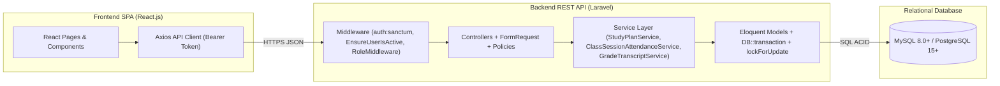
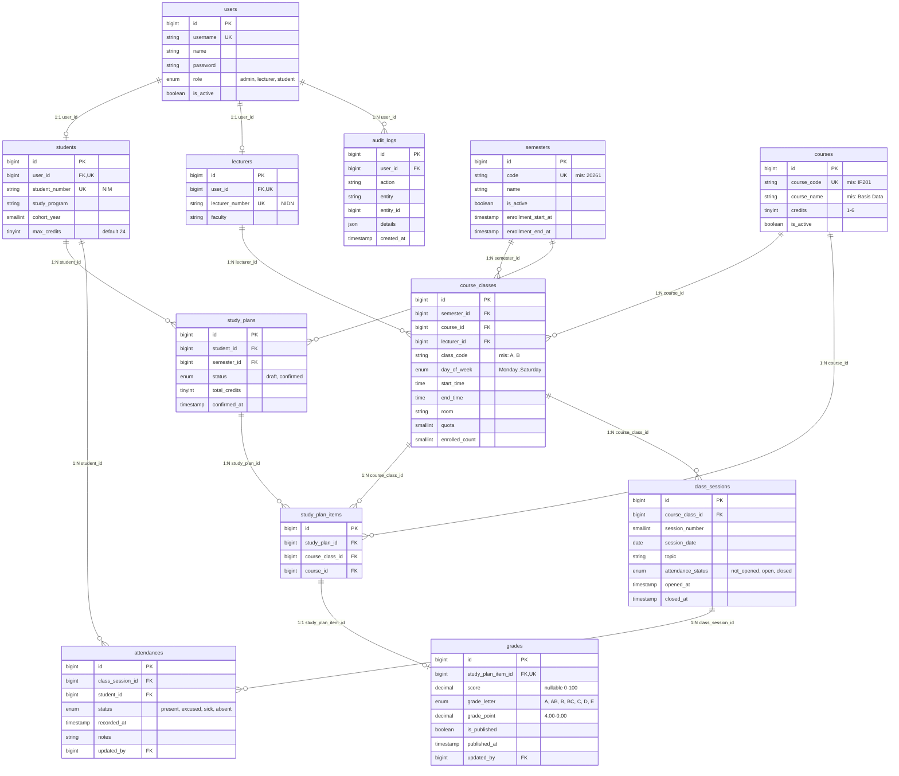
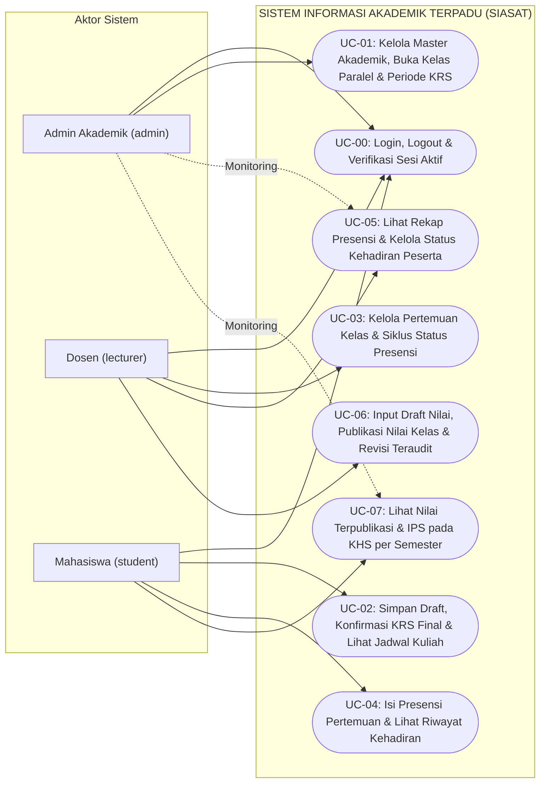
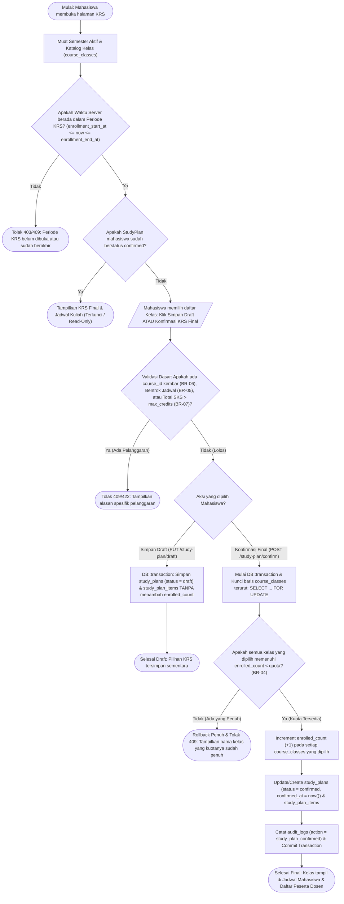
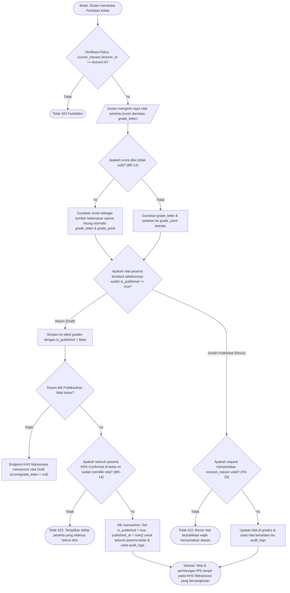

# APLIKASI WEB SISTEM INFORMASI AKADEMIK TERPADU (SIASAT)
## Software Requirements Specification (SRS)
**Manajemen Master Akademik, Pembukaan Kelas Paralel, Pengisian dan Konfirmasi Kartu Rencana Studi (KRS), Manajemen Pertemuan dan Presensi Perkuliahan Real-Time, serta Publikasi Nilai Kartu Hasil Studi (KHS)**

| Informasi Dokumen | Keterangan |
| :--- | :--- |
| **Versi** | `2.0` — Final Production-Ready Baseline; standardisasi penuh skema database, Eloquent Model, Service Layer, dan REST API ke konvensi bahasa Inggris Laravel; penutupan celah aturan bisnis (*edge cases*); penambahan standar *JSON Envelope*, NFR kuantitatif, prosedur uji *concurrency*, dan *Requirements Traceability Matrix* (RTM). |
| **Tanggal** | 19 November 2026 |
| **Status** | Final Production-Ready Baseline (Acuan Implementasi & Pengujian). |
| **Platform** | Aplikasi Web (*Single Page Application* + *RESTful API*) |
| **Nama Aplikasi** | SIASAT (Sistem Informasi Akademik Terpadu) |
| **Teknologi Rencana** | **Frontend**: React.js (Vite, React Router, Tailwind CSS, Axios); **Backend**: PHP Laravel (REST API, Laravel Sanctum, Service Layer, Eloquent ORM); **Database**: MySQL 8.0+ (InnoDB) / PostgreSQL 15+ (Relational Database dengan transaksi ACID). |
| **Tim Pengembang** | 2 Orang (Kolaborasi Fullstack Frontend React.js & Backend Laravel) |

> **Catatan Konvensi Dokumen**: Narasi spesifikasi, istilah domain akademik (KRS, KHS, SKS, IPS, NIM, NIDN), serta label antarmuka pengguna ditulis dalam bahasa Indonesia baku. Seluruh identifier teknis (nama tabel database, kolom, nilai ENUM, nama Eloquent Model, kelas Service, dan URI endpoint REST API) menggunakan bahasa Inggris berstandar konvensi Laravel (`snake_case` plural untuk tabel, `PascalCase` singular untuk Model).

---

## Riwayat Revisi

| Versi | Tanggal | Perubahan |
| :--- | :--- | :--- |
| **0.1** | 19 November 2026 | Draf awal SRS SIASAT: tujuan dan ruang lingkup satu semester, tiga aktor utama (Admin akademik, Mahasiswa, Dosen), konsep kelas paralel dan pertemuan, 12 kebutuhan fungsional (`FR-01` s/d `FR-12`), 3 kebutuhan nonfungsional (`NFR-01` s/d `NFR-03`), 4 skenario uji penerimaan, serta catatan asumsi terbuka. |
| **1.0** | 19 November 2026 | Penjabaran arsitektur Frontend React.js & Backend Laravel (MVC + Service Layer), matriks hak akses, pemodelan 12 tabel relasional awal, mekanisme *concurrency* (`DB::transaction` & `lockForUpdate()`), spesifikasi Seeder, diagram Use Case, dan Flowchart transaksional. |
| **2.0** | 19 November 2026 | **Final Production-Ready Baseline**: (1) Standardisasi penuh penamaan 12 tabel, kolom, nilai ENUM, Model Eloquent, Service Layer, dan endpoint API ke bahasa Inggris sesuai konvensi Laravel; (2) Sinkronisasi penomoran `FR-01`..`FR-32`, `BR-01`..`BR-22`, `NFR-01`..`NFR-15`, dan `UC-00`..`UC-07` (termasuk spesifikasi detail `UC-00` dan `UC-05`); (3) Penutupan *edge cases* aturan bisnis (penyimpanan *draft* KRS di database, aturan *re-open* presensi, prioritas `score` vs `grade_letter`, aturan publikasi & revisi nilai, proteksi kuota & jadwal kelas aktif, `ON DELETE RESTRICT`, pencabutan sesi akun nonaktif, serta syarat edit/hapus pertemuan); (4) Pelengkapan kontrak REST API & standar *JSON Envelope*; (5) Penambahan metrik NFR terukur, prosedur uji *edge cases*, dan **Lampiran C — Requirements Traceability Matrix (RTM)**. |

---

## Daftar Isi

1. [Pendahuluan](#1-pendahuluan)
   - 1.1 Tujuan Dokumen
   - 1.2 Ruang Lingkup Produk
   - 1.3 Tujuan Sistem
   - 1.4 Definisi dan Istilah
2. [Gambaran Umum Sistem](#2-gambaran-umum-sistem)
   - 2.1 Perspektif Produk
   - 2.2 Fungsi Utama
   - 2.3 Lingkungan Operasi
   - 2.4 Mode Demo untuk Presentasi dan Evaluasi
   - 2.5 Standar Antarmuka dan Konsistensi Visual (React.js + Tailwind CSS)
   - 2.6 Arsitektur Aplikasi — Decoupled React.js & Laravel MVC + Service Layer
3. [Aktor dan Hak Akses](#3-aktor-dan-hak-akses)
4. [Kebutuhan Fungsional](#4-kebutuhan-fungsional)
5. [Aturan Bisnis](#5-aturan-bisnis)
6. [Kebutuhan Data dan Konsep Database](#6-kebutuhan-data-dan-konsep-database)
   - 6.1 Relasi Logis
   - 6.2 Entity Relationship Diagram (ERD)
   - 6.3 Data Dictionary (12 Tabel Standar Konvensi Laravel)
   - 6.4 Relasi Antartabel dan Kebijakan Referensial (`ON DELETE`)
   - 6.5 Index dan Unique Constraints Database
   - 6.6 Catatan Implementasi Database, Transaksi ACID, dan Concurrency
   - 6.7 Penyimpanan Waktu dan Zona Waktu
   - 6.8 Contoh Payload JSON dan Query Agregasi Akademik
   - 6.9 Database Seeding (Laravel Seeder)
7. [Kebutuhan Nonfungsional](#7-kebutuhan-nonfungsional)
   - 7.1 Kebutuhan Antarmuka Pengguna (`NFR-UI`)
   - 7.2 Kebutuhan Nonfungsional Sistem (`NFR` Kuantitatif & Keamanan)
8. [Use Case Utama dan Flowchart Sistem](#8-use-case-utama-dan-flowchart-sistem)
   - 8.1 Diagram Use Case dan Pemetaan Kebutuhan
   - 8.2 Spesifikasi Use Case (`UC-00` s/d `UC-07`)
   - 8.3 Flowchart Sistem
9. [Kriteria Penerimaan](#9-kriteria-penerimaan)
   - 9.1 Skenario Pengujian Penerimaan Inti (Baseline Wajib `v0.1`)
   - 9.2 Prosedur Pengujian Edge Cases, Concurrency, dan Keamanan
10. [Batasan, Asumsi, dan Risiko](#10-batasan-asumsi-dan-risiko)
11. [Rencana Prioritas Implementasi dan Pembagian Tim (2 Orang)](#11-rencana-prioritas-implementasi-dan-pembagian-tim-2-orang)
- [Lampiran A — Definisi Metrik Akademik dan Skala Nilai](#lampiran-a--definisi-metrik-akademik-dan-skala-nilai)
- [Lampiran B — Kontrak Endpoint REST API Laravel dan Standar JSON Envelope](#lampiran-b--kontrak-endpoint-rest-api-laravel-dan-standar-json-envelope)
- [Lampiran C — Requirements Traceability Matrix (RTM)](#lampiran-c--requirements-traceability-matrix-rtm)
- [Referensi](#referensi)

---

## 1. Pendahuluan

### 1.1 Tujuan Dokumen
Dokumen *Software Requirements Specification* (SRS) ini mendefinisikan spesifikasi kebutuhan perangkat lunak secara lengkap dan terukur untuk aplikasi web **SIASAT (Sistem Informasi Akademik Terpadu)**. Dokumen ini menjadi acuan normatif bagi tim pengembang (2 orang) dalam merancang basis data, membangun kode sumber **Frontend React.js** dan **Backend Laravel**, menyusun kontrak integrasi API, serta melakukan pengujian penerimaan.

Cakupan sistem mengikuti **satu siklus semester perkuliahan** secara utuh, dimulai dari pengelolaan data induk akademik, pembukaan kelas paralel dan periode pengisian Kartu Rencana Studi (KRS) oleh Admin Akademik, pemilihan *draft* dan konfirmasi KRS Final oleh Mahasiswa, pembentukan jadwal kuliah pribadi dan daftar peserta kelas, pengelolaan sesi pertemuan dan pembukaan/penutupan presensi oleh Dosen, pengisian kehadiran oleh Mahasiswa, hingga pengisian dan publikasi nilai akhir pada Kartu Hasil Studi (KHS).

**Pemisahan Entitas Mata Kuliah (`Course`) dan Kelas (`CourseClass`)**:
Sistem membedakan secara tegas antara **Mata Kuliah** (`courses`) dan **Kelas** (`course_classes`). Sebagai contoh, *Basis Data* merupakan satu entitas Mata Kuliah pada kurikulum. Pada semester yang sama, Admin Akademik dapat membuka **Basis Data A** dan **Basis Data B** sebagai dua entitas **Kelas** yang terpisah, masing-masing dengan dosen pengampu, jadwal, ruangan, kuota, daftar peserta, serta daftar sesi pertemuan sendiri. Jika dosen membuat pertemuan pertama di Kelas A, pertemuan beserta sesi presensinya hanya berlaku untuk peserta Kelas A.

### 1.2 Ruang Lingkup Produk
SIASAT dirancang untuk mendukung operasional akademik perguruan tinggi dalam siklus semester aktif dengan tiga peran pengguna (*role*): **Admin Akademik (`admin`)**, **Dosen (`lecturer`)**, dan **Mahasiswa (`student`)**.

**Fokus versi awal (MVP)**:
1. Autentikasi pengguna (*login*, *logout*, dan pemeriksaan profil aktif) menggunakan token sesi terproteksi (**Laravel Sanctum**) disertai pencabutan token otomatis saat akun dinonaktifkan, serta otorisasi berbasis peran (*Role-Based Access Control*) dan kepemilikan sumber daya (*Laravel Policy*).
2. Pengelolaan data master akademik oleh Admin Akademik: data mahasiswa (`students`), dosen (`lecturers`), mata kuliah (`courses`), dan semester (`semesters`) beserta penetapan waktu mulai dan berakhirnya pengisian KRS (`enrollment_start_at` dan `enrollment_end_at`).
3. Pembukaan kelas paralel (`course_classes`) pada semester tertentu oleh Admin Akademik dengan menetapkan mata kuliah, kode kelas (misal `A`, `B`), dosen pengampu, jadwal (`day_of_week`, `start_time`, `end_time`), ruangan (`room`), serta kuota maksimum peserta (`quota`), dilengkapi proteksi perubahan jadwal/kuota setelah kelas memiliki peserta.
4. Penyimpanan *draft* KRS dan konfirmasi KRS Final (`study_plans` dan `study_plan_items`) oleh Mahasiswa selama periode KRS aktif dengan validasi berlapis di backend: pemeriksaan sisa kuota kelas secara atomik (`enrolled_count < quota`), pendeteksian bentrok jadwal antar-kelas, pencegahan pengambilan dua kelas paralel dari mata kuliah yang sama, dan pemeriksaan batas maksimum SKS (`max_credits`).
5. Pembentukan jadwal kuliah pribadi mahasiswa dan daftar peserta kelas dosen secara otomatis dari KRS yang telah dikonfirmasi (`status = 'confirmed'`).
6. Pembuatan, pengubahan, dan penghapusan bersyarat sesi pertemuan perkuliahan (`class_sessions`) oleh Dosen pengampu pada kelas yang diampu dengan pengisian tanggal (`session_date`) dan topik (`topic`), disertai penomoran urut otomatis (`session_number`: `1, 2, 3, ...`) yang independen untuk setiap kelas.
7. Pengelolaan siklus status presensi pertemuan oleh Dosen pengampu (`not_opened` → `open` → `closed`, termasuk pembukaan ulang terkontrol dengan pencatatan audit) serta pencatatan kehadiran mandiri satu kali per pertemuan (`attendances`) oleh Mahasiswa yang terdaftar di kelas tersebut saat status presensi `open`.
8. Penanganan rekapitulasi kehadiran pertemuan oleh Dosen (melihat peserta yang sudah mengisi presensi dan yang berstatus `Belum mengisi`, serta pembaruan status kehadiran menjadi `present`, `excused`, `sick`, atau `absent`) dan riwayat kehadiran pribadi oleh Mahasiswa.
9. Pengisian nilai akhir peserta (`grades`) oleh Dosen pengampu sebagai *draft* (`is_published = false`), publikasi nilai akhir secara kolektif per kelas (`is_published = true`), mekanisme revisi nilai teraudit, serta penampilan KHS pribadi Mahasiswa per semester beserta perhitungan Indeks Prestasi Semester (IPS).
10. Pencatatan jejak audit (`audit_logs`) untuk seluruh aksi akademik sensitif dan penyediaan *Database Seeder* Laravel yang *idempotent* (`InitialSeeder` dan `DemoSeeder`).

**Batasan di luar ruang lingkup MVP**:
- Pembayaran uang kuliah (UKT/SPP), tagihan keuangan, dan integrasi *payment gateway* tidak termasuk dalam MVP.
- Validasi pohon prasyarat kelulusan mata kuliah lintas semester (*prerequisite courses*) tidak termasuk dalam MVP.
- Proses batal-tambah mandiri oleh mahasiswa setelah menekan tombol **Konfirmasi KRS Final** tidak termasuk dalam MVP (KRS yang sudah berstatus `confirmed` bersifat final).

### 1.3 Tujuan Sistem
1. Menjamin ketertiban administrasi akademik mulai dari pembukaan kelas, pengisian KRS, perkuliahan, presensi, hingga penerbitan KHS dalam satu basis data relasional yang konsisten.
2. Mencegah anomali data pada masa KRS, seperti kuota kelas yang terlampaui akibat akses bersamaan (*race condition*), jadwal kuliah yang berbenturan, atau pengambilan mata kuliah ganda.
3. Memastikan keabsahan presensi perkuliahan dengan membatasi pengisian kehadiran hanya bagi peserta sah kelas terkait ketika sesi presensi berstatus `open`, serta menjamin sifat *idempotent* terhadap pengiriman ganda (*double-submit*).
4. Menjaga kerahasiaan dan integritas nilai akademik dengan mengisolasi nilai *draft* di sisi server agar tidak dapat diakses mahasiswa sebelum dipublikasikan secara resmi oleh dosen pengampu.

### 1.4 Definisi dan Istilah

| Istilah Domain | Padanan Teknis (Model / Tabel) | Definisi |
| :--- | :--- | :--- |
| **SIASAT** | — | Sistem Informasi Akademik Terpadu; aplikasi web pengelolaan siklus perkuliahan satu semester. |
| **Mata Kuliah** | `Course` (`courses`) | Unit kurikulum pembelajaran yang memiliki kode unik (`course_code`), nama (`course_name`), dan bobot SKS (`credits`). |
| **Kelas (Kelas Paralel)** | `CourseClass` (`course_classes`) | Pembukaan suatu Mata Kuliah pada semester tertentu dengan kode kelas spesifik (`class_code`: `A`, `B`), dosen pengampu, jadwal hari/jam, ruangan, dan kuota peserta tersendiri. |
| **SKS** | `credits` / `max_credits` | Satuan Kredit Semester; bobot beban studi sebuah mata kuliah dan dasar perhitungan batas pengambilan KRS serta perhitungan IPS pada KHS. |
| **Periode KRS** | `enrollment_start_at` s/d `enrollment_end_at` | Rentang waktu resmi pada semester aktif yang ditetapkan Admin Akademik di mana mahasiswa diizinkan menyimpan *draft* dan mengonfirmasi KRS. |
| **KRS Draft** | `StudyPlan` (`status = 'draft'`) | Rencana pilihan kelas yang disimpan sementara oleh mahasiswa di database selama periode KRS aktif sebelum dikonfirmasi menjadi final. Belum mengurangi kuota kelas (`enrolled_count`). |
| **KRS Final** | `StudyPlan` (`status = 'confirmed'`) | Kartu Rencana Studi yang telah dikonfirmasi oleh mahasiswa. Mengunci kuota kelas secara atomik, menampilkan kelas di jadwal mahasiswa, dan mencantumkan mahasiswa di daftar peserta dosen. |
| **Pertemuan** | `ClassSession` (`class_sessions`) | Sesi tatap muka perkuliahan yang dibuat dosen pada suatu Kelas, memiliki nomor urut otomatis per kelas (`session_number`), tanggal, topik, dan status presensi. |
| **Status Presensi Sesi** | `attendance_status` | Keadaan sesi kehadiran pada suatu pertemuan: `not_opened` (*Belum dibuka*), `open` (*Terbuka*), dan `closed` (*Ditutup*). |
| **Status Kehadiran Peserta** | `Attendance` (`attendances.status`) | Status kehadiran mahasiswa pada suatu pertemuan: `present` (*Hadir*), `excused` (*Izin*), `sick` (*Sakit*), atau `absent` (*Alpa*). Peserta yang belum memiliki baris di tabel `attendances` ditampilkan di UI sebagai **`Belum mengisi`**. |
| **Publikasi Nilai** | `Grade` (`is_published = true`) | Tindakan dosen pengampu untuk mengesahkan nilai akhir peserta kelas sehingga nilai tersebut tampil pada halaman KHS mahasiswa. |
| **KHS** | *Transcript Endpoint / View* | Kartu Hasil Studi; laporan nilai akademik mahasiswa per semester yang hanya menampilkan nilai mata kuliah yang telah dipublikasikan beserta perhitungan IPS. |
| **IPS** | `gpa` (*Semester GPA*) | Indeks Prestasi Semester; nilai rata-rata tertimbang semester yang dihitung dari $\frac{\sum (\text{credits} \times \text{grade\_point})}{\sum \text{credits}}$ untuk mata kuliah yang nilainya telah dipublikasikan. |
| **Zona Waktu Kampus** | `Asia/Jakarta` | Waktu Indonesia Barat (WIB, UTC+7). Validasi periode KRS dan tampilan waktu menggunakan zona waktu ini, sedangkan database menyimpan timestamp dalam UTC. |

---

## 2. Gambaran Umum Sistem

### 2.1 Perspektif Produk
SIASAT dikembangkan sebagai aplikasi web dengan arsitektur *decoupled* (pemisahan penuh antara antarmuka klien dan layanan server):
- **Frontend**: **React.js** (menggunakan Vite, React Router, Tailwind CSS, dan Axios).
- **Backend**: **PHP Laravel** yang menyediakan RESTful API berformat JSON, autentikasi token (**Laravel Sanctum**), validasi input (**FormRequest**), otorisasi peran dan kepemilikan (**Middleware & Policy**), logika bisnis (**Service Layer**), serta akses data (**Eloquent ORM**).
- **Database**: Relational Database Management System (**MySQL 8.0+ InnoDB** atau **PostgreSQL 15+**) dengan dukungan transaksi ACID, *foreign key constraints* (`ON DELETE RESTRICT` / `CASCADE`), *composite unique index*, dan *pessimistic row-level locking* (`SELECT ... FOR UPDATE`).

### 2.2 Fungsi Utama
1. Autentikasi multi-peran (`admin`, `lecturer`, `student`), pencabutan sesi akun nonaktif, dan proteksi endpoint berbasis peran serta kepemilikan sumber daya.
2. Manajemen data master akademik oleh Admin Akademik: Mahasiswa, Dosen, Mata Kuliah, dan Semester beserta pengaturan Periode KRS.
3. Pembukaan Kelas Paralel beserta validasi anti-bentrok jadwal dosen pengampu dan ruangan, serta aturan proteksi perubahan kelas yang sudah memiliki peserta.
4. Penyimpanan *draft* KRS dan konfirmasi KRS Final oleh Mahasiswa disertai validasi kuota atomik, deteksi bentrok jadwal, pencegahan duplikasi mata kuliah, dan validasi batas SKS.
5. Penampilan jadwal kuliah mahasiswa dan daftar peserta kelas bagi dosen pengampu maupun monitoring admin.
6. Manajemen sesi pertemuan kelas oleh dosen (pembuatan dengan penomoran urut otomatis per kelas, pengubahan tanggal/topik, penghapusan bersyarat) dan kendali siklus status presensi (`not_opened` → `open` → `closed` serta *re-open* teraudit).
7. Pengisian presensi kehadiran mandiri satu kali per pertemuan oleh mahasiswa serta pengelolaan rekapitulasi kehadiran (`present`, `excused`, `sick`, `absent`, dan `Belum mengisi`) oleh dosen.
8. Pengisian nilai akhir (*draft*), publikasi nilai kolektif per kelas, dan revisi nilai teraudit oleh dosen pengampu, serta penampilan Kartu Hasil Studi (KHS) per semester bagi mahasiswa.

### 2.3 Lingkungan Operasi
- **Perangkat Klien**: Peramban web modern (Chrome, Firefox, Edge, Safari versi terkini) pada desktop, laptop, tablet, dan ponsel pintar.
- **Lingkungan Frontend**: Node.js 20+ (build time), React 18+, Vite, Tailwind CSS 3+.
- **Lingkungan Backend**: PHP 8.2+, Laravel 11.x/12.x, Composer.
- **Lingkungan Database**: MySQL 8.0+ (wajib engine InnoDB) atau PostgreSQL 15+.
- **Pengaturan Waktu**: Zona waktu logika bisnis adalah `Asia/Jakarta` (UTC+7); penyimpanan timestamp di database menggunakan UTC.

### 2.4 Mode Demo untuk Presentasi dan Evaluasi
Untuk memfasilitasi demonstrasi dan pengujian penerimaan seluruh fitur tanpa terhalang tanggal kalender semester riil:
- Sistem menyediakan `DemoSeeder` yang menyiapkan data lengkap satu semester simulasi mencakup akun Admin, 2 Dosen, 5 Mahasiswa, Mata Kuliah (termasuk *Basis Data*), Kelas Paralel (*Basis Data A* dan *Basis Data B*), kelas dengan sisa kuota 1 kursi untuk simulasi rebutan kursi terakhir, kelas dengan jadwal beririsan untuk uji deteksi bentrok, sesi pertemuan dengan status presensi `not_opened` dan `open`, serta data nilai *draft* dan *published*.
- Admin Akademik dapat memperbarui `enrollment_start_at` dan `enrollment_end_at` pada semester aktif kapan saja melalui antarmuka Admin untuk menyimulasikan kondisi **Periode KRS Terbuka** maupun **Periode KRS Ditutup** secara instan saat evaluasi.

### 2.5 Standar Antarmuka dan Konsistensi Visual (Soft Daylight & Airy White Theme)
Antarmuka SIASAT menggunakan komponen **React.js** yang ditata dengan **Tailwind CSS** mengusung tema **Soft Daylight & Airy White** (terang, bersih, lembut di mata, tidak menggunakan warna gelap/navy yang berat maupun warna primer yang mencolok/kaku). Seluruh label antarmuka disajikan dalam bahasa Indonesia baku.

#### Palet Warna Antarmuka (Soft & Eye-Friendly)
- **Sidebar & Topbar Utama**: Putih Bersih `#FFFFFF` dengan garis pemisah halus `#E2E8F0` (`slate-200`) — tidak menggunakan sidebar gelap/navy agar tampilan terasa lapang, modern, dan ringan di mata.
- **Latar Area Konten (Canvas)**: Putih Hangat / *Soft Alabaster* `#F8FAFC` (`slate-50`), memberikan pemisahan visual yang lembut dengan permukaan kartu, tabel, dan modal yang berwarna Putih `#FFFFFF`.
- **Aksen Utama & Penanda Menu Aktif (Soft Indigo)**:
  - **Menu Aktif di Sidebar**: Latar Pastel Indigo `#EEF2FF` (`indigo-50`) dengan teks & ikon `#4338CA` (`indigo-700`) — lembut dan tidak menyilaukan.
  - **Tombol Aksi Utama**: Soft Indigo `#4F46E5` (`indigo-600`) dengan *hover* `#4338CA` (`indigo-700`) dan bayangan halus.
- **Teks Utama**: *Soft Charcoal* `#1E293B` (`slate-800` — menghindari hitam pekat `#000000` agar kontras tetap nyaman dibaca dalam waktu lama); **Teks Sekunder**: *Muted Slate* `#64748B` (`slate-500`).
- **Warna Status Semantik (Pastel Pill Badges — Tidak Mencolok)**:
  - **Berhasil / KRS Terkonfirmasi (`confirmed`) / Presensi Terbuka (`open`) / Hadir (`present`) / Nilai Terpublikasi**: Latar Mint Pastel `#ECFDF5` (`emerald-50`), Teks `#047857` (`emerald-700`), Border `#A7F3D0` (`emerald-200`).
  - **Peringatan / KRS Draft (`draft`) / Presensi Belum Dibuka (`not_opened`) / Belum Mengisi / Izin (`excused`) / Sakit (`sick`)**: Latar Cream Pastel `#FFFBEB` (`amber-50`), Teks `#B45309` (`amber-700`), Border `#FDE68A` (`amber-200`).
  - **Kesalahan / Bentrok Jadwal / Kuota Penuh / Presensi Ditutup (`closed`) / Alpa (`absent`)**: Latar Rose Pastel `#FFF1F2` (`rose-50`), Teks `#BE123C` (`rose-700`), Border `#FECDD3` (`rose-200`).

> **Prinsip Estetika Anti-Kaku & Aksesibilitas**:
> 1. Komponen kartu menggunakan sudut membulat lembut (`rounded-2xl`), tombol dan input menggunakan `rounded-xl`, serta badge status menggunakan bentuk kapsul (`rounded-full`) dengan *padding* yang lega.
> 2. Warna tidak menjadi satu-satunya penanda informasi; setiap badge wajib disertai titik indikator (*dot*) atau ikon dan teks label bahasa Indonesia yang jelas (contoh: `"Belum dibuka"`, `"Terbuka"`, `"Ditutup"`, `"Hadir"`, `"Belum mengisi"`, `"Draft"`, `"Terkonfirmasi"`).

#### Tipografi
- **Judul dan Heading**: `Plus Jakarta Sans` atau `Urbanist` (`font-semibold` / `font-bold`).
- **Teks Isi, Form, dan Tabel**: `Inter` atau `Outfit` (`font-normal` / `font-medium`).
- **Kode Akademik (`student_number`/NIM, `lecturer_number`/NIDN, `course_code`, `room`, jam kuliah)**: `JetBrains Mono` (`font-mono`).

#### Prinsip Tata Letak dan Interaksi
1. **Halaman Admin Akademik**: Menyediakan pengelolaan master data, pembukaan kelas paralel, pengaturan periode KRS, serta tampilan *read-only* monitoring peserta kelas, rekap presensi, KHS mahasiswa, dan log audit.
2. **Halaman Mahasiswa**:
   - Menyediakan indikator bar SKS (*Total SKS Dipilih / Batas Maksimal SKS*) dan status KRS (*Draft* vs *Final*).
   - Menyediakan tombol **Simpan Draft KRS** dan tombol **Konfirmasi KRS Final** (disertai dialog konfirmasi bahwa KRS yang sudah dikonfirmasi bersifat final).
   - Pada halaman presensi kelas, menampilkan nama kelas, nomor pertemuan (`session_number`), topik, dan status presensi (`NFR-03`). Tombol **Hadir / Isi Presensi** langsung berubah menjadi *loading* dan *disabled* saat diklik.
3. **Halaman Dosen**:
   - Memisahkan daftar kelas paralel yang diampu (*Basis Data A* vs *Basis Data B*).
   - Menyediakan tab **Daftar Peserta**, **Pertemuan & Presensi** (tombol *Buka Presensi*, *Tutup Presensi*, *Buka Ulang Presensi*, serta tabel rekap kehadiran), dan **Penilaian Akhir** (tombol *Simpan Draft Nilai* dan *Publikasikan Nilai Kelas*).

### 2.6 Arsitektur Aplikasi — Decoupled React.js & Laravel MVC + Service Layer
Sistem memisahkan tanggung jawab secara ketat antara lapisan antarmuka (React.js) dan lapisan server (Laravel):



#### Pembagian Tanggung Jawab Lapisan Backend Laravel
1. **Middleware & Policy Layer**:
   - `auth:sanctum`: Memverifikasi validitas token autentikasi.
   - `EnsureUserIsActive`: Memastikan `auth()->user()->is_active === true` pada setiap request; jika `false`, mencabut token dan mengembalikan `403 Forbidden`.
   - `RoleMiddleware`: Memeriksa kesesuaian `users.role` (`admin`, `lecturer`, `student`).
   - `CourseClassPolicy`, `ClassSessionPolicy`, `StudyPlanPolicy`: Memastikan dosen hanya dapat memodifikasi kelas yang diampunya (`course_classes.lecturer_id === $user->lecturer->id`) dan mahasiswa hanya mengakses data miliknya sendiri (`NFR-01`).
2. **Controller & FormRequest Layer (`app/Http/Controllers/Api/`, `app/Http/Requests/`)**:
   - Memvalidasi tipe data, format input, dan parameter request, lalu mendelegasikan eksekusi bisnis ke Service Layer dan memformat respons ke standar *JSON Envelope*. Controller tidak boleh berisi query transaksi kompleks.
3. **Service Layer (`app/Services/`)**:
   - `MasterAcademicService`: Mengelola pembuatan akun & profil mahasiswa/dosen, pencabutan token saat penonaktifan akun, pembukaan kelas paralel, validasi bentrok jadwal dosen/ruangan, dan proteksi perubahan kuota/jadwal kelas aktif.
   - `StudyPlanService`: Mengelola penyimpanan *draft* KRS dan konfirmasi KRS Final di dalam `DB::transaction()` menggunakan `lockForUpdate()` pada `course_classes`.
   - `ClassSessionAttendanceService`: Mengelola pembuatan pertemuan dengan penomoran urut otomatis per kelas, validasi edit/hapus pertemuan, transisi status presensi (`not_opened`, `open`, `closed`, dan *re-open*), serta pencatatan kehadiran mahasiswa yang *idempotent*.
   - `GradeTranscriptService`: Mengelola konversi nilai dengan prioritas `score`, penyimpanan *draft* nilai, validasi publikasi nilai kolektif per kelas, revisi nilai teraudit, serta kompilasi KHS dan perhitungan IPS.
4. **Model Layer (`app/Models/`)**:
   - Terdiri atas 12 Eloquent Model standar (`User`, `Student`, `Lecturer`, `Semester`, `Course`, `CourseClass`, `StudyPlan`, `StudyPlanItem`, `ClassSession`, `Attendance`, `Grade`, `AuditLog`).

---

## 3. Aktor dan Hak Akses

Sistem memiliki tepat **tiga peran pengguna (`users.role`)**: **Admin Akademik (`admin`)**, **Dosen (`lecturer`)**, dan **Mahasiswa (`student`)**. Seluruh hak akses pada tabel di bawah dipetakan 1:1 ke endpoint REST API pada Lampiran B.

| Fitur / Aksi Sistem | Admin Akademik (`admin`) | Dosen (`lecturer`) | Mahasiswa (`student`) |
| :--- | :---: | :---: | :---: |
| Login, Logout, dan Lihat Profil Sesi Aktif (`/api/auth/*`) | Ya | Ya | Ya |
| Mengelola data master Mahasiswa (`students` + `users`) | Ya | Tidak | Tidak |
| Mengelola data master Dosen (`lecturers` + `users`) | Ya | Tidak | Tidak |
| Mengelola data master Mata Kuliah (`courses`) | Ya | Tidak | Tidak |
| Mengelola Semester & menetapkan Periode KRS (`semesters`) | Ya | Tidak | Tidak |
| Membuka & memperbarui Kelas Paralel (`course_classes`) | Ya | Tidak | Tidak |
| Melihat katalog kelas ditawarkan pada semester aktif | Ya (Semua) | Tidak | Ya (Semester Aktif) |
| Menyimpan *Draft* KRS & Mengonfirmasi KRS Final (`study_plans`) | Tidak | Tidak | Ya (Milik Sendiri) |
| Melihat detail KRS & Jadwal Kuliah dari KRS Final | Ya (Monitoring) | Ya (Kelas Diampu) | Ya (Milik Sendiri) |
| Melihat Daftar Peserta Kelas dari KRS Final | Ya (Semua Kelas) | Ya (Hanya Kelas Diampu) | Tidak |
| Membuat, melihat, & mengubah tanggal/topik Pertemuan (`class_sessions`) | Ya (Lihat Saja) | Ya (Hanya Kelas Diampu) | Ya (Lihat di Kelasnya) |
| Menghapus Pertemuan (hanya jika `not_opened` & belum ada presensi) | Tidak | Ya (Hanya Kelas Diampu) | Tidak |
| Mengubah Status Presensi (`not_opened` → `open` → `closed` / *re-open*) | Tidak | Ya (Hanya Kelas Diampu) | Tidak |
| Mengisi Presensi Kehadiran Mandiri (1x saat status `open`) | Tidak | Tidak | Ya (Hanya Peserta Kelas) |
| Melihat Rekap Presensi Pertemuan (Sudah Mengisi vs `Belum mengisi`) | Ya (Semua Kelas) | Ya (Hanya Kelas Diampu) | Tidak |
| Memperbarui status kehadiran peserta (`present`/`excused`/`sick`/`absent`) | Tidak | Ya (Hanya Kelas Diampu) | Tidak |
| Melihat Riwayat Kehadiran Pribadi per Kelas | Tidak | Tidak | Ya (Milik Sendiri) |
| Melihat & Mengisi Nilai Akhir Peserta (*Simpan Draft*) | Tidak | Ya (Hanya Kelas Diampu) | Tidak |
| Memublikasikan Nilai Akhir Kelas & Merevisi Nilai Terpublikasi (dengan alasan) | Tidak | Ya (Hanya Kelas Diampu) | Tidak |
| Melihat Nilai Terpublikasi dan IPS pada KHS per Semester | Ya (Monitoring) | Tidak | Ya (Hanya Milik Sendiri) |
| Melihat Jejak Audit Sistem (`audit_logs`) | Ya | Tidak | Tidak |

---

## 4. Kebutuhan Fungsional

Seluruh kebutuhan fungsional disusun berurutan dari `FR-01` hingga `FR-32` tanpa nomor yang terlewat, dilengkapi referensi silang ke Draf `v0.1`.

| ID | Ref v0.1 | Fitur | Spesifikasi Kebutuhan Fungsional |
| :--- | :---: | :--- | :--- |
| **FR-01** | `FR-01` | Autentikasi & Menu Peran | Sistem harus memverifikasi `username`, `password`, dan status `is_active = true` saat pengguna login, menerbitkan token autentikasi Sanctum, serta menampilkan navigasi menu sesuai perannya (`admin`, `lecturer`, atau `student`). |
| **FR-02** | `FR-01`, `NFR-01` | Otorisasi Peran & Kepemilikan | Sistem harus memvalidasi peran pengguna dan hak kepemilikan terhadap kelas atau data pribadi pada setiap permintaan API di backend, termasuk menolak akses melalui tautan atau pemanggilan endpoint langsung. |
| **FR-03** | Tambahan v2.0 | Penonaktifan Akun & Pencabutan Sesi | Apabila Admin Akademik mengubah status akun pengguna menjadi nonaktif (`users.is_active = false`), sistem harus menolak login akun tersebut dan segera mencabut seluruh token sesi aktif pengguna terkait. |
| **FR-04** | `FR-02` | Manajemen Data Mahasiswa | Admin Akademik dapat menambah, melihat, mencari, dan memperbarui data mahasiswa (`students` beserta akun `users`), mencakup `student_number` (NIM) unik, nama, `study_program`, `cohort_year`, `max_credits` (default 24), dan status aktif. |
| **FR-05** | `FR-02` | Manajemen Data Dosen | Admin Akademik dapat menambah, melihat, mencari, dan memperbarui data dosen (`lecturers` beserta akun `users`), mencakup `lecturer_number` (NIDN) unik, nama, `faculty`, dan status aktif. |
| **FR-06** | `FR-02` | Manajemen Mata Kuliah | Admin Akademik dapat menambah, melihat, mencari, dan memperbarui data mata kuliah (`courses`), mencakup `course_code` unik, `course_name`, bobot SKS (`credits` 1–6), dan status aktif. |
| **FR-07** | `FR-02` | Manajemen Semester | Admin Akademik dapat menambah, melihat, dan memperbarui data semester (`semesters`), mencakup `code` unik, `name`, serta mengatur status aktif (`is_active`), di mana maksimal satu semester berstatus aktif pada satu waktu. |
| **FR-08** | `FR-04` | Pengaturan Periode KRS | Admin Akademik dapat menetapkan dan memperbarui waktu mulai (`enrollment_start_at`) dan waktu berakhir (`enrollment_end_at`) pengisian KRS pada suatu semester dalam zona waktu `Asia/Jakarta`. |
| **FR-09** | `FR-03` | Pembukaan Kelas Paralel | Admin Akademik dapat membuka kelas paralel (`course_classes`) untuk suatu mata kuliah pada semester tertentu (misal *Basis Data A* dan *Basis Data B*) dengan menetapkan `class_code`, `lecturer_id`, `day_of_week`, `start_time`, `end_time`, `room`, dan `quota`. |
| **FR-10** | `FR-03` | Validasi Bentrok Dosen & Ruang | Saat Admin Akademik membuka atau mengubah kelas pada semester yang sama, sistem harus menolak penyimpanan apabila terdapat irisan waktu pada hari yang sama untuk **dosen pengampu yang sama** atau **ruangan yang sama**. |
| **FR-11** | Tambahan v2.0 | Proteksi Perubahan Kelas Aktif | Sistem harus menolak penurunan `quota` kelas di bawah jumlah peserta terdaftar (`quota < enrolled_count`) dan menolak perubahan jadwal (`day_of_week`, `start_time`, `end_time`) atau `course_id` apabila kelas tersebut sudah memiliki peserta KRS Final (`enrolled_count > 0`). |
| **FR-12** | `FR-05` | Katalog Kelas pada Masa KRS | Mahasiswa dapat melihat daftar kelas yang dibuka pada semester aktif beserta informasi mata kuliah, SKS, kode kelas, dosen pengampu, jadwal, ruangan, kapasitas `quota`, dan `enrolled_count`. |
| **FR-13** | Tambahan v2.0 | Penyimpanan Draft KRS | Selama periode KRS aktif dan sebelum KRS berstatus `confirmed`, mahasiswa dapat menyimpan atau memperbarui pilihan kelas sebagai *draft* (`study_plans.status = 'draft'`) di database tanpa mengunci atau mengurangi kuota kelas. |
| **FR-14** | `FR-05` | Konfirmasi KRS Final | Mahasiswa dapat mengonfirmasi KRS menjadi final (`study_plans.status = 'confirmed'`) selama waktu server berada dalam rentang Periode KRS aktif (`enrollment_start_at <= now <= enrollment_end_at`). Di luar periode tersebut, sistem menolak penyimpanan *draft* maupun konfirmasi KRS. |
| **FR-15** | `FR-05` | Validasi Kuota Kelas Atomik | Sebelum menyimpan konfirmasi KRS Final, backend harus mengunci baris kelas yang dipilih (`lockForUpdate()`) dan memeriksa `enrolled_count < quota`. Jika ada kelas yang penuh, transaksi dibatalkan dan sistem menampilkan nama kelas yang penuh. |
| **FR-16** | `FR-05` | Validasi Bentrok Jadwal & MK Ganda | Sebelum menyimpan *draft* maupun konfirmasi KRS, backend harus memeriksa bahwa tidak ada dua kelas pilihan mahasiswa yang memiliki jadwal beririsan pada hari yang sama, serta tidak ada dua kelas paralel dari `course_id` yang sama. Jika gagal, sistem menampilkan alasan spesifiknya. |
| **FR-17** | `FR-05` | Validasi Batas Maksimal SKS | Sebelum menyimpan *draft* maupun konfirmasi KRS, backend harus memeriksa bahwa total SKS (`total_credits`) seluruh kelas yang dipilih tidak melebihi `students.max_credits` mahasiswa tersebut. |
| **FR-18** | `FR-06` | Pembentukan Jadwal & Peserta Kelas | Setelah KRS dikonfirmasi menjadi final (`status = 'confirmed'`), sistem menampilkan kelas-kelas tersebut pada **Jadwal Kuliah Mahasiswa** dan mencantumkan mahasiswa pada **Daftar Peserta Kelas** di halaman Dosen pengampu serta halaman monitoring Admin. |
| **FR-19** | `FR-07` | Pembuatan Pertemuan Kelas | Dosen pengampu dapat membuat sesi pertemuan baru (`class_sessions`) pada kelas yang diampunya dengan mengisi tanggal (`session_date`) dan topik (`topic`), termasuk menyiapkan topik lebih awal sebelum hari kuliah. |
| **FR-20** | `FR-07` | Penomoran Urut Pertemuan per Kelas | Sistem secara otomatis menetapkan `session_number` berurutan (`1, 2, 3, ...`) untuk setiap pertemuan baru di dalam lingkup kelas tersebut. Penomoran pertemuan Kelas A dan Kelas B bersifat independen. |
| **FR-21** | Tambahan v2.0 | Pengubahan & Penghapusan Bersyarat Pertemuan | Dosen pengampu dapat memperbarui `session_date` dan `topic` pertemuan pada kelasnya, serta hanya dapat menghapus pertemuan apabila `attendance_status` masih `not_opened` dan belum memiliki catatan kehadiran di tabel `attendances`. |
| **FR-22** | `FR-08` | Siklus Status Presensi Pertemuan | Pertemuan baru otomatis berstatus `not_opened` (*Belum dibuka*). Dosen pengampu dapat mengubahnya menjadi `open` (*Terbuka*), lalu `closed` (*Ditutup*), serta dapat membuka ulang (*re-open*: `closed` → `open`) disertai alasan yang tercatat di `audit_logs` tanpa menghapus presensi yang sudah masuk. |
| **FR-23** | `FR-09`, `NFR-02`, `NFR-03` | Pengisian Presensi oleh Mahasiswa | Mahasiswa dapat mengisi presensi kehadiran tepat **satu kali per pertemuan** apabila terdaftar pada KRS Final kelas tersebut dan `attendance_status` sedang `open`. Sistem mencatat `recorded_at` dan menampilkan status `Hadir` (`present`) beserta waktu pengisiannya. |
| **FR-24** | `FR-10` | Rekap Presensi bagi Dosen & Admin | Dosen pengampu (dan Admin Akademik untuk monitoring) dapat melihat rekapitulasi peserta tiap pertemuan yang menampilkan peserta yang sudah mengisi presensi beserta waktu pengisiannya dan peserta yang berstatus `Belum mengisi`. |
| **FR-25** | `FR-10` | Pengelolaan Status Kehadiran oleh Dosen | Dosen pengampu dapat menetapkan atau mengubah status kehadiran peserta pada rekap pertemuan menjadi `present` (*Hadir*), `excused` (*Izin*), `sick` (*Sakit*), atau `absent` (*Alpa*) beserta catatan opsional (`notes`). |
| **FR-26** | `FR-10` | Riwayat Kehadiran Mahasiswa | Mahasiswa dapat melihat riwayat kehadirannya sendiri pada setiap kelas yang diikuti, mencakup daftar pertemuan, tanggal, topik, status presensi pertemuan, status kehadirannya, dan waktu pengisian. |
| **FR-27** | `FR-11` | Pengisian Nilai Akhir (Draft) & Resolusi Input | Dosen pengampu dapat melihat daftar nilai dan menyimpan nilai akhir peserta kelasnya sebagai *draft* (`is_published = false`). Jika `score` (angka 0–100) dikirimkan, sistem otomatis menghitung `grade_letter` dan `grade_point` sebagai sumber kebenaran utama. |
| **FR-28** | `FR-11` | Publikasi Nilai Akhir Kolektif Kelas | Dosen pengampu dapat memublikasikan nilai akhir peserta kelas yang diampunya (`is_published = true`, `published_at = now()`) setelah seluruh peserta aktif di kelas tersebut memiliki nilai *draft* yang lengkap. |
| **FR-29** | Tambahan v2.0 | Revisi Nilai Terpublikasi dengan Audit | Apabila dosen pengampu perlu merevisi nilai peserta yang sudah berstatus `is_published = true`, sistem mewajibkan pengisian alasan revisi (`revision_reason`) dan mencatat nilai lama, nilai baru, serta alasan revisi ke `audit_logs`. |
| **FR-30** | `FR-12` | Penampilan KHS & Daftar Semester | Mahasiswa (dan Admin untuk monitoring) dapat memilih semester untuk melihat Kartu Hasil Studi (KHS). KHS hanya menampilkan nilai mata kuliah yang telah berstatus `is_published = true` beserta perhitungan IPS semester. |
| **FR-31** | Tambahan Standar | Pencatatan & Pembacaan Audit Log | Sistem mencatat setiap peristiwa kritis ke tabel `audit_logs` dan menyediakan endpoint bagi Admin Akademik untuk menelusuri riwayat audit terbaru. |
| **FR-32** | Tambahan Standar | Database Seeder (`InitialSeeder` & `DemoSeeder`) | Sistem menyediakan seeder Laravel via CLI yang bersifat *idempotent*, menyimpan password dengan *bcrypt*, dan menolak pembuatan data demo pada environment `production`. |

---

## 5. Aturan Bisnis

### BR-01 — Pemisahan Mata Kuliah (`Course`) dan Kelas Paralel (`CourseClass`)
Mata Kuliah (`courses`) adalah katalog kurikulum, sedangkan Kelas (`course_classes`) adalah penyelenggaraan perkuliahan pada semester tertentu. Satu Mata Kuliah dapat dibuka menjadi beberapa Kelas Paralel pada semester yang sama (contoh: *Basis Data A* dan *Basis Data B*) dengan kombinasi unik `(semester_id, course_id, class_code)`. Seluruh transaksi KRS, jadwal, daftar peserta, pertemuan, presensi, dan penilaian terikat pada `course_classes.id`.

### BR-02 — Semester Aktif dan Validasi Periode KRS
Maksimal hanya satu baris pada tabel `semesters` yang boleh memiliki `is_active = true` pada satu waktu. Saat Admin mengaktifkan sebuah semester, semester lain yang sebelumnya aktif otomatis diubah menjadi `is_active = false` dalam transaksi yang sama. Penyimpanan *draft* KRS maupun konfirmasi KRS Final hanya diizinkan jika kelas berada pada semester aktif dan waktu server (`Asia/Jakarta`) memenuhi:
$$\text{enrollment\_start\_at} \le \text{now} \le \text{enrollment\_end\_at}$$

### BR-03 — Pencegahan Bentrok Dosen dan Ruangan saat Pembukaan Kelas
Pada `semester_id` yang sama, Admin Akademik dilarang menyimpan dua `course_classes` berbeda pada `day_of_week` yang sama apabila memiliki rentang waktu yang beririsan untuk **dosen pengampu yang sama (`lecturer_id`)** atau **ruangan yang sama (`room`)**. Dua rentang waktu $[S_1, E_1)$ dan $[S_2, E_2)$ dinyatakan beririsan jika dan hanya jika:
$$S_1 < E_2 \quad \text{dan} \quad E_1 > S_2$$
Di mana $S$ adalah `start_time` dan $E$ adalah `end_time` (dengan syarat wajib $S < E$).

### BR-04 — Validasi Kuota Kelas dan Pemisahan Draft vs Confirmed KRS
1. Setiap `course_classes` memiliki kapasitas `quota` ($\ge 1$) dan penghitung peserta terkonfirmasi `enrolled_count` ($0 \le \text{enrolled\_count} \le \text{quota}$).
2. Penyimpanan **Draft KRS** (`study_plans.status = 'draft'`) menyimpan daftar kelas pilihan mahasiswa di tabel `study_plan_items` setelah memvalidasi tidak adanya bentrok jadwal (`BR-05`), tidak adanya mata kuliah ganda (`BR-06`), dan tidak terlampauinya batas SKS (`BR-07`), **tetapi belum menambah `enrolled_count`** dan belum memesan kursi secara eksklusif.
3. Penambahan `enrolled_count` (+1) dan penguncian kuota (`enrolled_count < quota`) hanya dilakukan saat mahasiswa menekan **Konfirmasi KRS Final** (`study_plans.status = 'confirmed'`) di dalam transaksi database yang mengunci baris `course_classes` terkait menggunakan `SELECT ... FOR UPDATE`.

### BR-05 — Validasi Bentrok Jadwal Kuliah Mahasiswa
Mahasiswa dilarang memilih dua atau lebih kelas pada semester yang sama apabila kelas-kelas tersebut jatuh pada `day_of_week` yang sama dan memiliki jam perkuliahan yang beririsan ($S_1 < E_2 \text{ dan } E_1 > S_2$). Pelanggaran aturan ini mengembalikan kode HTTP `409 Conflict` beserta detail pasangan kelas yang berbenturan.

### BR-06 — Larangan Mengambil Dua Kelas Paralel dari Mata Kuliah yang Sama
Dalam satu semester (`study_plan_id` yang sama), seorang mahasiswa hanya boleh mengambil maksimal **satu kelas** untuk satu `course_id` yang sama. Sebagai contoh, mahasiswa yang memilih *Basis Data A* dilarang memilih *Basis Data B*. Aturan ini dijaga di Service Layer maupun di level database melalui constraint `UNIQUE(study_plan_id, course_id)` pada tabel `study_plan_items`.

### BR-07 — Batas Maksimal SKS (`max_credits`)
Total bobot SKS (`study_plans.total_credits`) dari seluruh kelas yang dipilih mahasiswa pada satu semester tidak boleh melebihi `students.max_credits` milik mahasiswa tersebut (default **24 SKS**, rentang valid 12–24 SKS).

### BR-08 — Sifat Final Konfirmasi KRS pada MVP
Begitu mahasiswa berhasil mengonfirmasi KRS (`study_plans.status = 'confirmed'` dan `confirmed_at` terisi):
1. Dokumen KRS tersebut terkunci menjadi final untuk semester berjalan; upaya mengubah *draft* atau mengonfirmasi ulang ditolak dengan `409 Conflict`.
2. Kelas-kelas pada KRS Final langsung tampil pada jadwal kuliah mahasiswa dan mahasiswa langsung terdaftar sebagai peserta sah pada daftar peserta kelas dosen pengampu.

### BR-09 — Penomoran Urut Pertemuan Otomatis per Kelas (`session_number`)
Saat dosen pengampu membuat pertemuan baru pada suatu kelas (`course_class_id`), sistem menghitung `session_number = COALESCE(MAX(session_number), 0) + 1` khusus untuk `course_class_id` tersebut di dalam transaksi yang mengunci baris `course_classes`. Penomoran pertemuan antara Kelas A dan Kelas B bersifat independen (`1, 2, ...`).

### BR-10 — Siklus Status Presensi Pertemuan dan Aturan Pembukaan Ulang (*Re-open*)
Status presensi pada `class_sessions.attendance_status` mengikuti aturan transisi berikut:
1. **`not_opened` (*Belum dibuka*)**: Status awal saat pertemuan dibuat. Mahasiswa belum dapat mengisi presensi.
2. **`open` (*Terbuka*)**: Diaktifkan oleh dosen pengampu (`not_opened` → `open`), mengisi timestamp `opened_at`. Mahasiswa peserta kelas dapat mengisi kehadiran.
3. **`closed` (*Ditutup*)**: Diaktifkan oleh dosen pengampu (`open` → `closed`), mengisi timestamp `closed_at`. Mahasiswa tidak dapat lagi mengirim presensi mandiri.
4. **Pembukaan Ulang (*Re-open*: `closed` → `open`)**: Dosen pengampu diizinkan membuka kembali sesi presensi yang sudah `closed` (misalnya jika ada mahasiswa yang terlambat karena kendala teknis di kelas) dengan syarat wajib menyertakan alasan (`reason`). Sistem mempertahankan seluruh data presensi yang sudah tercatat sebelumnya, memperbarui `attendance_status = 'open'`, mengosongkan `closed_at`, dan mencatat aktivitas tersebut ke `audit_logs` (`action = 'attendance_session_reopened'`). Transisi mundur ke `not_opened` dilarang.

### BR-11 — Aturan Pengisian Presensi Mahasiswa (Idempotent & Satu Kali)
Pengisian presensi mandiri oleh mahasiswa hanya sah apabila:
1. Mahasiswa memiliki KRS berstatus `confirmed` yang memuat `course_class_id` dari pertemuan tersebut.
2. Pertemuan tersebut saat ini berstatus `attendance_status = 'open'`.
Jika mahasiswa yang sama mengirim permintaan presensi dua kali atau lebih secara berurutan maupun paralel (*concurrent requests*) saat sesi `open`, sistem hanya menyimpan tepat **satu** baris pada tabel `attendances` (`status = 'present'`), mempertahankan timestamp `recorded_at` pertama, dan mengembalikan respons sukses `200 OK` secara *idempotent* (`NFR-02`).

### BR-12 — Status Kehadiran dan Penanganan Belum Mengisi, Izin, Sakit, serta Alpa
1. Peserta kelas (dari KRS `confirmed`) yang belum memiliki baris rekaman pada tabel `attendances` untuk suatu pertemuan ditampilkan oleh sistem dengan status logis **`Belum mengisi`** (`unrecorded`).
2. Dosen pengampu dapat menetapkan atau mengubah status kehadiran peserta kelasnya kapan saja pada halaman rekap pertemuan menjadi `present` (*Hadir*), `excused` (*Izin*), `sick` (*Sakit*), atau `absent` (*Alpa*) melalui operasi *upsert* ke tabel `attendances` dengan mencatat `updated_by`.

### BR-13 — Skala Konversi Nilai dan Prioritas Sumber Kebenaran Input Nilai
1. Skala konversi resmi `score` ($0.00 - 100.00$) ke `grade_letter` dan `grade_point`:
   - $85.00 \le \text{score} \le 100.00 \rightarrow$ **`A`** (`grade_point = 4.00`)
   - $80.00 \le \text{score} < 85.00 \rightarrow$ **`AB`** (`grade_point = 3.50`)
   - $70.00 \le \text{score} < 80.00 \rightarrow$ **`B`** (`grade_point = 3.00`)
   - $65.00 \le \text{score} < 70.00 \rightarrow$ **`BC`** (`grade_point = 2.50`)
   - $55.00 \le \text{score} < 65.00 \rightarrow$ **`C`** (`grade_point = 2.00`)
   - $40.00 \le \text{score} < 55.00 \rightarrow$ **`D`** (`grade_point = 1.00`)
   - $0.00 \le \text{score} < 40.00 \rightarrow$ **`E`** (`grade_point = 0.00`)
2. **Aturan Prioritas Input Nilai**: Apabila payload request dari klien mengirimkan `score` (tidak `null`), maka **`score` menjadi sumber kebenaran tunggal (*single source of truth*)**; backend wajib menghitung ulang dan menimpa `grade_letter` serta `grade_point` berdasarkan `score` tersebut (atau menolak dengan `422 Unprocessable Entity` jika `grade_letter` yang dikirim bertentangan dengan hasil konversi `score`). Apabila `score` bernilai `null`, maka `grade_letter` wajib diisi dan backend menetapkan `grade_point` sesuai huruf tersebut.

### BR-14 — Aturan Publikasi Kolektif Nilai Kelas, Isolasi Draft, dan Revisi Nilai
1. **Isolasi Draft**: Selama `grades.is_published = false`, backend wajib menyembunyikan `score`, `grade_letter`, dan `grade_point` (mengembalikan `null`) pada seluruh endpoint mahasiswa (`FR-30`, `NFR-06`).
2. **Publikasi Kolektif per Kelas**: Aksi publikasi nilai dijalankan pada tingkat kelas (`POST /api/lecturer/classes/{classId}/grades/publish`). Sebelum memublikasikan, backend memeriksa bahwa **seluruh peserta KRS Final** pada kelas tersebut sudah memiliki baris nilai *draft* di tabel `grades`. Jika masih ada peserta yang nilainya belum diisi, publikasi ditolak dengan kode `422 Unprocessable Entity` beserta daftar mahasiswa yang nilainya masih kosong.
3. **Revisi Nilai Terpublikasi**: Nilai yang sudah berstatus `is_published = true` tidak dapat diubah melalui penyimpanan *draft* biasa. Jika dosen pengampu perlu mengoreksi nilai yang sudah terpublikasi, request wajib menyertakan field `revision_reason` (minimal 10 karakter); backend memperbarui nilai dan mencatat nilai sebelum, nilai sesudah, waktu, serta alasan revisi pada `audit_logs` (`action = 'published_grade_revised'`).

### BR-15 — Perhitungan Indeks Prestasi Semester (IPS) pada KHS
Pada KHS semester tertentu, IPS dihitung secara dinamis hanya dari mata kuliah pada KRS Final mahasiswa yang nilainya telah dipublikasikan (`grades.is_published = true`):
$$\text{IPS} = \frac{\sum_{i \in \text{Published}} (\text{credits}_i \times \text{grade\_point}_i)}{\sum_{i \in \text{Published}} \text{credits}_i}$$
Hasil perhitungan dibulatkan hingga 2 angka di belakang koma (`0.00` s/d `4.00`). Jika belum ada nilai yang terpublikasi, IPS bernilai `0.00`.

### BR-16 — Isolasi Hak Akses Lintas Pengguna dan Kelas (`NFR-01`)
1. Dosen hanya dapat mengakses atau memodifikasi peserta, pertemuan, presensi, dan nilai pada kelas di mana `course_classes.lecturer_id == auth()->user()->lecturer->id`.
2. Mahasiswa hanya dapat mengisi presensi pada kelas yang tercantum di KRS Final miliknya, serta hanya dapat melihat KRS, jadwal, riwayat presensi, dan KHS miliknya sendiri berdasarkan `auth()->user()->student->id`.

### BR-17 — Zona Waktu Resmi Aplikasi
Zona waktu operasional aplikasi adalah `Asia/Jakarta` (WIB, UTC+7). Backend mengevaluasi `enrollment_start_at` dan `enrollment_end_at` dalam `Asia/Jakarta`, menyimpan seluruh timestamp di database dalam UTC, dan mengirimkannya dalam format ISO-8601 UTC untuk dikonversi ke WIB pada antarmuka React.js.

### BR-18 — Proteksi Perubahan Kuota dan Jadwal pada Kelas Berpeserta
1. Saat Admin Akademik mengubah data `course_classes`, nilai `quota` baru wajib memenuhi `quota >= enrolled_count`. Jika `quota < enrolled_count`, perubahan ditolak dengan `409 Conflict`.
2. Jika `enrolled_count > 0` (atau kelas sudah direferensikan oleh `study_plan_items`), Admin Akademik dilarang mengubah `course_id`, `semester_id`, `day_of_week`, `start_time`, dan `end_time` (`409 Conflict`) agar tidak merusak validitas jadwal KRS mahasiswa yang sudah terdaftar. Perubahan `room` dan `lecturer_id` tetap diizinkan selama lolos validasi bentrok `BR-03`.

### BR-19 — Kebijakan Integritas Referensial (`ON DELETE RESTRICT`) dan Penonaktifan Akun
1. Data master (`users`, `students`, `lecturers`, `semesters`, `courses`, `course_classes`) yang telah memiliki data transaksional (`study_plans`, `class_sessions`, `attendances`, `grades`) dilarang dihapus secara fisik (*hard delete*) dan dijaga dengan constraint `ON DELETE RESTRICT` di database. Penonaktifan dilakukan melalui bendera `is_active = false`.
2. Saat `users.is_active` diubah menjadi `false`, sistem langsung menghapus seluruh token di tabel `personal_access_tokens` untuk user tersebut dan menolak seluruh request berikutnya.

### BR-20 — Aturan Pengubahan dan Penghapusan Sesi Pertemuan (`class_sessions`)
1. Dosen pengampu dapat mengubah `session_date` dan `topic` dari suatu pertemuan kapan saja.
2. Dosen pengampu hanya diizinkan menghapus (`DELETE`) suatu pertemuan apabila pertemuan tersebut masih berstatus `attendance_status = 'not_opened'` **dan** belum memiliki baris terkait di tabel `attendances`. Apabila pertemuan yang dihapus bukan nomor urut terakhir, sistem secara otomatis mengurutkan ulang (`re-sequence`) `session_number` pertemuan setelahnya di dalam kelas yang sama dalam satu `DB::transaction()` agar urutan `1..N` tetap rapat tanpa celah. Jika status presensi sudah `open` atau `closed`, penghapusan ditolak dengan `409 Conflict`.

### BR-21 — Konsistensi pada Proses Bersamaan (*Concurrency Control*)
Sistem wajib menangani kondisi pacu (*race condition*) di tingkat database dan transaksi aplikasi, bukan menggunakan penguncian memori proses tunggal:
1. Konfirmasi KRS menggunakan `SELECT ... FOR UPDATE` (`lockForUpdate()`) pada baris `course_classes`.
2. Pembuatan pertemuan menggunakan `lockForUpdate()` pada baris induk `course_classes` + constraint `UNIQUE(course_class_id, session_number)`.
3. Pengisian presensi menggunakan constraint `UNIQUE(class_session_id, student_id)` + operasi *atomic upsert/firstOrCreate*.

### BR-22 — Kewajiban Pencatatan Jejak Audit (`audit_logs`)
Setiap eksekusi aksi berikut wajib menulis catatan ke tabel `audit_logs` di dalam transaksi database yang sama: (1) aktivasi semester & perubahan periode KRS, (2) penonaktifan akun pengguna, (3) konfirmasi KRS Final mahasiswa, (4) pembukaan, penutupan, dan pembukaan ulang (*re-open*) sesi presensi, (5) perubahan manual status kehadiran peserta oleh dosen, serta (6) publikasi nilai kelas dan revisi nilai yang sudah terpublikasi.

---

## 6. Kebutuhan Data dan Konsep Database

Model data SIASAT v2.0 terdiri atas tepat **12 tabel relasional** dalam konvensi bahasa Inggris Laravel (`snake_case` plural) yang berkorespondensi 1:1 dengan Eloquent Model (`PascalCase` singular):

| No | Nama Tabel SQL | Eloquent Model | Fungsi Utama |
| :---: | :--- | :--- | :--- |
| 1 | **`users`** | `User` | Akun autentikasi, kredensial *bcrypt*, peran (`admin`, `lecturer`, `student`), dan status aktif. |
| 2 | **`students`** | `Student` | Profil akademik mahasiswa (`student_number`/NIM, `study_program`, `cohort_year`, `max_credits`). |
| 3 | **`lecturers`** | `Lecturer` | Profil akademik dosen (`lecturer_number`/NIDN, `faculty`). |
| 4 | **`semesters`** | `Semester` | Periode semester akademik (`code`, `name`, `is_active`, `enrollment_start_at`, `enrollment_end_at`). |
| 5 | **`courses`** | `Course` | Katalog mata kuliah (`course_code`, `course_name`, `credits`, `is_active`). |
| 6 | **`course_classes`** | `CourseClass` | Kelas paralel yang dibuka pada suatu semester (`class_code`, jadwal, ruangan, `quota`, `enrolled_count`). |
| 7 | **`study_plans`** | `StudyPlan` | Dokumen induk KRS mahasiswa per semester (`status`: `draft` / `confirmed`, `total_credits`). |
| 8 | **`study_plan_items`** | `StudyPlanItem` | Daftar kelas yang diambil pada KRS sekaligus daftar peserta kelas. |
| 9 | **`class_sessions`** | `ClassSession` | Sesi pertemuan perkuliahan per kelas (`session_number`, `session_date`, `topic`, `attendance_status`). |
| 10 | **`attendances`** | `Attendance` | Rekaman kehadiran mahasiswa per pertemuan (`status`: `present`, `excused`, `sick`, `absent`). |
| 11 | **`grades`** | `Grade` | Nilai akhir peserta kelas (`score`, `grade_letter`, `grade_point`, `is_published`, `published_at`). |
| 12 | **`audit_logs`** | `AuditLog` | Jejak audit aktivitas penting pengguna dan sistem. |

*(Catatan: Laravel juga menyertakan tabel bawaan `personal_access_tokens` milik Laravel Sanctum untuk manajemen token autentikasi API).*

### 6.1 Relasi Logis
1. Satu `User` dengan `role = 'student'` berelasi `1:1` dengan satu `Student`; satu `User` dengan `role = 'lecturer'` berelasi `1:1` dengan satu `Lecturer`.
2. Satu `Course` dapat memiliki banyak `CourseClass` paralel pada satu `Semester` (misal *Basis Data A* dan *Basis Data B*). Setiap `CourseClass` diampu oleh satu `Lecturer`.
3. Satu `Student` memiliki maksimal satu `StudyPlan` pada satu `Semester` (`UNIQUE(student_id, semester_id)`). Satu `StudyPlan` memiliki banyak `StudyPlanItem`.
4. Kolom `course_id` disimpan pada `study_plan_items` (disalin dari `course_classes.course_id`) untuk menegakkan constraint `UNIQUE(study_plan_id, course_id)` sehingga database secara fisik menolak dua kelas paralel dari mata kuliah yang sama dalam satu KRS (`BR-06`).
5. Satu `CourseClass` memiliki banyak `ClassSession` dengan nomor urut `1..N` yang unik per kelas (`UNIQUE(course_class_id, session_number)`).
6. Satu `ClassSession` memiliki banyak `Attendance`, di mana setiap mahasiswa maksimal memiliki satu catatan kehadiran per sesi pertemuan (`UNIQUE(class_session_id, student_id)`).
7. Satu `StudyPlanItem` memiliki maksimal satu `Grade` (`1:1` melalui `UNIQUE(study_plan_item_id)`).

### 6.2 Entity Relationship Diagram (ERD)



### 6.3 Data Dictionary (12 Tabel Standar Konvensi Laravel)

#### 6.3.1 `users` (Model: `User`)
Fungsi: Menyimpan akun autentikasi seluruh pengguna sistem.

| Field | Tipe SQL / Migration Laravel | Kunci | Wajib | Keterangan / Aturan |
| :--- | :--- | :--- | :---: | :--- |
| `id` | `BIGINT UNSIGNED` (`id()`) | PK | Ya | Primary key auto-increment. |
| `username` | `VARCHAR(50)` | Unique | Ya | Username login unik (NIM, NIDN, atau username admin). |
| `name` | `VARCHAR(120)` | — | Ya | Nama lengkap pengguna. |
| `password` | `VARCHAR(255)` | — | Ya | Hash password menggunakan `bcrypt` (`Hash::make`). |
| `role` | `ENUM('admin','lecturer','student')` | Index | Ya | Peran pengguna untuk kontrol akses RBAC. |
| `is_active` | `BOOLEAN` | Index | Ya | Status akun aktif (`true`) atau nonaktif (`false`). Default `true`. |
| `created_at` | `TIMESTAMP` | — | Ya | Waktu pembuatan dalam UTC. |
| `updated_at` | `TIMESTAMP` | — | Ya | Waktu pembaruan terakhir dalam UTC. |

#### 6.3.2 `students` (Model: `Student`)
Fungsi: Menyimpan profil akademik mahasiswa.

| Field | Tipe SQL / Migration Laravel | Kunci | Wajib | Keterangan / Aturan |
| :--- | :--- | :--- | :---: | :--- |
| `id` | `BIGINT UNSIGNED` (`id()`) | PK | Ya | Primary key auto-increment. |
| `user_id` | `BIGINT UNSIGNED` | FK, Unique | Ya | Referensi ke `users.id` (`ON DELETE RESTRICT`). |
| `student_number` | `VARCHAR(30)` | Unique | Ya | Nomor Induk Mahasiswa (NIM) unik. |
| `study_program` | `VARCHAR(100)` | — | Ya | Nama Program Studi (contoh: `Teknik Informatika`). |
| `cohort_year` | `SMALLINT UNSIGNED` | — | Ya | Tahun angkatan masuk (contoh: `2024`, `2025`, `2026`). |
| `max_credits` | `TINYINT UNSIGNED` | — | Ya | Batas maksimum SKS per semester; default `24` (rentang valid `12`–`24`). |
| `created_at` | `TIMESTAMP` | — | Ya | Waktu pembuatan dalam UTC. |
| `updated_at` | `TIMESTAMP` | — | Ya | Waktu pembaruan terakhir dalam UTC. |

#### 6.3.3 `lecturers` (Model: `Lecturer`)
Fungsi: Menyimpan profil akademik dosen.

| Field | Tipe SQL / Migration Laravel | Kunci | Wajib | Keterangan / Aturan |
| :--- | :--- | :--- | :---: | :--- |
| `id` | `BIGINT UNSIGNED` (`id()`) | PK | Ya | Primary key auto-increment. |
| `user_id` | `BIGINT UNSIGNED` | FK, Unique | Ya | Referensi ke `users.id` (`ON DELETE RESTRICT`). |
| `lecturer_number` | `VARCHAR(30)` | Unique | Ya | Nomor Induk Dosen Nasional (NIDN) / Kode Dosen unik. |
| `faculty` | `VARCHAR(100)` | — | Ya | Nama Fakultas (contoh: `Fakultas Teknologi Informasi`). |
| `created_at` | `TIMESTAMP` | — | Ya | Waktu pembuatan dalam UTC. |
| `updated_at` | `TIMESTAMP` | — | Ya | Waktu pembaruan terakhir dalam UTC. |

#### 6.3.4 `semesters` (Model: `Semester`)
Fungsi: Menyimpan data semester dan periode pengisian KRS.

| Field | Tipe SQL / Migration Laravel | Kunci | Wajib | Keterangan / Aturan |
| :--- | :--- | :--- | :---: | :--- |
| `id` | `BIGINT UNSIGNED` (`id()`) | PK | Ya | Primary key auto-increment. |
| `code` | `VARCHAR(20)` | Unique | Ya | Kode semester unik (contoh: `20261`). |
| `name` | `VARCHAR(100)` | — | Ya | Nama semester (contoh: `Semester Gasal 2026/2027`). |
| `is_active` | `BOOLEAN` | Index | Ya | Menandakan semester aktif. Maksimal 1 baris bernilai `true`. |
| `enrollment_start_at` | `TIMESTAMP` | — | Ya | Waktu mulai pengisian KRS (disimpan UTC, divalidasi `Asia/Jakarta`). |
| `enrollment_end_at` | `TIMESTAMP` | — | Ya | Waktu berakhir pengisian KRS (`enrollment_end_at > enrollment_start_at`). |
| `created_at` | `TIMESTAMP` | — | Ya | Waktu pembuatan dalam UTC. |
| `updated_at` | `TIMESTAMP` | — | Ya | Waktu pembaruan terakhir dalam UTC. |

#### 6.3.5 `courses` (Model: `Course`)
Fungsi: Menyimpan katalog mata kuliah kurikulum.

| Field | Tipe SQL / Migration Laravel | Kunci | Wajib | Keterangan / Aturan |
| :--- | :--- | :--- | :---: | :--- |
| `id` | `BIGINT UNSIGNED` (`id()`) | PK | Ya | Primary key auto-increment. |
| `course_code` | `VARCHAR(20)` | Unique | Ya | Kode unik mata kuliah, uppercase (contoh: `IF201`). |
| `course_name` | `VARCHAR(120)` | — | Ya | Nama mata kuliah (contoh: `Basis Data`). |
| `credits` | `TINYINT UNSIGNED` | — | Ya | Bobot SKS mata kuliah (1 s/d 6). |
| `is_active` | `BOOLEAN` | Index | Ya | Status aktif mata kuliah; default `true`. |
| `created_at` | `TIMESTAMP` | — | Ya | Waktu pembuatan dalam UTC. |
| `updated_at` | `TIMESTAMP` | — | Ya | Waktu pembaruan terakhir dalam UTC. |

#### 6.3.6 `course_classes` (Model: `CourseClass`)
Fungsi: Menyimpan pembukaan kelas paralel pada suatu semester.

| Field | Tipe SQL / Migration Laravel | Kunci | Wajib | Keterangan / Aturan |
| :--- | :--- | :--- | :---: | :--- |
| `id` | `BIGINT UNSIGNED` (`id()`) | PK | Ya | Primary key auto-increment. |
| `semester_id` | `BIGINT UNSIGNED` | FK | Ya | Referensi ke `semesters.id` (`ON DELETE RESTRICT`). |
| `course_id` | `BIGINT UNSIGNED` | FK | Ya | Referensi ke `courses.id` (`ON DELETE RESTRICT`). |
| `lecturer_id` | `BIGINT UNSIGNED` | FK | Ya | Referensi ke `lecturers.id` (`ON DELETE RESTRICT`). |
| `class_code` | `VARCHAR(10)` | — | Ya | Kode kelas paralel, uppercase (`A`, `B`, `C`). Unik per `(semester_id, course_id, class_code)`. |
| `day_of_week` | `ENUM('Monday','Tuesday','Wednesday','Thursday','Friday','Saturday')` | — | Ya | Hari kuliah mingguan (ditampilkan di UI sebagai `Senin`..`Sabtu`). |
| `start_time` | `TIME` | — | Ya | Jam mulai kuliah (contoh: `08:00:00`). |
| `end_time` | `TIME` | — | Ya | Jam selesai kuliah (contoh: `10:30:00`, wajib `> start_time`). |
| `room` | `VARCHAR(50)` | — | Ya | Kode ruang kuliah (contoh: `FTI-301`). |
| `quota` | `SMALLINT UNSIGNED` | — | Ya | Kapasitas maksimum peserta kelas ($\ge 1$, wajib $\ge \text{enrolled\_count}$). |
| `enrolled_count` | `SMALLINT UNSIGNED` | — | Ya | Jumlah peserta KRS `confirmed` saat ini; default `0`. Diperbarui atomik dengan `lockForUpdate()`. |
| `created_at` | `TIMESTAMP` | — | Ya | Waktu pembuatan dalam UTC. |
| `updated_at` | `TIMESTAMP` | — | Ya | Waktu pembaruan terakhir dalam UTC. |

#### 6.3.7 `study_plans` (Model: `StudyPlan`)
Fungsi: Menyimpan dokumen induk KRS seorang mahasiswa pada satu semester.

| Field | Tipe SQL / Migration Laravel | Kunci | Wajib | Keterangan / Aturan |
| :--- | :--- | :--- | :---: | :--- |
| `id` | `BIGINT UNSIGNED` (`id()`) | PK | Ya | Primary key auto-increment. |
| `student_id` | `BIGINT UNSIGNED` | FK | Ya | Referensi ke `students.id` (`ON DELETE RESTRICT`). Unik per `(student_id, semester_id)`. |
| `semester_id` | `BIGINT UNSIGNED` | FK | Ya | Referensi ke `semesters.id` (`ON DELETE RESTRICT`). |
| `status` | `ENUM('draft','confirmed')` | Index | Ya | Status KRS: `draft` (sementara) atau `confirmed` (final). |
| `total_credits` | `TINYINT UNSIGNED` | — | Ya | Total SKS seluruh item kelas pada KRS ini (`<= students.max_credits`). |
| `confirmed_at` | `TIMESTAMP` | — | Bersyarat | Waktu konfirmasi KRS Final (UTC); wajib terisi saat `status = 'confirmed'`. |
| `created_at` | `TIMESTAMP` | — | Ya | Waktu pembuatan dalam UTC. |
| `updated_at` | `TIMESTAMP` | — | Ya | Waktu pembaruan terakhir dalam UTC. |

#### 6.3.8 `study_plan_items` (Model: `StudyPlanItem`)
Fungsi: Menyimpan item kelas yang dipilih mahasiswa pada KRS sekaligus menjadi daftar peserta kelas.

| Field | Tipe SQL / Migration Laravel | Kunci | Wajib | Keterangan / Aturan |
| :--- | :--- | :--- | :---: | :--- |
| `id` | `BIGINT UNSIGNED` (`id()`) | PK | Ya | Primary key auto-increment. |
| `study_plan_id` | `BIGINT UNSIGNED` | FK | Ya | Referensi ke `study_plans.id` (`ON DELETE CASCADE`). |
| `course_class_id` | `BIGINT UNSIGNED` | FK | Ya | Referensi ke `course_classes.id` (`ON DELETE RESTRICT`). Unik per `(study_plan_id, course_class_id)`. |
| `course_id` | `BIGINT UNSIGNED` | FK | Ya | Referensi ke `courses.id` (`ON DELETE RESTRICT`). Unik per `(study_plan_id, course_id)` untuk mencegah pengambilan dua kelas paralel dari mata kuliah yang sama (`BR-06`). |
| `created_at` | `TIMESTAMP` | — | Ya | Waktu pembuatan dalam UTC. |
| `updated_at` | `TIMESTAMP` | — | Ya | Waktu pembaruan terakhir dalam UTC. |

#### 6.3.9 `class_sessions` (Model: `ClassSession`)
Fungsi: Menyimpan sesi pertemuan perkuliahan per kelas beserta status sesi presensinya.

| Field | Tipe SQL / Migration Laravel | Kunci | Wajib | Keterangan / Aturan |
| :--- | :--- | :--- | :---: | :--- |
| `id` | `BIGINT UNSIGNED` (`id()`) | PK | Ya | Primary key auto-increment. |
| `course_class_id` | `BIGINT UNSIGNED` | FK | Ya | Referensi ke `course_classes.id` (`ON DELETE RESTRICT`). |
| `session_number` | `SMALLINT UNSIGNED` | — | Ya | Nomor urut pertemuan dalam kelas tersebut (`1, 2, 3, ...`), dihitung otomatis. Unik per `(course_class_id, session_number)`. |
| `session_date` | `DATE` | — | Ya | Tanggal pelaksanaan pertemuan. |
| `topic` | `VARCHAR(255)` | — | Ya | Topik pembahasan perkuliahan. |
| `attendance_status` | `ENUM('not_opened','open','closed')` | Index | Ya | Status presensi pertemuan; default `not_opened` saat dibuat. |
| `opened_at` | `TIMESTAMP` | — | Tidak | Waktu saat presensi dibuka oleh dosen (UTC). |
| `closed_at` | `TIMESTAMP` | — | Tidak | Waktu saat presensi ditutup oleh dosen (UTC). |
| `created_at` | `TIMESTAMP` | — | Ya | Waktu pembuatan dalam UTC. |
| `updated_at` | `TIMESTAMP` | — | Ya | Waktu pembaruan terakhir dalam UTC. |

#### 6.3.10 `attendances` (Model: `Attendance`)
Fungsi: Menyimpan rekaman kehadiran mahasiswa pada suatu sesi pertemuan.

| Field | Tipe SQL / Migration Laravel | Kunci | Wajib | Keterangan / Aturan |
| :--- | :--- | :--- | :---: | :--- |
| `id` | `BIGINT UNSIGNED` (`id()`) | PK | Ya | Primary key auto-increment. |
| `class_session_id` | `BIGINT UNSIGNED` | FK | Ya | Referensi ke `class_sessions.id` (`ON DELETE RESTRICT`). |
| `student_id` | `BIGINT UNSIGNED` | FK | Ya | Referensi ke `students.id` (`ON DELETE RESTRICT`). Unik per `(class_session_id, student_id)` (`NFR-02`). |
| `status` | `ENUM('present','excused','sick','absent')` | — | Ya | Status kehadiran: `present` (Hadir), `excused` (Izin), `sick` (Sakit), `absent` (Alpa). |
| `recorded_at` | `TIMESTAMP` | — | Ya | Waktu pencatatan kehadiran dalam UTC. |
| `notes` | `VARCHAR(255)` | — | Tidak | Catatan tambahan (misal keterangan surat izin/sakit). |
| `updated_by` | `BIGINT UNSIGNED` | FK | Tidak | Referensi ke `users.id` (`ON DELETE SET NULL`) pelaku pencatatan/pembaruan. |
| `created_at` | `TIMESTAMP` | — | Ya | Waktu pembuatan dalam UTC. |
| `updated_at` | `TIMESTAMP` | — | Ya | Waktu pembaruan terakhir dalam UTC. |

#### 6.3.11 `grades` (Model: `Grade`)
Fungsi: Menyimpan nilai akhir mahasiswa pada suatu kelas beserta status publikasinya ke KHS.

| Field | Tipe SQL / Migration Laravel | Kunci | Wajib | Keterangan / Aturan |
| :--- | :--- | :--- | :---: | :--- |
| `id` | `BIGINT UNSIGNED` (`id()`) | PK | Ya | Primary key auto-increment. |
| `study_plan_item_id` | `BIGINT UNSIGNED` | FK, Unique | Ya | Referensi ke `study_plan_items.id` (`ON DELETE RESTRICT`). |
| `score` | `DECIMAL(5,2)` | — | Tidak | Nilai angka `0.00` s/d `100.00`. Jika diisi, menjadi sumber kebenaran utama penentu `grade_letter` dan `grade_point`. |
| `grade_letter` | `ENUM('A','AB','B','BC','C','D','E')` | — | Ya | Nilai huruf akhir. |
| `grade_point` | `DECIMAL(3,2)` | — | Ya | Bobot mutu (`4.00`, `3.50`, `3.00`, `2.50`, `2.00`, `1.00`, `0.00`). |
| `is_published` | `BOOLEAN` | Index | Ya | Status publikasi nilai; default `false` (*draft*). |
| `published_at` | `TIMESTAMP` | — | Bersyarat | Waktu publikasi nilai oleh dosen dalam UTC; wajib terisi saat `is_published = true`. |
| `updated_by` | `BIGINT UNSIGNED` | FK | Ya | Referensi ke `users.id` (`ON DELETE RESTRICT`) dosen pengampu. |
| `created_at` | `TIMESTAMP` | — | Ya | Waktu pembuatan dalam UTC. |
| `updated_at` | `TIMESTAMP` | — | Ya | Waktu pembaruan terakhir dalam UTC. |

#### 6.3.12 `audit_logs` (Model: `AuditLog`)
Fungsi: Menyimpan jejak audit permanen atas aktivitas kritis pada sistem.

| Field | Tipe SQL / Migration Laravel | Kunci | Wajib | Keterangan / Aturan |
| :--- | :--- | :--- | :---: | :--- |
| `id` | `BIGINT UNSIGNED` (`id()`) | PK | Ya | Primary key auto-increment. |
| `user_id` | `BIGINT UNSIGNED` | FK | Tidak | Referensi ke `users.id` (`ON DELETE SET NULL`); `null` untuk aksi CLI/sistem. |
| `action` | `VARCHAR(80)` | Index | Ya | Nama aksi (contoh: `study_plan_confirmed`, `attendance_session_opened`, `attendance_session_reopened`, `grades_published`, `published_grade_revised`, `user_deactivated`). |
| `entity` | `VARCHAR(60)` | Index | Ya | Nama tabel entitas terdampak (`study_plans`, `class_sessions`, `attendances`, `grades`, `users`). |
| `entity_id` | `BIGINT UNSIGNED` | — | Tidak | ID baris dokumen yang terdampak. |
| `details` | `JSON` | — | Tidak | Payload rincian perubahan (nilai lama, nilai baru, alasan). |
| `created_at` | `TIMESTAMP` | Index | Ya | Waktu kejadian dalam UTC. |

### 6.4 Relasi Antartabel dan Kebijakan Referensial (`ON DELETE`)

| Tabel Asal (Parent) | Tabel Tujuan (Child) | Kardinalitas | Foreign Key | Kebijakan `ON DELETE` |
| :--- | :--- | :---: | :--- | :--- |
| `users` | `students` | `1 : 1` | `students.user_id` | `RESTRICT` |
| `users` | `lecturers` | `1 : 1` | `lecturers.user_id` | `RESTRICT` |
| `semesters` | `course_classes` | `1 : N` | `course_classes.semester_id` | `RESTRICT` |
| `courses` | `course_classes` | `1 : N` | `course_classes.course_id` | `RESTRICT` |
| `lecturers` | `course_classes` | `1 : N` | `course_classes.lecturer_id` | `RESTRICT` |
| `students` | `study_plans` | `1 : N` | `study_plans.student_id` | `RESTRICT` |
| `semesters` | `study_plans` | `1 : N` | `study_plans.semester_id` | `RESTRICT` |
| `study_plans` | `study_plan_items` | `1 : N` | `study_plan_items.study_plan_id` | `CASCADE` (saat *draft* diperbarui) |
| `course_classes` | `study_plan_items` | `1 : N` | `study_plan_items.course_class_id` | `RESTRICT` |
| `courses` | `study_plan_items` | `1 : N` | `study_plan_items.course_id` | `RESTRICT` |
| `course_classes` | `class_sessions` | `1 : N` | `class_sessions.course_class_id` | `RESTRICT` |
| `class_sessions` | `attendances` | `1 : N` | `attendances.class_session_id` | `RESTRICT` |
| `students` | `attendances` | `1 : N` | `attendances.student_id` | `RESTRICT` |
| `study_plan_items` | `grades` | `1 : 1` | `grades.study_plan_item_id` | `RESTRICT` |
| `users` | `audit_logs` | `1 : N` | `audit_logs.user_id` | `SET NULL` |

### 6.5 Index dan Unique Constraints Database

| Tabel | Kolom Index / Constraint | Jenis | Tujuan & Aturan Bisnis yang Dijaga |
| :--- | :--- | :--- | :--- |
| `users` | `username` | Unique | Mencegah duplikasi username login. |
| `students` | `student_number`, `user_id` | Unique | Mencegah NIM ganda dan menjamin relasi `1:1` dengan `users`. |
| `lecturers` | `lecturer_number`, `user_id` | Unique | Mencegah NIDN ganda dan menjamin relasi `1:1` dengan `users`. |
| `semesters` | `code` | Unique | Mencegah kode semester duplikat. |
| `courses` | `course_code` | Unique | Mencegah kode mata kuliah duplikat. |
| `course_classes` | `(semester_id, course_id, class_code)` | Composite Unique | Mencegah pembukaan dua kelas dengan kode sama pada mata kuliah dan semester yang sama. |
| `course_classes` | `(semester_id, lecturer_id, day_of_week)` | Composite Index | Mempercepat query deteksi bentrok jadwal mengajar dosen (`BR-03`). |
| `course_classes` | `(semester_id, room, day_of_week)` | Composite Index | Mempercepat query deteksi bentrok ruangan (`BR-03`). |
| `study_plans` | `(student_id, semester_id)` | Composite Unique | Menjamin setiap mahasiswa maksimal memiliki satu dokumen KRS per semester. |
| `study_plan_items` | `(study_plan_id, course_class_id)` | Composite Unique | Mencegah kelas yang sama dimasukkan dua kali ke dalam satu KRS. |
| `study_plan_items` | `(study_plan_id, course_id)` | Composite Unique | **Guard Database `BR-06`**: Mencegah pengambilan dua kelas paralel dari mata kuliah yang sama dalam satu semester. |
| `class_sessions` | `(course_class_id, session_number)` | Composite Unique | **Guard Database `FR-20`**: Menjamin nomor urut pertemuan tidak pernah kembar di dalam kelas yang sama. |
| `attendances` | `(class_session_id, student_id)` | Composite Unique | **Guard Database `NFR-02`**: Menjamin pengiriman presensi ganda bersamaan dari mahasiswa yang sama hanya menghasilkan tepat satu baris catatan. |
| `grades` | `study_plan_item_id` | Unique | Menjamin setiap peserta kelas hanya memiliki satu baris nilai akhir. |

### 6.6 Catatan Implementasi Database, Transaksi ACID, dan Concurrency

#### 6.6.1 Skenario Concurrency A: Perebutan Kuota Kursi Terakhir saat Konfirmasi KRS (`FR-15`)
Ketika `course_classes.quota = 30` dan `enrolled_count = 29` (tersisa 1 kursi), lalu dua mahasiswa menekan tombol **Konfirmasi KRS Final** pada milidetik yang sama:
```php
DB::transaction(function () use ($student, $activeSemester, $classIds) {
    // 1. Kunci dokumen KRS mahasiswa (atau buat baru)
    $studyPlan = StudyPlan::where('student_id', $student->id)
        ->where('semester_id', $activeSemester->id)
        ->lockForUpdate()
        ->first();

    if ($studyPlan && $studyPlan->status === 'confirmed') {
        throw new ConflictHttpException('KRS Anda sudah dikonfirmasi sebelumnya.');
    }

    // 2. Urutkan ID kelas secara ascending untuk mencegah Deadlock, lalu kunci baris kelas
    sort($classIds);
    $classes = CourseClass::with('course')
        ->whereIn('id', $classIds)
        ->where('semester_id', $activeSemester->id)
        ->lockForUpdate()
        ->get();

    // 3. Validasi kuota, duplikasi course_id, bentrok jadwal, dan batas max_credits
    foreach ($classes as $courseClass) {
        if ($courseClass->enrolled_count >= $courseClass->quota) {
            throw new ConflictHttpException(
                "Kuota kelas {$courseClass->course->course_name} {$courseClass->class_code} telah penuh ({$courseClass->enrolled_count}/{$courseClass->quota})."
            );
        }
    }

    // 4. Tambah enrolled_count (+1) dan simpan StudyPlan (status = confirmed) + StudyPlanItem
    foreach ($classes as $courseClass) {
        $courseClass->increment('enrolled_count');
    }
});
```
Transaksi mahasiswa pertama melakukan *commit* dan mengubah `enrolled_count` menjadi `30`. Transaksi mahasiswa kedua yang tertahan pada `lockForUpdate()` kemudian membaca `enrolled_count = 30`, melempar `409 Conflict`, dan melakukan *rollback* utuh tanpa pernah menyebabkan `enrolled_count = 31`.

#### 6.6.2 Skenario Concurrency B: Pengiriman Presensi Ganda Bersamaan (`NFR-02`)
Saat mahasiswa menekan tombol **Hadir / Isi Presensi** dua kali secara cepat atau paralel:
1. Di dalam `DB::transaction()`, `ClassSessionAttendanceService` membaca baris `ClassSession` dengan `lockForUpdate()` (atau pembacaan konsisten) dan memverifikasi `attendance_status === 'open'`. Jika status telah berubah menjadi `closed`, sistem menolak dengan `409 Conflict`.
2. Sistem memverifikasi keanggotaan mahasiswa pada `study_plan_items` yang berinduk pada `study_plans.status = 'confirmed'` untuk `course_class_id` tersebut (`403 Forbidden` jika bukan peserta).
3. Sistem mengeksekusi penyimpanan ke tabel `attendances` dengan memanfaatkan constraint `UNIQUE(class_session_id, student_id)`:
   - Jika baris belum ada, baris baru dibuat dengan `status = 'present'` dan `recorded_at = now()`.
   - Jika request paralel kedua mengenai `UniqueConstraintViolationException`, backend menangkap exception tersebut dan mengambil baris `Attendance` yang baru saja dibuat oleh request pertama, lalu mengembalikan respons sukses `200 OK` dengan data `recorded_at` pertama. Tidak ada baris ganda dan tidak ada error `500` yang bocor ke pengguna.

#### 6.6.3 Skenario Concurrency C: Penomoran Urut Pertemuan per Kelas (`FR-20`)
Saat dosen membuat pertemuan baru pada `course_class_id`:
1. Di dalam `DB::transaction()`, backend mengunci baris induk `CourseClass::where('id', $classId)->lockForUpdate()->firstOrFail()`.
2. Menghitung `$nextNumber = (int) ClassSession::where('course_class_id', $classId)->max('session_number') + 1`.
3. Menyimpan `ClassSession` baru dengan `session_number = $nextNumber` dan `attendance_status = 'not_opened'`.

### 6.7 Penyimpanan Waktu dan Zona Waktu
- Seluruh evaluasi logika waktu bisnis (seperti pemeriksaan apakah `now()` berada di antara `enrollment_start_at` dan `enrollment_end_at`) menggunakan zona waktu **`Asia/Jakarta` (WIB, UTC+7)** di server Laravel.
- Database menyimpan seluruh kolom `TIMESTAMP` dalam UTC.
- Seluruh timestamp (`confirmed_at`, `opened_at`, `closed_at`, `recorded_at`, `published_at`) wajib dibuat oleh server backend Laravel dan dilarang mengambil nilai jam dari request body klien.

### 6.8 Contoh Payload JSON dan Query Agregasi Akademik

#### Contoh Query Rekap Presensi Pertemuan (`FR-24`)
Daftar peserta pertemuan diambil dari `study_plan_items` (dengan `study_plans.status = 'confirmed'` dan `course_class_id` terkait) yang di-*LEFT JOIN* ke tabel `attendances` pada `class_session_id`:
- Jika baris `attendances` ditemukan: kembalikan `status` (`present`, `excused`, `sick`, `absent`) dan `recorded_at`.
- Jika baris `attendances` bernilai `NULL`: kembalikan `status = null` dan `display_status = "Belum mengisi"`.

#### Contoh Payload JSON KHS Mahasiswa (`GET /api/student/transcript?semester_id=1`)
```json
{
  "success": true,
  "message": "Data Kartu Hasil Studi berhasil dimuat.",
  "data": {
    "semester": {
      "id": 1,
      "code": "20261",
      "name": "Semester Gasal 2026/2027"
    },
    "student": {
      "student_number": "672024001",
      "name": "Budi Santoso",
      "study_program": "Teknik Informatika"
    },
    "items": [
      {
        "course_code": "IF201",
        "course_name": "Basis Data",
        "class_code": "A",
        "credits": 3,
        "is_published": true,
        "score": 88.50,
        "grade_letter": "A",
        "grade_point": 4.00,
        "quality_points": 12.00,
        "published_at": "2026-11-19T09:30:00Z"
      },
      {
        "course_code": "IF202",
        "course_name": "Pemrograman Berbasis Platform",
        "class_code": "B",
        "credits": 4,
        "is_published": false,
        "score": null,
        "grade_letter": null,
        "grade_point": null,
        "quality_points": null,
        "published_at": null
      }
    ],
    "summary": {
      "total_enrolled_credits": 7,
      "total_published_credits": 3,
      "gpa": 4.00
    }
  }
}
```

### 6.9 Database Seeding (Laravel Seeder)
1. **`database/seeders/InitialSeeder.php`**:
   - Menyiapkan akun **Admin Akademik** awal (`role = 'admin'`) menggunakan variabel environment `INITIAL_ADMIN_USERNAME` dan `INITIAL_ADMIN_PASSWORD` yang di-hash dengan `Hash::make()`. Jika variabel belum diatur di `.env`, proses seeding berhenti dengan pesan error yang jelas.
2. **`database/seeders/DemoSeeder.php`**:
   - Menyiapkan data simulasi lengkap pada tabel `users`, `students`, `lecturers`, `semesters`, `courses`, `course_classes`, `study_plans`, `study_plan_items`, `class_sessions`, `attendances`, dan `grades` untuk menguji seluruh skenario Bab 9:
     - Mata kuliah `IF201 - Basis Data (3 SKS)` dengan dua kelas paralel: **Basis Data A** (`class_code = 'A'`) dan **Basis Data B** (`class_code = 'B'`).
     - Kelas dengan sisa kuota 1 kursi (`quota = 30`, `enrolled_count = 29`) untuk uji *race condition* dan penolakan kuota penuh.
     - Kelas dengan jadwal beririsan untuk uji penolakan bentrok jadwal.
     - Dua akun mahasiswa berbeda (`Peserta A` terdaftar di *Basis Data A*, `Peserta B` terdaftar di *Basis Data B*) untuk uji penolakan akses lintas kelas (`NFR-01`).
   - Bersifat **idempotent** (`updateOrCreate` berdasarkan kunci unik) dan wajib menolak dijalankan apabila `app()->environment('production')`.

---

## 7. Kebutuhan Nonfungsional

### 7.1 Kebutuhan Antarmuka Pengguna (`NFR-UI`)
- **NFR-UI-01 — Konsistensi Visual React.js**: Antarmuka menerapkan palet warna, tipografi, dan tata letak standar pada Bagian 2.5 menggunakan React.js dan Tailwind CSS.
- **NFR-UI-02 — Kejelasan Informasi Halaman Presensi (`NFR-03 v0.1`)**: Halaman presensi mahasiswa wajib menampilkan nama kelas, nomor pertemuan (`session_number`), topik, dan status presensi (`Belum dibuka`, `Terbuka`, atau `Ditutup`). Setelah presensi berhasil, antarmuka langsung menampilkan status **`Hadir`** dan waktu pengisian (`recorded_at` dalam WIB).
- **NFR-UI-03 — Pesan Kesalahan Validasi KRS yang Spesifik**: Setiap penolakan penyimpanan *draft* atau konfirmasi KRS wajib menampilkan alasan spesifik dari backend (nama kelas yang penuh, pasangan kelas yang bentrok jadwal, mata kuliah yang diambil ganda, atau jumlah kelebihan SKS).
- **NFR-UI-04 — Proteksi Tombol Aksi Sensitif (*Loading & Disabled*)**: Tombol *Simpan Draft KRS*, *Konfirmasi KRS Final*, *Buat Pertemuan*, *Buka/Tutup Presensi*, *Isi Presensi*, dan *Publikasikan Nilai* wajib langsung dinonaktifkan (*disabled*) dan menampilkan indikator *loading* selama request berlangsung.
- **NFR-UI-05 — Responsivitas Lintas Perangkat**: Tata letak harus responsif pada layar desktop/laptop (`>= 1024px`) maupun ponsel pintar (`360px - 768px`) tanpa menyembunyikan tombol aksi utama.

### 7.2 Kebutuhan Nonfungsional Sistem (`NFR` Kuantitatif & Keamanan)

| ID | Ref v0.1 | Kategori | Spesifikasi Kebutuhan Nonfungsional Terukur |
| :--- | :---: | :--- | :--- |
| **NFR-01** | `NFR-01` | Otorisasi & Isolasi Akses | Server wajib memverifikasi peran (`role`) dan kepemilikan akses terhadap kelas atau data pribadi pada setiap permintaan API, serta menolak akses tidak sah melalui URL/API langsung dengan HTTP `401` atau `403`. |
| **NFR-02** | `NFR-02` | Idempotensi & Concurrency Presensi | Dua atau lebih pengiriman presensi bersamaan dari mahasiswa yang sama pada pertemuan yang sama hanya boleh menghasilkan tepat **1 baris** pada tabel `attendances` tanpa error `500`. |
| **NFR-03** | `NFR-03` | Bukti & Status Presensi | Endpoint dan halaman presensi wajib menyajikan kelas, `session_number`, dan `attendance_status` terkini, serta mengembalikan status `present` (*Hadir*) dan `recorded_at` setelah presensi berhasil. |
| **NFR-04** | Baru v2.0 | Kinerja Waktu Respons API | Waktu respons endpoint pembacaan data (*GET*) harus **< 500 ms (p95)** dan endpoint transaksional penulisan (*POST/PUT/PATCH* termasuk konfirmasi KRS) harus **< 1000 ms (p95)** pada beban kerja normal. |
| **NFR-05** | Baru v2.0 | Kapasitas Uji Beban Concurrency | Mekanisme transaksi database (`lockForUpdate` pada kuota KRS dan *unique constraint* pada presensi) harus mampu menahan minimal **50 request paralel bersamaan** tanpa menghasilkan `enrolled_count > quota`, nomor pertemuan ganda, maupun catatan presensi ganda. |
| **NFR-06** | Baru v2.0 | Isolasi Server-Side Nilai Draft | Nilai dengan `is_published = false` wajib disensor (`null`) di tingkat serializer backend Laravel pada seluruh endpoint mahasiswa; dilarang mengirimkan nilai *draft* ke browser mahasiswa. |
| **NFR-07** | Baru v2.0 | Keamanan Kredensial & Sesi Sanctum | Password wajib di-hash dengan **bcrypt** (minimum *cost factor* 10). Token Laravel Sanctum memiliki masa kedaluwarsa **480 menit (8 jam)** dan langsung dihapus dari database saat pengguna logout atau saat akun dinonaktifkan (`is_active = false`). |
| **NFR-08** | Baru v2.0 | Rate Limiting & Proteksi Brute-Force | Endpoint `POST /api/auth/login` wajib menerapkan *rate limiting* maksimal **5 percobaan gagal per menit** per kombinasi IP dan username; percobaan ke-6 dikembalikan dengan kode HTTP `429 Too Many Requests`. |
| **NFR-09** | Baru v2.0 | Keamanan API (CORS, XSS, SQLi) | Backend hanya mengizinkan origin Frontend React yang terdaftar pada whitelist CORS, menggunakan parameter binding Eloquent/PDO untuk mencegah SQL Injection, dan memvalidasi seluruh input melalui `FormRequest`. |
| **NFR-10** | Baru v2.0 | Konsistensi Nomor Urut Pertemuan | Penomoran `session_number` wajib selalu berurutan `1..N` per `course_class_id` tanpa duplikasi (`UNIQUE(course_class_id, session_number)`). |
| **NFR-11** | Baru v2.0 | Akurasi Zona Waktu Server | Seluruh validasi waktu periode KRS dan pencatatan timestamp menggunakan sumber waktu server backend (`Asia/Jakarta` untuk evaluasi aturan jadwal, UTC untuk penyimpanan database). |
| **NFR-12** | Baru v2.0 | Integritas Referensial Database | Seluruh relasi induk-anak pada data master akademik wajib menerapkan `FOREIGN KEY` dengan `ON DELETE RESTRICT` untuk mencegah penghapusan tidak sengaja terhadap data yang sudah memiliki riwayat akademik. |
| **NFR-13** | Baru v2.0 | Auditabilitas Aktivitas Kritis | Seluruh perubahan sensitif (`BR-22`) tercatat secara atomik pada tabel `audit_logs` dan tidak dapat dihapus atau diubah oleh pengguna melalui antarmuka aplikasi. |
| **NFR-14** | Baru v2.0 | Backup & Pemulihan Database | Tersedia prosedur pencadangan database terjadwal harian (*daily automated dump* `mysqldump`/`pg_dump`) dengan retensi minimal 7 hari dan skrip pemulihan (*restore*) yang teruji. |
| **NFR-15** | Baru v2.0 | Keamanan Seeder & Konfigurasi | Rahasia aplikasi disimpan di `.env`, seeder bersifat *idempotent*, dan `DemoSeeder` menolak dieksekusi pada environment `production`. |

---

## 8. Use Case Utama dan Flowchart Sistem

### 8.1 Diagram Use Case dan Pemetaan Kebutuhan



#### Pemetaan Use Case ke Kebutuhan Fungsional

| Kode Use Case | Nama Use Case | Aktor Utama | Kebutuhan Fungsional Terkait |
| :--- | :--- | :--- | :--- |
| **UC-00** | Login, Logout & Verifikasi Sesi Aktif | Admin, Dosen, Mahasiswa | `FR-01`, `FR-02`, `FR-03` |
| **UC-01** | Mengelola Master Akademik, Membuka Kelas Paralel & Periode KRS | Admin Akademik | `FR-04` – `FR-11`, `FR-31` |
| **UC-02** | Menyimpan Draft, Mengonfirmasi KRS Final & Melihat Jadwal Kuliah | Mahasiswa | `FR-12` – `FR-18`, `FR-31` |
| **UC-03** | Mengelola Pertemuan Kelas & Siklus Status Presensi | Dosen | `FR-19` – `FR-22`, `FR-31` |
| **UC-04** | Mengisi Presensi Pertemuan & Melihat Riwayat Kehadiran | Mahasiswa | `FR-23`, `FR-26` |
| **UC-05** | Melihat Rekap Presensi & Mengelola Status Kehadiran Peserta | Dosen (Monitoring: Admin) | `FR-24`, `FR-25`, `FR-31` |
| **UC-06** | Mengisi Draft Nilai, Memublikasikan Nilai Kelas & Revisi Nilai | Dosen | `FR-27` – `FR-29`, `FR-31` |
| **UC-07** | Melihat Nilai Terpublikasi & IPS pada KHS per Semester | Mahasiswa (Monitoring: Admin) | `FR-30` |

---

### 8.2 Spesifikasi Use Case (`UC-00` s/d `UC-07`)

#### UC-00 — Login, Logout & Verifikasi Sesi Aktif
| Bagian | Deskripsi |
| :--- | :--- |
| **Aktor** | Admin Akademik, Dosen, Mahasiswa |
| **Prasyarat** | Pengguna memiliki akun terdaftar pada tabel `users`. |
| **Alur Utama** | 1. Pengguna membuka halaman Login dan memasukkan `username` serta `password`.<br>2. Backend memeriksa batas *rate limit* (`NFR-08`), mencocokkan `username`, memverifikasi hash `password` menggunakan `bcrypt`, dan memeriksa bahwa `users.is_active === true`.<br>3. Backend menerbitkan token Laravel Sanctum beserta data profil (`role`, dan detail `student` atau `lecturer`).<br>4. Frontend React.js menyimpan token sesi dan mengarahkan pengguna ke dashboard sesuai perannya.<br>5. Saat pengguna menekan tombol **Logout**, backend menghapus token aktif dari database. |
| **Alur Alternatif** | - **Kredensial Salah**: Jika `username` atau `password` tidak cocok, sistem mengembalikan `401 Unauthorized` dengan pesan `"Username atau password tidak valid."`<br>- **Akun Nonaktif (`FR-03`)**: Jika `users.is_active === false`, sistem menolak login dengan `403 Forbidden` (`"Akun Anda telah dinonaktifkan oleh Admin Akademik."`). Jika akun dinonaktifkan saat sesi sedang berjalan, seluruh token aktif dicabut dan request berikutnya ditolak dengan `403 Forbidden`.<br>- **Rate Limit Terlampaui (`NFR-08`)**: Jika gagal login > 5 kali dalam 1 menit, sistem menolak dengan `429 Too Many Requests`. |
| **Hasil** | Pengguna yang valid dan aktif memperoleh sesi terautentikasi sesuai hak akses perannya. |

#### UC-01 — Mengelola Master Akademik, Membuka Kelas Paralel & Periode KRS
| Bagian | Deskripsi |
| :--- | :--- |
| **Aktor** | Admin Akademik (`admin`) |
| **Prasyarat** | Admin Akademik telah login. |
| **Alur Utama** | 1. Admin Akademik mengelola data master mahasiswa (`students`), dosen (`lecturers`), mata kuliah (`courses`, misal `IF201 - Basis Data`, 3 SKS), dan semester (`semesters`).<br>2. Admin Akademik membuka kelas paralel pada semester aktif (misal *Basis Data A* dan *Basis Data B*) dengan mengisi `class_code`, `lecturer_id`, `day_of_week`, `start_time`, `end_time`, `room`, dan `quota`.<br>3. Backend memeriksa keunikan `(semester_id, course_id, class_code)` serta memastikan tidak ada bentrok jadwal dosen maupun ruangan pada hari dan jam yang beririsan (`BR-03`), lalu menyimpan kelas.<br>4. Admin Akademik menetapkan `enrollment_start_at` dan `enrollment_end_at` pada semester aktif untuk membuka periode pengisian KRS. |
| **Alur Alternatif** | - **Bentrok Jadwal Dosen/Ruang (`FR-10`)**: Jika dosen atau ruangan sudah digunakan kelas lain pada hari dan jam yang beririsan di semester yang sama, backend menolak dengan `409 Conflict` dan menyebutkan kelas yang berbenturan.<br>- **Penurunan Kuota di Bawah Peserta Terdaftar (`FR-11`)**: Jika Admin mengubah kuota kelas menjadi lebih kecil dari `enrolled_count`, backend menolak dengan `409 Conflict`.<br>- **Perubahan Jadwal Kelas Berpeserta (`FR-11`)**: Jika `enrolled_count > 0` dan Admin mencoba mengubah hari, jam, atau mata kuliah kelas tersebut, backend menolak dengan `409 Conflict`. |
| **Hasil** | Data master, kelas paralel, dan periode KRS tersimpan secara valid tanpa bentrok jadwal maupun korupsi kuota. |

#### UC-02 — Menyimpan Draft, Mengonfirmasi KRS Final & Melihat Jadwal Kuliah
| Bagian | Deskripsi |
| :--- | :--- |
| **Aktor** | Mahasiswa (`student`) |
| **Prasyarat** | Mahasiswa telah login, semester aktif berada dalam periode KRS (`enrollment_start_at <= now <= enrollment_end_at`), dan KRS mahasiswa belum berstatus `confirmed`. |
| **Alur Utama** | 1. Mahasiswa membuka halaman **Pengisian KRS** dan melihat katalog kelas paralel yang ditawarkan beserta sisa kuota (`quota - enrolled_count`).<br>2. Mahasiswa memilih kelas-kelas yang diinginkan. Mahasiswa dapat menekan **Simpan Draft KRS** (`PUT /api/student/study-plan/draft`) untuk menyimpan sementara pilihannya (`status = 'draft'`) setelah sistem memvalidasi tidak ada bentrok jadwal, tidak ada mata kuliah ganda, dan total SKS $\le \text{max\_credits}$.<br>3. Saat sudah yakin, mahasiswa menekan tombol **Konfirmasi KRS Final** (`POST /api/student/study-plan/confirm`).<br>4. Di dalam `DB::transaction()`, backend mengunci baris `course_classes` yang dipilih dengan `lockForUpdate()`, memvalidasi ulang seluruh aturan (`BR-02`, `BR-04` s/d `BR-08`), menaikkan `enrolled_count` (+1) pada tiap kelas, mengubah `study_plans.status = 'confirmed'`, mengisi `confirmed_at`, dan mencatat `audit_logs`.<br>5. Sistem menampilkan kelas dari KRS Final pada **Jadwal Kuliah Mahasiswa** dan mencantumkan mahasiswa pada **Daftar Peserta Kelas** dosen. |
| **Alur Alternatif** | - **Kuota Kelas Penuh (`FR-15`)**: Jika salah satu kelas mencapai `enrolled_count >= quota` (termasuk saat kalah cepat pada kursi terakhir), transaksi di-*rollback* penuh dan sistem mengembalikan `409 Conflict` dengan menyebut nama kelas yang penuh.<br>- **Bentrok Jadwal / Mata Kuliah Ganda / Kelebihan SKS (`FR-16`, `FR-17`)**: Sistem membatalkan penyimpanan dan mengembalikan alasan spesifik pelanggaran.<br>- **Di Luar Periode KRS (`FR-14`)**: Sistem menolak aksi dengan `403 Forbidden` / `409 Conflict`. |
| **Hasil** | KRS mahasiswa berstatus `confirmed` (Final), kuota kelas bertambah secara atomik, jadwal kuliah terbentuk, dan daftar peserta dosen terbarui. |

#### UC-03 — Mengelola Pertemuan Kelas & Siklus Status Presensi
| Bagian | Deskripsi |
| :--- | :--- |
| **Aktor** | Dosen (`lecturer`) |
| **Prasyarat** | Dosen telah login dan merupakan dosen pengampu sah kelas tersebut (`course_classes.lecturer_id == lecturer.id`). |
| **Alur Utama** | 1. Dosen membuka halaman detail kelas yang diampu (misal *Basis Data A*) dan menekan **Buat Pertemuan**.<br>2. Dosen mengisi `session_date` dan `topic` (topik dapat disiapkan lebih awal sebelum hari kuliah).<br>3. Di dalam `DB::transaction()`, backend mengunci baris `course_classes`, menetapkan `session_number = MAX(session_number) + 1` khusus untuk kelas tersebut, dan menyimpan pertemuan dengan `attendance_status = 'not_opened'`.<br>4. Saat perkuliahan dimulai, dosen mengubah status presensi menjadi `open` (*Terbuka*, mengisi `opened_at`).<br>5. Setelah sesi presensi berakhir, dosen mengubah status presensi menjadi `closed` (*Ditutup*, mengisi `closed_at`). |
| **Alur Alternatif** | - **Bukan Dosen Pengampu (`NFR-01`)**: Jika dosen mencoba mengakses atau memodifikasi kelas dosen lain, backend menolak dengan `403 Forbidden`.<br>- **Hapus Pertemuan (`FR-21`, `BR-20`)**: Dosen hanya dapat menghapus pertemuan jika `attendance_status === 'not_opened'` dan belum ada data `attendances`. Jika sudah pernah dibuka/ditutup, penghapusan ditolak dengan `409 Conflict`.<br>- **Pembukaan Ulang Presensi (`FR-22`, `BR-10`)**: Jika dosen membuka ulang sesi yang sudah `closed` (`closed` → `open`), dosen wajib mengisi alasan (`reason`); sistem mencatat ke `audit_logs` dan mempertahankan presensi mahasiswa yang sudah masuk. |
| **Hasil** | Sesi pertemuan dikelola dengan nomor urut independen per kelas dan siklus presensi terkendali. |

#### UC-04 — Mengisi Presensi Pertemuan & Melihat Riwayat Kehadiran
| Bagian | Deskripsi |
| :--- | :--- |
| **Aktor** | Mahasiswa (`student`) |
| **Prasyarat** | Mahasiswa telah login dan terdaftar pada KRS Final (`study_plans.status = 'confirmed'`) untuk kelas tersebut. |
| **Alur Utama** | 1. Mahasiswa membuka halaman presensi kelas yang menampilkan informasi kelas, `session_number`, `session_date`, `topic`, dan `attendance_status` (`NFR-03`).<br>2. Ketika pertemuan berstatus `open`, mahasiswa menekan tombol **Hadir / Isi Presensi**.<br>3. Backend memverifikasi keanggotaan KRS Final mahasiswa di kelas tersebut, memastikan `attendance_status === 'open'`, dan mencatat kehadiran ke tabel `attendances` (`status = 'present'`, `recorded_at = now()`) secara *idempotent*.<br>4. Antarmuka menampilkan status **`Hadir`** dan waktu pengisian (`recorded_at` dalam WIB) pada halaman presensi dan riwayat kehadiran pribadi mahasiswa. |
| **Alur Alternatif** | - **Pengiriman Ganda Bersamaan (`NFR-02`)**: Jika mahasiswa menekan tombol Absen dua kali, sistem hanya menyimpan 1 catatan dan mengembalikan catatan pertama secara *idempotent*.<br>- **Mahasiswa Bukan Peserta Kelas (`NFR-01`)**: Jika Peserta B (kelas lain) mengakses endpoint presensi Kelas A, backend menolak dengan `403 Forbidden`.<br>- **Presensi Belum Dibuka atau Sudah Ditutup (`FR-23`)**: Jika dosen telah menutup presensi sementara halaman mahasiswa masih terbuka, pengiriman ditolak dengan `409 Conflict` dan rekap kehadiran tidak berubah. |
| **Hasil** | Kehadiran mahasiswa tercatat tepat satu kali dengan bukti waktu pengisian yang sah. |

#### UC-05 — Melihat Rekap Presensi & Mengelola Status Kehadiran Peserta
| Bagian | Deskripsi |
| :--- | :--- |
| **Aktor** | Dosen (`lecturer`); Admin Akademik (`admin` — mode *read-only* monitoring) |
| **Prasyarat** | Dosen mengampu kelas terkait (atau Admin Akademik sedang melakukan monitoring); pertemuan telah dibuat pada kelas tersebut. |
| **Alur Utama** | 1. Dosen memilih salah satu pertemuan pada kelas yang diampunya dan membuka tampilan **Rekapitulasi Presensi**.<br>2. Sistem menampilkan daftar seluruh peserta kelas dari KRS Final yang memisahkan/menandai peserta yang sudah memiliki catatan kehadiran (`Hadir`, `Izin`, `Sakit`, `Alpa` beserta `recorded_at`) dan peserta yang belum memiliki catatan kehadiran (**`Belum mengisi`**).<br>3. Apabila terdapat mahasiswa yang mengajukan izin, sakit, atau ditetapkan alpa/hadir manual oleh dosen, dosen memilih status kehadiran baru (`present`, `excused`, `sick`, atau `absent`) dan mengisi catatan opsional (`notes`) pada baris mahasiswa tersebut.<br>4. Backend memvalidasi bahwa mahasiswa tersebut adalah peserta sah kelas, melakukan *upsert* pada tabel `attendances` dengan `updated_by = user_id` dosen, dan mencatat perubahan ke `audit_logs`. |
| **Alur Alternatif** | - **Akses Dosen Tidak Berwenang (`NFR-01`)**: Jika dosen yang bukan pengampu kelas mengakses rekap atau mencoba mengubah status kehadiran peserta, backend menolak dengan `403 Forbidden`.<br>- **Mahasiswa Bukan Peserta Kelas**: Jika `student_id` yang dikirim bukan peserta KRS Final kelas tersebut, backend menolak dengan `404 Not Found` / `422 Unprocessable Entity`. |
| **Hasil** | Rekapitulasi kehadiran pertemuan selalu akurat dan pembaruan status kehadiran (`Hadir`/`Izin`/`Sakit`/`Alpa`) tercatat beserta jejak auditnya. |

#### UC-06 — Mengisi Draft Nilai, Memublikasikan Nilai Kelas & Revisi Nilai
| Bagian | Deskripsi |
| :--- | :--- |
| **Aktor** | Dosen (`lecturer`) |
| **Prasyarat** | Dosen telah login dan mengampu kelas terkait. |
| **Alur Utama** | 1. Dosen membuka tab **Penilaian Akhir** pada kelas yang diampu untuk melihat daftar peserta kelas beserta status nilai saat ini.<br>2. Dosen menginput nilai peserta (`score` `0–100` dan/atau `grade_letter`) lalu menekan **Simpan Draft Nilai** (`PUT /api/lecturer/classes/{classId}/grades`).<br>3. Backend menerapkan aturan prioritas `BR-13` (jika `score` diisi, `grade_letter` dan `grade_point` dihitung otomatis dari `score`), lalu menyimpan data ke tabel `grades` dengan `is_published = false`.<br>4. Setelah seluruh peserta kelas memiliki nilai *draft*, dosen menekan tombol **Publikasikan Nilai Kelas** (`POST /api/lecturer/classes/{classId}/grades/publish`).<br>5. Di dalam `DB::transaction()`, backend memverifikasi kelengkapan nilai seluruh peserta kelas, mengubah `is_published = true`, mengisi `published_at = now()`, dan mencatat `audit_logs`. |
| **Alur Alternatif** | - **Nilai Peserta Belum Lengkap saat Publikasi (`BR-14`)**: Jika masih ada peserta KRS Final di kelas tersebut yang belum memiliki nilai *draft*, publikasi kolektif ditolak dengan `422 Unprocessable Entity` disertai daftar nama mahasiswa yang belum dinilai.<br>- **Konflik Input `score` dan `grade_letter` (`BR-13`)**: Jika keduanya dikirim namun tidak sesuai skala konversi, backend menggunakan `score` sebagai sumber kebenaran utama (atau menolak jika `score` di luar rentang `0–100`).<br>- **Revisi Nilai Setelah Dipublikasikan (`FR-29`, `BR-14`)**: Jika dosen mengubah nilai yang sudah `is_published = true`, dosen wajib menyertakan `revision_reason`; jika tanpa alasan, backend menolak dengan `422 Unprocessable Entity`. |
| **Hasil** | Nilai akhir peserta tersimpan dengan aman sebagai *draft* sebelum publikasi, dan terpublikasi secara utuh ke KHS setelah disahkan dosen. |

#### UC-07 — Melihat Nilai Terpublikasi & IPS pada KHS per Semester
| Bagian | Deskripsi |
| :--- | :--- |
| **Aktor** | Mahasiswa (`student`); Admin Akademik (`admin` — mode monitoring) |
| **Prasyarat** | Mahasiswa telah login dan memiliki KRS Final pada semester yang dipilih. |
| **Alur Utama** | 1. Mahasiswa membuka halaman **Kartu Hasil Studi (KHS)** dan memilih semester dari daftar semester.<br>2. Backend mengambil daftar mata kuliah dari KRS Final mahasiswa pada semester tersebut beserta relasi `grades`.<br>3. Untuk setiap mata kuliah: jika `grades.is_published === true`, backend mengirimkan `score`, `grade_letter`, `grade_point`, dan `quality_points`; jika belum ada nilai atau `is_published === false`, backend menyensor seluruh kolom nilai menjadi `null` dan menandai status `"Belum Dipublikasikan"`.<br>4. Backend menghitung IPS (`gpa`) hanya dari mata kuliah yang nilainya telah dipublikasikan (`BR-15`) dan menampilkan KHS kepada mahasiswa. |
| **Alur Alternatif** | - **Upaya Mengakses KHS Mahasiswa Lain (`NFR-01`)**: Endpoint mahasiswa (`/api/student/transcript`) selalu mengambil `student_id` dari token autentikasi pengguna yang login sehingga mahasiswa tidak pernah dapat mengakses KHS mahasiswa lain. |
| **Hasil** | Mahasiswa melihat nilai resmi yang telah dipublikasikan beserta perhitungan IPS yang akurat tanpa kebocoran nilai *draft*. |

---

### 8.3 Flowchart Sistem

#### 8.3.1 Flowchart A — Penyimpanan Draft dan Konfirmasi KRS Final Mahasiswa (`StudyPlanService`)



#### 8.3.2 Flowchart B — Pertemuan, Siklus Presensi Dosen, dan Pengisian Presensi Mahasiswa (`ClassSessionAttendanceService`)

```mermaid
flowchart TD
    subgraph Lecturer_Flow["Alur Dosen Pengampu (Lecturer)"]
        D1(["Mulai: Dosen akses kelas yang diampu"]) --> D2{"Verifikasi Policy: course_classes.lecturer_id == lecturer.id? (NFR-01)"}
        D2 -- Tidak --> DX(["Tolak 403 Forbidden"])
        D2 -- Ya --> D3[/"Dosen buat Pertemuan (input session_date & topic)"/]
        D3 --> D4["DB::transaction: Lock CourseClass -> Hitung session_number = MAX + 1 per kelas"]
        D4 --> D5["Simpan ClassSession (attendance_status = not_opened)"]
        D5 --> D6["Dosen klik Buka Presensi -> attendance_status = open, opened_at = now()"]
        D6 --> D7["Dosen klik Tutup Presensi -> attendance_status = closed, closed_at = now()"]
        D7 --> D8{"Perlu Buka Ulang (Re-open)?"}
        D8 -- Ya --> D9["Wajib isi reason -> Set attendance_status = open, pertahankan attendances lama & catat audit_logs"]
    end

    subgraph Student_Flow["Alur Mahasiswa Mengisi Presensi (Student)"]
        M1(["Mulai: Mahasiswa kirim POST /api/student/sessions/{sessionId}/attendances"]) --> M2{"Apakah Mahasiswa peserta KRS Confirmed di kelas pertemuan ini? (NFR-01)"}
        M2 -- Tidak --> MX1(["Tolak 403 Forbidden: Bukan peserta kelas ini"])
        M2 -- Ya --> M3{"Apakah class_sessions.attendance_status == open? (FR-23)"}
        M3 -- Tidak --> MX2(["Tolak 409 Conflict: Presensi belum dibuka atau sudah ditutup"])
        M3 -- Ya --> M4["DB::transaction: FirstOrCreate attendances dengan UNIQUE(class_session_id, student_id)"]
        M4 --> M5{"Apakah catatan presensi mahasiswa ini sudah ada? (NFR-02 Double Submit)"}
        M5 -- Ya --> M6["Kembalikan rekaman presensi pertama secara Idempotent (200 OK, tanpa duplikasi)"]
        M5 -- Tidak --> M7["Insert baris baru: status = present, recorded_at = now() (201 Created)"]
        M6 --> M8(["Selesai: Tampilkan status Hadir & waktu pengisian (WIB)"])
        M7 --> M8
    end
```



#### 8.3.3 Flowchart C — Pengisian Draft Nilai, Publikasi Nilai Kelas, Revisi, dan KHS (`GradeTranscriptService`)



---

## 9. Kriteria Penerimaan

### 9.1 Skenario Pengujian Penerimaan Inti (Baseline Wajib `SRS_SIASAT_v0.1.docx`)

| Kode Uji | Modul & Rujukan Kebutuhan | Prosedur Pengujian & Hasil yang Wajib Terpenuhi |
| :--- | :--- | :--- |
| **AT-01** | **KRS & Validasi Kuota/Jadwal**<br>(`FR-12`–`FR-18`, `BR-04`–`BR-08`) | 1. Login sebagai Mahasiswa pada periode KRS aktif, pilih kelas yang kuotanya masih tersedia (`enrolled_count < quota`), lalu konfirmasi KRS Final.<br>2. Periksa **Jadwal Kuliah Mahasiswa** dan **Daftar Peserta Kelas Dosen**; kelas wajib muncul di jadwal mahasiswa dan nama mahasiswa wajib tercantum di daftar peserta dosen.<br>3. Ulangi konfirmasi KRS dengan akun mahasiswa lain pada kelas yang sudah penuh (`enrolled_count == quota`), kelas yang jadwalnya bentrok, kelas paralel dari mata kuliah yang sama, atau total SKS `> max_credits`. Sistem **wajib menolak** dengan HTTP `409`/`422` dan menampilkan alasan penolakan yang spesifik. |
| **AT-02** | **Pertemuan Kelas Paralel**<br>(`FR-19`–`FR-22`, `BR-09`) | 1. Login sebagai Dosen pengampu mata kuliah *Basis Data* yang memiliki dua kelas paralel: **Kelas A** dan **Kelas B**.<br>2. Buat **dua** pertemuan di Kelas A dan **satu** pertemuan di Kelas B dengan mengisi `session_date` dan `topic`.<br>3. Periksa `session_number` yang dihasilkan: pada Kelas A wajib muncul nomor **`1` dan `2`**, sedangkan pada Kelas B wajib muncul nomor **`1`**.<br>4. Ketiga pertemuan baru tersebut wajib berstatus awal **`not_opened`** (*Belum dibuka*). |
| **AT-03** | **Presensi, Double-Submit & Keamanan Akses**<br>(`FR-22`–`FR-26`, `NFR-01`–`NFR-03`) | 1. Dosen mengubah status presensi pertemuan Kelas A menjadi `open` (*Terbuka*).<br>2. **Uji Klik Ganda (`NFR-02`)**: Peserta A (terdaftar di Kelas A) menekan tombol Absen dua kali secara berurutan maupun paralel. Di tabel `attendances` dan rekap dosen, Peserta A **wajib tercatat hanya satu kali** dengan status `present` (*Hadir*) dan `recorded_at` awal.<br>3. **Uji Akses Lintas Kelas (`NFR-01`)**: Peserta B (tidak terdaftar di Kelas A) mengakses endpoint presensi Kelas A. Sistem **wajib menolak** dengan HTTP `403 Forbidden`.<br>4. **Uji Kirim Setelah Ditutup**: Biarkan halaman presensi Peserta A lainnya tetap terbuka saat status masih `open`. Dosen kemudian menutup presensi (`attendance_status = 'closed'`). Peserta A tersebut lalu menekan tombol Absen dari halaman yang masih terbuka tadi. Sistem **wajib menolak** (`409 Conflict`) dan rekap kehadiran kelas **wajib tetap sama**. |
| **AT-04** | **Isolasi Nilai Draft & Publikasi KHS**<br>(`FR-27`–`FR-30`, `NFR-06`) | 1. Login sebagai Dosen pengampu, simpan nilai peserta kelas sebagai *draft* (`is_published = false`).<br>2. Login sebagai Mahasiswa peserta tersebut dan periksa halaman **KHS** serta payload JSON `/api/student/transcript`. Nilai *draft* **wajib bernilai `null`** dan tidak boleh muncul sebelum dipublikasikan.<br>3. Dosen menekan tombol **Publikasikan Nilai Kelas** (`is_published = true`).<br>4. Periksa kembali KHS mahasiswa tersebut dan KHS mahasiswa lain: nilai beserta IPS **wajib muncul hanya setelah dipublikasikan** dan **hanya pada KHS mahasiswa yang bersangkutan**. |

### 9.2 Prosedur Pengujian Edge Cases, Concurrency, dan Keamanan

| Kode Uji | Fokus Edge Case | Langkah Prosedur Pengujian Konkret | Hasil Ekspektasi Lulus Uji |
| :--- | :--- | :--- | :--- |
| **AT-05** | **Simulasi Race Condition Perebutan 1 Kursi Terakhir KRS**<br>(`FR-15`, `NFR-05`, `BR-04`) | 1. Siapkan kelas *Jaringan Komputer A* dengan `quota = 30` dan `enrolled_count = 29` (sisa 1 kursi).<br>2. Siapkan 2 akun mahasiswa (`Mhs-1` dan `Mhs-2`) yang belum konfirmasi KRS.<br>3. Kirimkan request `POST /api/student/study-plan/confirm` untuk `Mhs-1` dan `Mhs-2` secara bersamaan menggunakan skrip uji paralel (`Promise.all` / `curl --parallel`). | - Tepat **1 mahasiswa** menerima respons `200 OK` (KRS `confirmed`).<br>- Mahasiswa lainnya menerima respons `409 Conflict` (`"Kuota kelas Jaringan Komputer A telah penuh (30/30)."`).<br>- Nilai akhir `course_classes.enrolled_count` di database tepat **`30`** (tidak pernah `31`). |
| **AT-06** | **Penolakan Login & Pencabutan Token Akun Nonaktif**<br>(`FR-03`, `NFR-07`, `BR-19`) | 1. Login sebagai Mahasiswa dan simpan Bearer Token Sanctum yang aktif.<br>2. Login sebagai Admin Akademik, lalu ubah status mahasiswa tersebut menjadi `is_active = false` melalui `PUT /api/admin/students/{id}`.<br>3. Gunakan Bearer Token mahasiswa tadi untuk memanggil `GET /api/student/schedule`, lalu coba login ulang. | - Panggilan API dengan token lama langsung ditolak dengan `401`/`403 Forbidden` karena token telah dicabut dan dicegat middleware `EnsureUserIsActive`.<br>- Percobaan login ulang dengan password yang benar tetap ditolak dengan `403 Forbidden`. |
| **AT-07** | **Penolakan Penurunan Kuota di Bawah `enrolled_count` & Perubahan Jadwal Kelas Aktif**<br>(`FR-11`, `BR-18`) | 1. Pastikan kelas *Basis Data A* memiliki `enrolled_count = 15` dan `quota = 30`.<br>2. Sebagai Admin, kirim `PUT /api/admin/classes/{id}` dengan `quota = 10`.<br>3. Kirim `PUT /api/admin/classes/{id}` dengan mengubah `day_of_week` dari `Monday` ke `Wednesday`. | - Kedua request ditolak oleh backend dengan kode HTTP `409 Conflict`.<br>- Data `quota` dan jadwal kelas di database tetap utuh. |
| **AT-08** | **Validasi Konflik Input Nilai, Kelengkapan Publikasi & Revisi Teraudit**<br>(`FR-27`–`FR-29`, `BR-13`, `BR-14`) | 1. Dosen mengirim input nilai `score = 90.00` (setara `A`) disertai `grade_letter = "C"`.<br>2. Pada kelas dengan 10 peserta, dosen baru mengisi nilai 9 peserta (1 peserta belum dinilai), lalu menekan **Publikasikan Nilai Kelas**.<br>3. Lengkapi nilai ke-10 peserta, publikasikan kelas, lalu ubah nilai salah satu peserta tanpa `revision_reason` dan dengan `revision_reason`. | - Pada langkah 1, sistem menetapkan `grade_letter = "A"` dan `grade_point = 4.00` mengikuti `score = 90.00` sebagai sumber kebenaran utama.<br>- Pada langkah 2, publikasi ditolak dengan `422 Unprocessable Entity` dan mencantumkan 1 mahasiswa yang belum dinilai.<br>- Pada langkah 3, revisi tanpa alasan ditolak (`422`), sedangkan revisi dengan alasan berhasil dan tercatat di `audit_logs`. |
| **AT-09** | **Syarat Hapus Pertemuan & Pembukaan Ulang Presensi**<br>(`FR-21`, `FR-22`, `BR-10`, `BR-20`) | 1. Dosen membuat Pertemuan 1 (`not_opened`), lalu mengubahnya menjadi `open` dan `closed`.<br>2. Dosen mencoba menghapus (`DELETE`) Pertemuan 1.<br>3. Dosen membuka ulang (`PATCH` status ke `open` dengan `reason`) Pertemuan 1. | - Penghapusan Pertemuan 1 yang sudah `closed` ditolak dengan `409 Conflict`.<br>- Pembukaan ulang berhasil mengubah status ke `open`, mempertahankan data `attendances` yang sudah ada, dan menambah 1 baris di `audit_logs`. |

---

## 10. Batasan, Asumsi, dan Risiko

### 10.1 Batasan MVP
1. Sistem hanya mencakup tiga peran: **Admin Akademik (`admin`)**, **Dosen (`lecturer`)**, dan **Mahasiswa (`student`)**.
2. Konfirmasi KRS Final (`study_plans.status = 'confirmed'`) bersifat mengikat untuk semester berjalan; mahasiswa hanya dapat mengubah pilihan kelas selama KRS masih berstatus `draft`.
3. Sistem tidak mencakup pembayaran UKT, pohon prasyarat mata kuliah lintas semester, jadwal ujian terpisah, maupun multi-dosen (*team teaching*) pada satu kelas yang sama.

### 10.2 Asumsi
1. Batas maksimum pengambilan SKS bawaan setiap mahasiswa (`students.max_credits`) adalah **24 SKS** dan dapat disesuaikan oleh Admin Akademik per mahasiswa.
2. Peserta kelas yang belum memiliki baris rekaman pada tabel `attendances` di suatu pertemuan ditampilkan dengan status **`Belum mengisi`**, dan dosen pengampu berwenang menetapkan status `present`, `excused`, `sick`, atau `absent`.
3. Server backend dan database memiliki sinkronisasi waktu NTP yang akurat dengan zona waktu bisnis `Asia/Jakarta`.

### 10.3 Risiko dan Mitigasi

| Risiko Teknis & Operasional | Dampak | Strategi Mitigasi |
| :--- | :--- | :--- |
| **Overbooking kuota kelas saat rebutan KRS** | `enrolled_count` melampaui `quota`. | Penguncian baris kelas menggunakan `SELECT ... FOR UPDATE` (`lockForUpdate()`) dengan urutan ID terurut di dalam `DB::transaction()`. |
| **Duplikasi catatan presensi akibat klik ganda / jaringan lambat** | Mahasiswa tercatat dua kali pada satu pertemuan (`NFR-02` gagal). | Constraint `UNIQUE(class_session_id, student_id)` di database, logika *idempotent* `firstOrCreate` di backend, dan *disabled button* saat *loading* di React.js. |
| **Kebocoran nilai *draft* melalui *Network Inspector* browser** | Mahasiswa mengetahui nilai sebelum dipublikasikan (`NFR-06` gagal). | Penyensoran nilai (`score = null`, `grade_letter = null`, `grade_point = null`) dilakukan di serializer Backend Laravel apabila `is_published === false`. |
| **Perubahan jadwal/kuota kelas oleh Admin setelah KRS dikonfirmasi** | Jadwal mahasiswa menjadi bentrok secara diam-diam atau peserta melebihi kuota baru. | Terapkan `BR-18`: tolak penurunan `quota < enrolled_count` dan tolak perubahan hari/jam/mata kuliah jika `enrolled_count > 0`. |
| **Akses lintas kelas atau lintas mahasiswa via manipulasi ID endpoint** | Mahasiswa B absen di Kelas A atau Dosen X mengubah nilai Kelas Dosen Y (`NFR-01` gagal). | Penegakan *Laravel Policy* pada setiap endpoint untuk memverifikasi `lecturer_id` dan keanggotaan `study_plan_items` milik pengguna dari token sesi. |

---

## 11. Rencana Prioritas Implementasi dan Pembagian Tim (2 Orang)

### 11.1 Tahapan Prioritas Implementasi

| Tahap | Fokus Pengembangan | Hasil yang Diharapkan (Deliverable) |
| :---: | :--- | :--- |
| **1** | Setup Repository React.js + Laravel, 12 Migration Standar Inggris, Model Eloquent, Auth Sanctum, Middleware `EnsureUserIsActive` & Seeder | Login multi-peran, pencabutan sesi akun nonaktif, proteksi rute, dan data `InitialSeeder` + `DemoSeeder` berfungsi. |
| **2** | Modul Admin Akademik (`MasterAcademicService`) | CRUD `students`, `lecturers`, `courses`, `semesters` (periode KRS), dan pembukaan `course_classes` (+ validasi bentrok & proteksi kelas aktif). |
| **3** | Modul KRS & Jadwal (`StudyPlanService`) | Penyimpanan *draft* KRS, konfirmasi KRS Final atomik (`lockForUpdate`), Jadwal Kuliah Mahasiswa, dan Daftar Peserta Kelas. |
| **4** | Modul Pertemuan & Presensi (`ClassSessionAttendanceService`) | CRUD pertemuan (auto `session_number` `1..N` per kelas, syarat hapus), siklus status presensi (`not_opened` → `open` → `closed` / *re-open*), presensi mahasiswa *idempotent*, dan rekap kehadiran. |
| **5** | Modul Penilaian & KHS (`GradeTranscriptService`) | Input nilai *draft* (prioritas `score`), publikasi nilai kolektif kelas, revisi nilai teraudit, dan halaman KHS mahasiswa + perhitungan IPS. |
| **6** | Pengujian Penerimaan End-to-End (`AT-01` s/d `AT-09`) | Seluruh skenario uji fungsional, *concurrency*, *edge cases*, dan keamanan lulus verifikasi. |

### 11.2 Pembagian Kerja Tim Berdua (Partner 1 & Partner 2)

| Area Tanggung Jawab | **Partner 1 (Lead Backend Architecture, Master Akademik & Engine KRS)** | **Partner 2 (Lead Frontend Architecture, Engine Pertemuan/Presensi & Nilai/KHS)** |
| :--- | :--- | :--- |
| **Pondasi Bersama** | Setup proyek Laravel, konfigurasi CORS & Sanctum, pembuatan **12 Migration & Eloquent Model** (`User` s/d `AuditLog`), Middleware `EnsureUserIsActive`, serta `InitialSeeder` & `DemoSeeder`. | Setup proyek React.js (Vite + Tailwind CSS + React Router + Axios Interceptor), Layout Sidebar multi-role, Halaman Login, dan penanganan standar *JSON Envelope* error. |
| **Modul 1: Admin & Master Data** | **Backend**: `MasterAcademicService` & Controller untuk `students`, `lecturers`, `courses`, `semesters`, `course_classes` (+ validasi `BR-03`, `BR-18`, `BR-19`), dan endpoint monitoring Admin. | **Frontend**: Halaman Dashboard Admin untuk pengelolaan Mahasiswa, Dosen, Mata Kuliah, Semester/Periode KRS, Pembukaan Kelas Paralel, dan tampilan Log Audit. |
| **Modul 2: KRS & Jadwal** | **Backend**: `StudyPlanService` (simpan *draft* KRS, konfirmasi KRS Final dengan `lockForUpdate()`, validasi `BR-04`..`BR-08`), endpoint Jadwal Mahasiswa & Peserta Kelas. | **Frontend**: Halaman Pengisian KRS Mahasiswa (indikator SKS, tombol *Simpan Draft* & *Konfirmasi KRS Final*, alert error spesifik) dan Halaman Jadwal Kuliah. |
| **Modul 3: Pertemuan & Presensi** | **Frontend**: Halaman Detail Kelas Dosen (Daftar Peserta, Buat/Edit/Hapus Pertemuan, Buka/Tutup/Re-open Presensi, Tabel Rekap Kehadiran) & Halaman Presensi Mahasiswa. | **Backend**: `ClassSessionAttendanceService` (auto `session_number` per kelas, aturan edit/hapus pertemuan, siklus status presensi, submit presensi *idempotent* `NFR-02`, Policy `NFR-01`, dan *upsert* status kehadiran). |
| **Modul 4: Nilai & KHS** | **Backend**: `GradeTranscriptService` (konversi & prioritas `score`, simpan *draft*, validasi publikasi kolektif kelas, revisi nilai teraudit, serta endpoint KHS + perhitungan IPS). | **Frontend**: Tab Penilaian & Publikasi Nilai pada halaman Dosen, Halaman KHS Mahasiswa dengan filter semester, serta eksekusi skrip pengujian `AT-01` s/d `AT-09`. |

---

## Lampiran A — Definisi Metrik Akademik dan Skala Nilai

| Metrik / Atribut | Rumus / Definisi Rancangan |
| :--- | :--- |
| **Sisa Kuota Kelas** | $\text{Remaining Quota} = \text{course\_classes.quota} - \text{course\_classes.enrolled\_count}$. Kelas penuh apabila bernilai $0$. |
| **Total SKS KRS (`total_credits`)** | Jumlah seluruh `courses.credits` dari kelas-kelas pada satu `study_plans`. Wajib $\le \text{students.max\_credits}$ (default 24 SKS). |
| **Nomor Urut Pertemuan (`session_number`)** | Bilangan bulat positif berurutan mulai dari `1` untuk setiap `course_class_id` (`COALESCE(MAX(session_number), 0) + 1`). |
| **Status Tampilan Kehadiran Peserta** | Jika terdapat baris pada `attendances`, tampilkan `status` (`present` = Hadir, `excused` = Izin, `sick` = Sakit, `absent` = Alpa) beserta `recorded_at`. Jika belum ada baris pada `attendances`, tampilkan **`Belum mengisi`**. |
| **Indeks Prestasi Semester (IPS / `gpa`)** | $\text{IPS} = \frac{\sum (\text{credits}_i \times \text{grade\_point}_i)}{\sum \text{credits}_i}$ dihitung khusus untuk item KRS `confirmed` pada semester terpilih yang memiliki nilai dengan `grades.is_published = true`. |

---

## Lampiran B — Kontrak Endpoint REST API Laravel dan Standar JSON Envelope

### B.1 Daftar Lengkap Endpoint REST API (Sinkron 100% dengan Matriks Hak Akses Bab 3)

Seluruh endpoint menggunakan prefix `/api` dan mengembalikan format JSON. Selain `/api/auth/login`, seluruh endpoint wajib menyertakan header `Authorization: Bearer <token>` (`auth:sanctum` + `EnsureUserIsActive`).

#### 1. Autentikasi & Sesi (`/api/auth`)
| Method & URI Endpoint | Role | Fungsi Utama & Aturan Validasi |
| :--- | :---: | :--- |
| `POST /api/auth/login` | Publik | Autentikasi `username` & `password` (rate limit 5x/menit); menolak jika `is_active = false`; menerbitkan token Sanctum (`FR-01`, `FR-03`, `NFR-08`). |
| `POST /api/auth/logout` | Semua Role | Mencabut token sesi aktif pengguna saat ini (`FR-01`). |
| `GET /api/auth/me` | Semua Role | Mengambil profil pengguna yang sedang login beserta objek `student` atau `lecturer` (`FR-01`). |

#### 2. Modul Admin Akademik (`/api/admin`)
| Method & URI Endpoint | Role | Fungsi Utama & Aturan Validasi |
| :--- | :---: | :--- |
| `GET /api/admin/students` | `admin` | Menampilkan daftar mahasiswa beserta status akun dan `max_credits` (`FR-04`). |
| `POST /api/admin/students` | `admin` | Membuat akun `users` (`role = student`) dan profil `students` baru dalam satu transaksi (`FR-04`). |
| `PUT /api/admin/students/{studentId}` | `admin` | Memperbarui data mahasiswa; jika `is_active` diubah ke `false`, cabut seluruh token Sanctum user tersebut (`FR-03`, `FR-04`). |
| `GET /api/admin/lecturers` | `admin` | Menampilkan daftar dosen beserta status akun (`FR-05`). |
| `POST /api/admin/lecturers` | `admin` | Membuat akun `users` (`role = lecturer`) dan profil `lecturers` baru (`FR-05`). |
| `PUT /api/admin/lecturers/{lecturerId}` | `admin` | Memperbarui data dosen; mencabut token jika dinonaktifkan (`FR-03`, `FR-05`). |
| `GET /api/admin/courses` | `admin` | Menampilkan katalog seluruh mata kuliah (`FR-06`). |
| `POST /api/admin/courses` | `admin` | Menambah mata kuliah baru (`course_code` unik, `credits` 1–6) (`FR-06`). |
| `PUT /api/admin/courses/{courseId}` | `admin` | Memperbarui data mata kuliah (`FR-06`). |
| `GET /api/admin/semesters` | `admin` | Menampilkan daftar semester beserta jadwal periode KRS (`FR-07`, `FR-08`). |
| `POST /api/admin/semesters` | `admin` | Membuat semester baru beserta `enrollment_start_at` dan `enrollment_end_at` (`FR-07`, `FR-08`). |
| `PUT /api/admin/semesters/{semesterId}` | `admin` | Memperbarui semester, mengaktifkan semester (menonaktifkan semester lain), dan mengatur periode KRS (`FR-07`, `FR-08`). |
| `GET /api/admin/classes` | `admin` | Menampilkan daftar kelas paralel yang dibuka (filter per `semester_id`) (`FR-09`). |
| `POST /api/admin/classes` | `admin` | Membuka kelas paralel baru beserta validasi anti-bentrok jadwal dosen dan ruangan (`FR-09`, `FR-10`). |
| `PUT /api/admin/classes/{classId}` | `admin` | Memperbarui kelas; menolak `quota < enrolled_count` dan menolak ubah jadwal/MK jika `enrolled_count > 0` (`FR-10`, `FR-11`). |
| `GET /api/admin/classes/{classId}/participants` | `admin` | Monitoring daftar mahasiswa peserta kelas dari KRS Final (`FR-18`). |
| `GET /api/admin/classes/{classId}/sessions` | `admin` | Monitoring daftar sesi pertemuan pada suatu kelas (`FR-24`). |
| `GET /api/admin/sessions/{sessionId}/attendances` | `admin` | Monitoring rekapitulasi kehadiran peserta pada suatu pertemuan (`FR-24`). |
| `GET /api/admin/students/{studentId}/transcript` | `admin` | Monitoring Kartu Hasil Studi (KHS) mahasiswa per `semester_id` (`FR-30`). |
| `GET /api/admin/audit-logs` | `admin` | Menampilkan daftar jejak audit aktivitas sistem terbaru (`FR-31`). |

#### 3. Modul Mahasiswa (`/api/student`)
| Method & URI Endpoint | Role | Fungsi Utama & Aturan Validasi |
| :--- | :---: | :--- |
| `GET /api/student/semesters` | `student` | Menampilkan daftar semester untuk filter KHS dan informasi periode KRS aktif (`FR-12`, `FR-30`). |
| `GET /api/student/classes` | `student` | Menampilkan katalog kelas paralel yang ditawarkan pada semester aktif (`FR-12`). |
| `GET /api/student/study-plan` | `student` | Menampilkan detail KRS mahasiswa (`draft` atau `confirmed`) pada semester aktif/terpilih (`FR-13`, `FR-14`). |
| `PUT /api/student/study-plan/draft` | `student` | Menyimpan/memperbarui pilihan kelas sebagai *draft* KRS (`status = 'draft'`) selama periode KRS aktif; memvalidasi bentrok jadwal, MK ganda, dan batas SKS (`FR-13`, `FR-16`, `FR-17`). |
| `POST /api/student/study-plan/confirm` | `student` | Mengonfirmasi KRS menjadi final (`status = 'confirmed'`) secara atomik (`lockForUpdate`), memvalidasi kuota, bentrok jadwal, MK ganda, dan batas SKS (`FR-14`–`FR-18`). |
| `GET /api/student/schedule` | `student` | Menampilkan jadwal kuliah mingguan mahasiswa dari KRS Final (`FR-18`). |
| `GET /api/student/classes/{classId}/sessions` | `student` | Menampilkan daftar pertemuan kelas, status presensi, dan riwayat kehadiran pribadi mahasiswa; memverifikasi keanggotaan kelas (`FR-26`, `NFR-01`, `NFR-03`). |
| `POST /api/student/sessions/{sessionId}/attendances` | `student` | Mengisi presensi kehadiran mandiri 1x secara *idempotent* jika peserta sah kelas dan `attendance_status == 'open'` (`FR-23`, `NFR-01`, `NFR-02`). |
| `GET /api/student/transcript` | `student` | Menampilkan KHS pribadi berdasarkan query `?semester_id={id}`; hanya menampilkan nilai dengan `is_published = true` beserta IPS (`FR-30`, `NFR-01`, `NFR-06`). |

#### 4. Modul Dosen (`/api/lecturer`)
| Method & URI Endpoint | Role | Fungsi Utama & Aturan Validasi |
| :--- | :---: | :--- |
| `GET /api/lecturer/classes` | `lecturer` | Menampilkan daftar kelas paralel yang diampu oleh dosen yang sedang login (`FR-18`). |
| `GET /api/lecturer/classes/{classId}/participants` | `lecturer` | Menampilkan daftar mahasiswa peserta kelas dari KRS Final; memverifikasi kepemilikan kelas (`FR-18`, `NFR-01`). |
| `GET /api/lecturer/classes/{classId}/sessions` | `lecturer` | Menampilkan daftar seluruh sesi pertemuan pada kelas yang diampu (`FR-19`, `NFR-01`). |
| `POST /api/lecturer/classes/{classId}/sessions` | `lecturer` | Membuat pertemuan baru dengan `session_number` urut otomatis per kelas dan status awal `not_opened` (`FR-19`, `FR-20`). |
| `PUT /api/lecturer/sessions/{sessionId}` | `lecturer` | Memperbarui `session_date` dan `topic` pertemuan pada kelas yang diampu (`FR-21`). |
| `DELETE /api/lecturer/sessions/{sessionId}` | `lecturer` | Menghapus pertemuan hanya jika `attendance_status == 'not_opened'` dan belum memiliki data `attendances` (`FR-21`, `BR-20`). |
| `PATCH /api/lecturer/sessions/{sessionId}/attendance-status` | `lecturer` | Mengubah status presensi (`not_opened` → `open` → `closed`, atau `closed` → `open` dengan `reason`) (`FR-22`, `BR-10`). |
| `GET /api/lecturer/sessions/{sessionId}/attendances` | `lecturer` | Menampilkan rekapitulasi peserta yang sudah mengisi presensi dan yang berstatus `Belum mengisi` (`FR-24`). |
| `PUT /api/lecturer/sessions/{sessionId}/attendances/{studentId}` | `lecturer` | Menetapkan atau mengubah status kehadiran peserta (`present`, `excused`, `sick`, `absent`) beserta `notes` (`FR-25`). |
| `GET /api/lecturer/classes/{classId}/grades` | `lecturer` | Menampilkan daftar nilai seluruh peserta kelas (baik *draft* maupun *published*) (`FR-27`). |
| `PUT /api/lecturer/classes/{classId}/grades` | `lecturer` | Menyimpan nilai akhir peserta kelas sebagai *draft* (prioritas `score`), atau merevisi nilai terpublikasi dengan `revision_reason` (`FR-27`, `FR-29`, `BR-13`). |
| `POST /api/lecturer/classes/{classId}/grades/publish` | `lecturer` | Memublikasikan seluruh nilai peserta kelas ke KHS (`is_published = true`) setelah memastikan tidak ada peserta yang nilainya masih kosong (`FR-28`, `BR-14`). |

---

### B.2 Standar Envelope JSON & HTTP Status Code

Seluruh respons REST API Laravel wajib menggunakan struktur *JSON Envelope* yang seragam agar Frontend React.js dapat menangani pesan sukses, konflik aturan bisnis, dan validasi form secara konsisten.

#### 1. Respons Sukses (`200 OK` / `201 Created`)
```json
{
  "success": true,
  "message": "Presensi berhasil dicatat.",
  "data": {
    "id": 142,
    "class_session_id": 12,
    "session_number": 1,
    "student_id": 8,
    "status": "present",
    "status_label": "Hadir",
    "recorded_at": "2026-11-19T01:15:30Z"
  }
}
```

#### 2. Respons Tidak Terautentikasi (`401 Unauthorized`)
```json
{
  "success": false,
  "error_code": "UNAUTHENTICATED",
  "message": "Sesi Anda telah berakhir atau token tidak valid. Silakan login kembali.",
  "errors": null
}
```

#### 3. Respons Akses Ditolak / Lintas Kelas / Akun Nonaktif (`403 Forbidden`)
```json
{
  "success": false,
  "error_code": "FORBIDDEN_CLASS_ACCESS",
  "message": "Akses ditolak. Anda tidak terdaftar sebagai peserta pada kelas Basis Data A.",
  "errors": null
}
```

#### 4. Respons Sumber Daya Tidak Ditemukan (`404 Not Found`)
```json
{
  "success": false,
  "error_code": "RESOURCE_NOT_FOUND",
  "message": "Data pertemuan yang diminta tidak ditemukan.",
  "errors": null
}
```

#### 5. Respons Konflik Aturan Bisnis / Kuota Penuh / Jadwal Bentrok / State Presensi (`409 Conflict`)
```json
{
  "success": false,
  "error_code": "CLASS_QUOTA_FULL",
  "message": "Konfirmasi KRS gagal karena kuota kelas telah penuh.",
  "errors": {
    "conflicting_classes": [
      {
        "course_class_id": 5,
        "course_code": "IF201",
        "course_name": "Basis Data",
        "class_code": "A",
        "quota": 30,
        "enrolled_count": 30,
        "reason": "Kuota kelas Basis Data A telah penuh (30/30)."
      }
    ]
  }
}
```

#### 6. Respons Kesalahan Validasi Input / Nilai Belum Lengkap (`422 Unprocessable Entity`)
```json
{
  "success": false,
  "error_code": "VALIDATION_ERROR",
  "message": "Publikasi nilai gagal. Masih terdapat 1 peserta kelas yang belum memiliki nilai.",
  "errors": {
    "ungraded_students": [
      {
        "student_id": 14,
        "student_number": "672024014",
        "name": "Siti Aminah"
      }
    ]
  }
}
```

---

## Lampiran C — Requirements Traceability Matrix (RTM)

Tabel berikut memetakan setiap Kebutuhan Fungsional (`FR-01` s/d `FR-32`) ke Aturan Bisnis (`BR`), Use Case (`UC`), Endpoint REST API Laravel, dan Kode Skenario Uji Penerimaan (`AT`).

| ID FR | Nama Kebutuhan | Aturan Bisnis (`BR`) | Use Case (`UC`) | Endpoint REST API Terkait | Skenario Uji (`AT`) |
| :--- | :--- | :---: | :---: | :--- | :---: |
| **FR-01** | Autentikasi & Menu Peran | `BR-19` | `UC-00` | `POST /api/auth/login`, `POST /api/auth/logout`, `GET /api/auth/me` | `AT-01`, `AT-06` |
| **FR-02** | Otorisasi Peran & Kepemilikan | `BR-16` | `UC-00`..`UC-07` | Seluruh endpoint `/api/admin/*`, `/api/lecturer/*`, `/api/student/*` | `AT-03`, `AT-04` |
| **FR-03** | Penonaktifan Akun & Pencabutan Sesi | `BR-19`, `BR-22` | `UC-00`, `UC-01` | `PUT /api/admin/students/{id}`, `PUT /api/admin/lecturers/{id}` | `AT-06` |
| **FR-04** | Manajemen Data Mahasiswa | `BR-07`, `BR-19` | `UC-01` | `GET/POST/PUT /api/admin/students` | `AT-01`, `AT-06` |
| **FR-05** | Manajemen Data Dosen | `BR-19` | `UC-01` | `GET/POST/PUT /api/admin/lecturers` | `AT-02` |
| **FR-06** | Manajemen Mata Kuliah | `BR-01`, `BR-19` | `UC-01` | `GET/POST/PUT /api/admin/courses` | `AT-01`, `AT-02` |
| **FR-07** | Manajemen Semester | `BR-02`, `BR-19` | `UC-01` | `GET/POST/PUT /api/admin/semesters` | `AT-01` |
| **FR-08** | Pengaturan Periode KRS | `BR-02`, `BR-17` | `UC-01` | `POST/PUT /api/admin/semesters` | `AT-01` |
| **FR-09** | Pembukaan Kelas Paralel | `BR-01`, `BR-03` | `UC-01` | `GET/POST /api/admin/classes` | `AT-01`, `AT-02` |
| **FR-10** | Validasi Bentrok Dosen & Ruang | `BR-03` | `UC-01` | `POST/PUT /api/admin/classes` | `AT-01` |
| **FR-11** | Proteksi Perubahan Kelas Aktif | `BR-18` | `UC-01` | `PUT /api/admin/classes/{classId}` | `AT-07` |
| **FR-12** | Katalog Kelas pada Masa KRS | `BR-01`, `BR-02` | `UC-02` | `GET /api/student/classes`, `GET /api/student/semesters` | `AT-01` |
| **FR-13** | Penyimpanan Draft KRS | `BR-02`, `BR-04`..`BR-07` | `UC-02` | `GET /api/student/study-plan`, `PUT /api/student/study-plan/draft` | `AT-01` |
| **FR-14** | Konfirmasi KRS Final | `BR-02`, `BR-08`, `BR-17` | `UC-02` | `POST /api/student/study-plan/confirm` | `AT-01`, `AT-05` |
| **FR-15** | Validasi Kuota Kelas Atomik | `BR-04`, `BR-21` | `UC-02` | `POST /api/student/study-plan/confirm` | `AT-01`, `AT-05` |
| **FR-16** | Validasi Bentrok Jadwal & MK Ganda | `BR-05`, `BR-06` | `UC-02` | `PUT /api/student/study-plan/draft`, `POST /api/student/study-plan/confirm` | `AT-01` |
| **FR-17** | Validasi Batas Maksimal SKS | `BR-07` | `UC-02` | `PUT /api/student/study-plan/draft`, `POST /api/student/study-plan/confirm` | `AT-01` |
| **FR-18** | Pembentukan Jadwal & Peserta Kelas | `BR-08`, `BR-16` | `UC-02`, `UC-03` | `GET /api/student/schedule`, `GET /api/lecturer/classes/{classId}/participants`, `GET /api/admin/classes/{classId}/participants` | `AT-01` |
| **FR-19** | Pembuatan Pertemuan Kelas | `BR-01`, `BR-16` | `UC-03` | `GET/POST /api/lecturer/classes/{classId}/sessions` | `AT-02` |
| **FR-20** | Penomoran Urut Pertemuan per Kelas | `BR-09`, `BR-21` | `UC-03` | `POST /api/lecturer/classes/{classId}/sessions` | `AT-02` |
| **FR-21** | Pengubahan & Penghapusan Pertemuan | `BR-20` | `UC-03` | `PUT/DELETE /api/lecturer/sessions/{sessionId}` | `AT-09` |
| **FR-22** | Siklus Status Presensi Pertemuan | `BR-10`, `BR-22` | `UC-03` | `PATCH /api/lecturer/sessions/{sessionId}/attendance-status` | `AT-02`, `AT-03`, `AT-09` |
| **FR-23** | Pengisian Presensi oleh Mahasiswa | `BR-11`, `BR-16`, `BR-21` | `UC-04` | `POST /api/student/sessions/{sessionId}/attendances` | `AT-03` |
| **FR-24** | Rekap Presensi bagi Dosen & Admin | `BR-12`, `BR-16` | `UC-05` | `GET /api/lecturer/sessions/{sessionId}/attendances`, `GET /api/admin/sessions/{sessionId}/attendances` | `AT-03` |
| **FR-25** | Pengelolaan Status Kehadiran Peserta | `BR-12`, `BR-22` | `UC-05` | `PUT /api/lecturer/sessions/{sessionId}/attendances/{studentId}` | `AT-03` |
| **FR-26** | Riwayat Kehadiran Mahasiswa | `BR-12`, `BR-16` | `UC-04` | `GET /api/student/classes/{classId}/sessions` | `AT-03` |
| **FR-27** | Pengisian Nilai Akhir (Draft) | `BR-13`, `BR-14`, `BR-16` | `UC-06` | `GET/PUT /api/lecturer/classes/{classId}/grades` | `AT-04`, `AT-08` |
| **FR-28** | Publikasi Nilai Akhir Kolektif Kelas | `BR-14`, `BR-22` | `UC-06` | `POST /api/lecturer/classes/{classId}/grades/publish` | `AT-04`, `AT-08` |
| **FR-29** | Revisi Nilai Terpublikasi dengan Audit | `BR-14`, `BR-22` | `UC-06` | `PUT /api/lecturer/classes/{classId}/grades` | `AT-08` |
| **FR-30** | Penampilan KHS & Perhitungan IPS | `BR-14`..`BR-16` | `UC-07` | `GET /api/student/transcript`, `GET /api/admin/students/{studentId}/transcript` | `AT-04` |
| **FR-31** | Pencatatan & Pembacaan Audit Log | `BR-22` | `UC-01`..`UC-06` | `GET /api/admin/audit-logs` | `AT-08`, `AT-09` |
| **FR-32** | Database Seeder (`Initial` & `Demo`) | `BR-02`, `BR-19` | `UC-00`..`UC-07` | CLI Artisan `php artisan db:seed` | `AT-01`..`AT-09` |

---

## Referensi
1. ISO/IEC/IEEE 29148:2018. *Systems and software engineering — Life cycle processes — Requirements engineering*.
2. IEEE Std 830-1998. *IEEE Recommended Practice for Software Requirements Specifications*.
3. NASA. *Software Engineering Handbook*, bagian 5.09, “SRS – Software Requirements Specification”. https://swehb.nasa.gov/pages/viewpage.action?pageId=140640605
4. Dokumen Draf Awal `SRS_SIASAT_v0.1.docx` dan Baseline `SRS_SIASAT_v1.0.docx` (19 November 2026).
